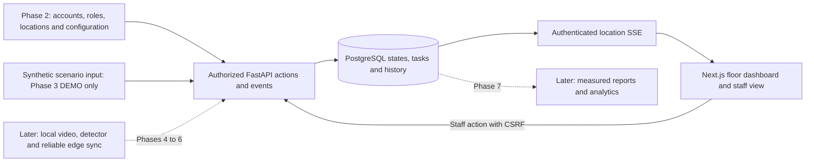

# Phase 3 proposal: a dashboard that works with simulation

**Prepared:** 2026-11-07, Asia/Dhaka.
**Status:** Approved by the founder and implemented in Phase 3; see [the phase explanation](phase_explanations/PHASE_03.md) for actual verification and limitations. This document preserves the proposal and sequence; the later founder decisions below supersede conflicting original options.
**Authority:** [MASTER_SPEC.md, section 17, Phase 3](MASTER_SPEC.md#phase-3---first-working-dashboard-with-simulation), with sections 7, 11, and 12 providing state, dashboard, and security rules.
**Foundation:** [Phase 2 implementation and fresh review](phase_explanations/PHASE_02.md#pre-phase-3-review-2026-11-07); [proposed local checkpoint](PHASE_02_CHECKPOINT.md).

**Approved decisions:** manager/admin-only block/reopen; passive viewing/SSE never refresh idle expiry; absolute expiry always applies; simulation requires DEMO_MODE, a synthetic location and manager/admin access; existing npm findings accepted only for restricted local development; existing database credentials preserved with a [required pre-pilot rotation procedure](DATABASE_CREDENTIAL_ROTATION.md); manually confirmed ready/cleaning/blocked states and timers survive simulated source failure while source health remains visibly unavailable. Phase 2 checkpoint `62ad229` on `main` is complete. No Phase 4 approval is implied.

## 1. What the approved specification requires

Development Phase 3 is the first responsive floor dashboard using **API-backed simulated events**. It must show all six table states, time in the current state, staff tasks, Start cleaning, Mark ready, and Out of service actions, live updates over SSE or an explained alternative, clear offline indicators, accessible labels, and a mobile layout. Every simulated screen and event must be recognizable as DEMO.

Its exact completion condition is that two demo restaurants have different tables/events, actions and timers work from browser through API/database, and demonstration needs no video. Acknowledgement and a safe activity view follow the dashboard/task requirements in sections 7 and 11. Sign-in and authorized restaurant/location switching already exist in Phase 2 and should be reused.

The master also uses “Phase 3” for a later commercial product expansion in section 4.2. That is a different numbering scheme. Predicting the next free table and enterprise features are **not** this development milestone.

| Requirement | Planned behavior | Acceptance evidence to collect during implementation |
| --- | --- | --- |
| P3-01: separate restaurants | A and B load their own persisted table, task, event, and layout data | Positive reads and both-direction foreign-ID/body/cursor tests |
| P3-02: floor and six states | Labeled table shapes, state text/icons, summary counts, selected-table details | Browser checks for every state, including UNKNOWN and OUT_OF_SERVICE |
| P3-03: timers | UTC state-entry timestamps, server-time reference, location-local clock/history | Refresh/reconnect, clock skew, time-zone and daylight-saving tests |
| P3-04: staff workflow | Acknowledge, start cleaning, mark ready; manager blocks/reopens a table | API/database/browser transitions, role checks and safe rejection tests |
| P3-05: tasks and activity | Oldest-first active tasks; one active reset task for the relevant occupancy session; safe table history | Duplicate/retry/concurrent action tests and no duplicate task/effect |
| P3-06: updates | Initial authorized snapshot followed by durable, location-scoped SSE | Two simultaneous browsers update without reload; proxy stream survives beyond 10 seconds |
| P3-07: stale/offline safety | Separate connection freshness from simulated camera/source health | Disconnect/reconnect/restart tests; stale data cannot imply a currently ready table |
| P3-08: usability | Mobile staff view, keyboard controls, readable labels/icons and colors | Desktop/mobile screenshots, keyboard/focus checks, no horizontal overflow |
| P3-09: truthful simulation | Persistent DEMO labels; synthetic scenario controls are disabled outside permitted demo locations | Disabled-mode, non-demo-location, unauthorized actor and source-label tests |
| P3-10: preserve the foundation | Existing login/configuration/health/demo contracts and records preserved | Existing 152-test regression plus new tests, lint/type/build and additive-migration preservation checks |

This table defined the original acceptance checklist. Current passed checks and remaining limits are recorded in the Phase 3 explanation; the proposal is not a substitute for that evidence.

## 2. How it fits the complete restaurant system

For example, a DEMO operator simulates guests arriving at A's Table 4. A's browsers show OCCUPIED and its saved timer. Simulated departure creates RESET_PENDING and one task. A staff member acknowledges, starts cleaning, then confirms ready. B receives none of A's updates. A lost source makes unconfirmed observations UNKNOWN; manual states remain with an offline source warning. A lost browser connection shows a stale banner. No real camera or AI is needed.

Phases 4–6 later replace synthetic observations with authorized local video, a reviewed detector, and durable device delivery. Phase 7 connects real edge events to the workflow and adds analytics/exports. Phase 3 needs the small event/task slice for its own demonstration; it does not implement real edge ingestion, device pairing, offline edge queues, detector hysteresis, or analytics early.

## 3. Proposed technologies and architecture choices

| Technology | Purpose | Installation/change policy |
| --- | --- | --- |
| Existing Next.js 15, React, TypeScript | Protected dashboard, selector, floor cards and mobile staff view | Reuse installed/locked packages; no major upgrade in this plan |
| Existing CSS and HTML/SVG | Responsive floor layout, focus states, text/icons and accessible controls | No required diagram/UI library. Tailwind in master section 6 is a recommendation; existing CSS can meet this milestone without another dependency |
| Existing FastAPI/Pydantic | Validated snapshot, action, task, activity and stream APIs | Reuse current stack |
| Existing SQLAlchemy/Alembic/PostgreSQL 16 | Durable history/tasks/state, constraints, forward migrations and RLS | Back up before an approved additive migration; preserve existing records |
| Browser EventSource and FastAPI StreamingResponse | One-way server-to-browser SSE; normal HTTP for actions | Built-in browser and installed framework capabilities; no new SSE package required |
| Existing pytest, HTTPX, Ruff, TypeScript and Edge browser tooling | Security, database, workflow and browser verification | New tests, not new software by default; ask before any optional Playwright/browser installation |
| Existing Docker Compose | Local API/web/database integration | Only approved later rebuild/restart; no volume deletion |

Recommended choices for founder review:

1. Keep the Phase 2 HttpOnly cookie sessions, CSRF checks, explicit location grants, backend permissions, restricted database role and RLS. No replacement authentication system.
2. Use **SSE**, as preferred by the master. One selected location needs one incoming stream, while staff actions remain ordinary protected POST requests. No Redis, WebSocket server, broker, or extra service is necessary for this local milestone.
3. Store events in PostgreSQL; bounded polling by the streaming endpoint is adequate initially. An in-memory-only broadcaster would lose changes on restart and fail across workers, so it is not the durable source.
4. Keep business configuration and operational permissions distinct. Staff must not gain general UPDATE permission over table labels, seats, ownership, or state. Propose a narrowly granted database action function, following the existing controlled-function pattern: fixed search path, no PUBLIC execution, server-verified identity, current role/location checks, allowed transition, row lock, expected revision, idempotency, and atomic state/task/event/audit writes. Its privileged owner requires explicit review; never assume RLS automatically constrains a SECURITY DEFINER owner. Test both the HTTP boundary and direct runtime-role calls. Installer has no operational mutation permission.
5. Permit simulation only when the server's demo feature flag is enabled **and** the target location is explicitly marked synthetic. Existing DEMO_MODE currently gates only the public static demo route, so a flag alone is insufficient. Only an owner/admin/manager with a location grant may send a bounded predefined demo scenario. Staff operate normal tasks, not simulation. No background simulation runs on application startup.

These choices were approved with the founder decisions above. Their concrete implementation and actual evidence are recorded in the phase explanation.

## 4. Data and workflow design to approve before coding

### Additive database slice

- Preserve revisions 0001/0002. Add a new forward revision after a private backup, rehearsed against the isolated PostgreSQL instance with a sentinel preexisting record.
- Add explicitly scoped table events containing schema version, organization/location/table, event ID, previous/new state where applicable, UTC occurrence/ingestion times, source (demo/manual), safe evidence, actor where applicable, occupancy-session reference, and idempotency key. Confidence stays absent/unknown for unmeasured simulation; do not invent model accuracy.
- Add staff tasks with organization/location/table, occupancy-session reference, status and UTC creation/acknowledgement/start/completion timestamps. Enforce uniqueness for the reset task belonging to a table session, and at most one active reset task for that table. Record explicit resolution/cancellation reasons rather than deleting tasks.
- Add operational revision/occupancy-session/freshness fields and an explicitly synthetic-location marker with safe defaults. Old tables remain UNKNOWN until an allowed initialization path; migrations must not manufacture historical observations or confirm old tables ready.
- Use a deterministic labeled grid for the first floor layout. This is a floor arrangement, not camera polygon calibration or a measured restaurant plan. Store editable normalized layout positions only if required after reviewing the UI; do not add uploads or a floor-plan editor to satisfy this milestone.
- Apply composite same-tenant/location references, immutable ownership, appropriate indexes, RLS read policies and restricted function/column grants to every new structure. No generalized staff configuration UPDATE grant.
- Serialize each location's published changes using a location revision row locked within the same mutation transaction. A PostgreSQL sequence alone does not guarantee commit order. The snapshot and replay cursor must represent a consistent boundary so concurrent commits cannot disappear between initial load and subscription.

### Proposed action rules

All operational permissions additionally require enabled membership and an explicit location grant. The table's ownership comes from the authorized resource, not the submitted body.

| Operation | Allowed roles | Proposed precondition/effect |
| --- | --- | --- |
| View floor, tasks, safe activity and stream | Owner, org admin, manager, staff, installer | Assigned location only; installer remains read-only for operations |
| Acknowledge task | Owner, org admin, manager, staff | Open matching task; changes task acknowledgement, not table readiness |
| Start cleaning | Owner, org admin, manager, staff | RESET_PENDING with a matching active task; changes table to CLEANING and records actor/time |
| Mark ready | Owner, org admin, manager, staff | CLEANING with an explicit staff confirmation and fresh simulated vacancy; or documented UNKNOWN initial setup confirmation with fresh vacancy. Reject known occupancy or stale/unknown source |
| Out of service | Owner, org admin, manager | May block a table, records reason/audit and resolves active task explicitly |
| Reopen out-of-service table | Owner, org admin, manager | Returns to UNKNOWN, requiring a separate allowed ready confirmation; never silently AVAILABLE |
| Simulate arrival/departure/source interruption/resume | Owner, org admin, manager | Demo flag plus synthetic assigned location; finite allowed scenarios, current revision and idempotency key |

The master section 4 briefly says staff can set out of service, while its canonical state rule in section 7 and role description reserve that action for a manager. This proposal chooses the narrower manager/admin permission and makes that choice explicit for approval.

Valid demonstration path: UNKNOWN → staff confirms initial ready → AVAILABLE → simulated arrival → OCCUPIED → simulated departure → RESET_PENDING → staff Start cleaning → CLEANING → staff Mark ready → AVAILABLE. Acknowledgement alone never changes table state. A duplicate departure/request cannot open another task. Occupancy return resolves an obsolete reset task explicitly. Source loss makes unconfirmed observations UNKNOWN; manually confirmed AVAILABLE, CLEANING and OUT_OF_SERVICE retain their state-entry times with a separate offline warning. Do not count unavailable-source readiness as currently verified. Preserve cleaning/block precedence on conflicting inputs; never infer readiness from a cached state.

These are demo workflow rules. The full video observation/grace-period state engine belongs to Phase 5. Staff confirmation means a human says the table is ready; it does not mean software has proved cleanliness.

### Proposed API additions

| API | Purpose |
| --- | --- |
| `GET /v1/locations/{location_id}/dashboard` | Consistent snapshot: scoped tables/tasks, summary, source status, DEMO label, server UTC time, location zone and event cursor |
| `POST /v1/tables/{table_id}/actions` | Existing planned contract: typed action, expected revision, matching task where needed, idempotency key and bounded reason/confirmation fields |
| `GET /v1/locations/{location_id}/tasks` | Bounded, status-filtered, oldest-first staff tasks |
| `GET /v1/locations/{location_id}/activity` | Bounded safe operational history, with a table filter; does not expose admin-only membership/security audits |
| `GET /v1/locations/{location_id}/stream` | Authorized, resumable SSE for table/task/source changes |
| `POST /v1/locations/{location_id}/demo/events` | Explicitly gated predefined synthetic scenario inputs; unavailable for ordinary locations/disabled demo mode |

Reject foreign IDs/cursors and extra tenant/location/state fields. Continue 401/403/404/409/422 handling without leaking resource existence. All mutations require exact allowed Origin and current session-bound CSRF. A retry with the same idempotency key and payload returns the original result; reusing it with a different payload conflicts. A stale revision conflicts and asks the user to refresh. Keep response schemas and frontend types aligned; update OpenAPI/contracts rather than leaving planned routes indistinguishable from implemented ones.

### SSE, transactions and freshness

1. Obtain an authenticated consistent snapshot, then subscribe from its location cursor. On reconnect use a validated Last-Event-ID or an equivalent initial cursor. A cursor is a replay position, never permission. Filter every payload, health notice and replay query to the currently authorized location.
2. Update the fixed Next.js proxy to forward the replay header and stream incrementally. Its current 10-second fetch timeout is inappropriate for a long-lived stream. Retain ordinary request limits and use stream-specific connection/heartbeat deadlines, no buffering/caching, and cancellation when the browser disconnects. Do not expose arbitrary upstream URLs.
3. A long stream must not reuse Phase 2's request-scoped Session/transaction. Authenticate before opening, then use short transactions to re-check current session/membership/grants, set transaction-local identity, fetch bounded batches, and close/commit before waiting. Run synchronous database calls outside the async event loop. Never hold a connection, row lock or transaction during a network wait.
4. Re-check permission and expiry before every emitted batch and heartbeat; close and clear the client workspace when expired/revoked/disabled. Never place a session token in a URL, cursor, message body or log. Native same-origin EventSource sends the HttpOnly cookie; a GET stream does not replace CSRF protection on POST actions.
5. Implemented bounds are a two-second heartbeat, stale after 15 seconds, four streams per user and 32 total per API process, and 100 replay rows per batch. These are local defaults, not a capacity guarantee. Passive HTTP viewing and every SSE check must not refresh idle expiry; absolute expiry always applies.
6. Store safe ordered changes durably so API restart does not lose them. If a cursor is invalid, from another location, ahead of the current revision, or older than the supported replay range, require a fresh authorized snapshot. Version the envelope; tolerate duplicate deliveries on the client and preserve state revision ordering.
7. Show browser connection freshness and simulated source health separately. During a network outage preserve last-known information with a prominent STALE label, suppress current-ready counts/actions, and never label a cached AVAILABLE value live. Simulated source failure changes unconfirmed states to UNKNOWN and preserves manually confirmed states with an offline warning, per the founder decision. No actual device/camera online claim exists in Phase 3.
8. On restaurant/location switch, close the previous stream, cancel pending requests, clear previous data immediately, and reject late responses from the former selection. Test this race, including multiple browser profiles and revoked grants.

## 5. Ordered implementation steps after approval

1. **Save the reviewed Phase 2 checkpoint.** Obtain explicit local commit approval, commit the reviewed manifest, verify branch/hash/status/exclusions. Keep this separate from permission to implement Phase 3.
2. **Agree on boundaries and decisions.** Approve the SSE approach, synthetic-location gating, role/action matrix, controlled database action function, transition rules, replay ordering, and idle/freshness policy. Agree whether security maintenance is a separate preliminary change. No dependency upgrade is implied by Phase 3 approval.
3. **Rehearse data changes.** Back up existing data, inspect migration head, create additive models/migration/policies, test forward migration and unchanged preexisting records in the disposable instance. Apply the reviewed migration only to the intended database. Never reset/reseed over user records.
4. **Implement the small workflow service and database boundary.** Add revision/idempotency checks, the allowed demo/manual transitions, one reset task per session, atomic audit/event/task updates, and safe conflict responses. First test this without the UI.
5. **Add snapshot, tasks, activity and action APIs.** Derive scope from the verified identity and resource, keep bounded responses, add OpenAPI schemas and positive/negative tests for every role. Preserve Phase 2 configuration contracts.
6. **Add explicit synthetic scenarios.** Append distinct, clearly labeled scenarios for A and B in dedicated demo locations with no password reset or data deletion. Use repeatable IDs/idempotency, fresh UTC timestamps and explicit setup/run commands. Keep scenarios paused until deliberately triggered and preserve all prior demo/configuration records.
7. **Implement and test SSE through Next.js.** Add durable cursor replay, short database transactions, heartbeat/revocation checks, disconnect cleanup, bounded replay/backpressure and the stream-specific proxy path. Verify an open stream beyond the old 10-second timeout before depending on it in the UI.
8. **Build the responsive floor dashboard.** Reuse sign-in and permitted selection; add summary, deterministic layout, six labeled states, timers and table details. Calculate durations from persisted UTC state_since and a server clock reference so refresh does not restart a timer. Use the location IANA zone for wall-clock/history display; do not present a simulated timer as order/service time.
9. **Build staff actions and safe activity.** Add oldest-first tasks, acknowledge/start/ready controls, manager block/reopen controls and clear conflict/permission/error states. Disable repeated submissions; show successful server results rather than assuming optimistic writes succeeded. Keep privileged audit history separate.
10. **Verify offline behavior and usability.** Test source outage, browser network loss, API restart/replay, no misleading availability, missing grants/expired sessions, rapid selection changes, narrow mobile width, keyboard navigation, text contrast/focus and announcements without screen-reader timer spam.
11. **Run the full verification gate.** Run all current regressions plus new workflow/security/SSE/migration tests against isolated PostgreSQL; run Ruff, pip check, frontend lint/type/build, and real browser/proxy scenarios. Fix failures and rerun affected checks. Record exact commands, counts, warnings, measured timings and limitations; do not promise a future test count or claim AI accuracy.
12. **Document, demonstrate and stop.** Create `docs/phase_explanations/PHASE_03.md` only when implementation is completed, with all AGENTS-required sections, Windows 11 commands, file purposes and actual evidence. Update the phase index, handoff, API contract, architecture, implementation plan and affected earlier explanations. Present two separate restaurant demonstrations and stop for founder approval before Phase 4.

### Expected file areas during the later implementation

- `services/api/src/restaurant_api/`: models/schemas, new workflow/demo/stream modules, route registration and any reviewed settings/security changes.
- `services/api/migrations/versions/` and `migrations/sql/`: new additive revision/policies/functions; never rewrite applied revisions.
- `services/api/tests/`: workflow, idempotency/concurrency, scoped events/tasks/activity/streams, session revocation and migration preservation.
- `apps/web/app/`: protected dashboard/staff views and small shared types/components; current sign-in/settings integration and CSS; fixed proxy streaming support.
- `scripts/`: explicit synthetic scenario commands and browser verification without embedded credentials.
- `packages/contracts/`, CI and documentation: contract updates, relevant existing checks and actual phase explanation. New dependencies or test-browser installs require permission first.

These are proposed change areas, not files changed by this review.

## 6. Dependencies, risks and gates before Phase 3

| Finding | Required next action | Does it prevent a local synthetic Phase 3? |
| --- | --- | --- |
| Phase 2 checkpoint completed | `62ad22996f6e369c9116028ba0266ed3102b2e94` on local `main`; no push | Resolved |
| Workflow permissions/event ordering and SSE lifetime | Approved and implemented; controlled database actions, passive expiry and scoped replay have tests | Resolved for the local milestone; production review remains |
| npm audit: 8 affected packages, 1 high/7 moderate | Separate approved maintenance: investigate compatible parent updates; if needed review a narrow override, then lint/type/build/audit/browser checks. Do not run `audit fix --force` | Not a test failure, but resolve or explicitly accept restricted local-development risk before continuing; fix before external/pilot use |
| Legacy database administrator password is weak | Obtain approval for a backed-up, tested rotation; preserve current volume and update only private administrative configuration | Keep localhost/private during local work; rotation is required before public/pilot use |
| Production identity/security operations absent | TLS, admin MFA/recovery, secret management, non-root containers, retention/monitoring and external review remain open | They block public release; they do not require adding production services to this simulation milestone |
| `next lint` and Starlette/HTTPX deprecations; broad Python ranges | Plan a tested tooling migration and reproducible locks separately; do not install `httpx2` or upgrade Next automatically | Existing checks pass with warnings; not a local functional blocker |
| Python security advisory scan not performed; host/runtime versions differ | Current pip check proves compatibility only. Plan an approved advisory scan and tests on supported Docker/CI runtimes | Do not claim all dependencies are vulnerability-free or hosted CI has passed |
| Stream capacity and full browser/accessibility matrix unverified | Add bounded stream checks and recorded browser coverage in Phase 3; mark larger-scale testing unverified | Local acceptance must pass; no production capacity guarantee |

### Current npm evidence and safe repair approach

Fresh `npm audit --json` on 2026-11-07 reports PostCSS (high), its Next.js dependency chain, and minimatch with five affected TypeScript-ESLint parents (seven moderate entries in total). These are affected-package entries, not eight independently exploitable bugs. Installed Next.js is 15.5.29; its lockfile resolves PostCSS 8.4.31. The audit suggests Next.js 16.4.5, explicitly a major upgrade. minimatch 10.2.6 appears in the lint dependency chain.

The upstream [PostCSS advisory](https://github.com/postcss/postcss/security/advisories/GHSA-fxqj-rqcc-2cmp) describes a source-map file-disclosure issue fixed in 8.5.23. Other audit advisories also apply to the installed older version; choosing a fix requires checking all current advisories and the actual dependency graph. The upstream [minimatch advisory](https://github.com/isaacs/minimatch/security/advisories/GHSA-g3hv-75wg-m249) identifies pattern-amplification denial of service and lists 11.0.1 as patched. A transitive major override needs compatibility checks even if npm says a fix exists.

Recommendation: use a separate maintenance branch/checkpoint after approval, inspect current parent release manifests, prefer supported compatible fixes, and evaluate a targeted PostCSS override only if upstream constraints and regression tests support it. Do not accept/process untrusted CSS, source maps or glob patterns while affected tooling remains. This review did not install, upgrade, override or suppress anything and does not establish runtime exploitability for every advisory.

## 7. Technical references and approval boundary

The proposed SSE design uses the browser's [EventSource event IDs/reconnect protocol](https://developer.mozilla.org/en-US/docs/Web/API/Server-sent_events/Using_server-sent_events), the installed FastAPI/Starlette [StreamingResponse capability](https://fastapi.tiangolo.com/advanced/custom-response/#streamingresponse), and Next.js [streaming Route Handlers](https://nextjs.org/docs/app/api-reference/file-conventions/route#streaming). Current online documentation can describe versions newer than the project's pinned Next.js; implementation must be tested on the installed version, without assuming new framework APIs are available.

The local Phase 2 commit and Phase 3 implementation received separate explicit approvals. Phase 3 approval does not authorize major dependency upgrades, credential rotation, a remote push, public deployment or Phase 4. The founder's local-risk acceptance and manual-state/session decisions above govern this implementation.
