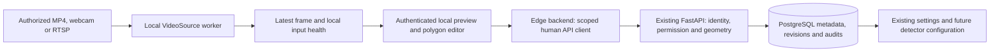

# Phase 4 approved plan: local video input and camera calibration

> **Implementation reconciliation — 2026-11-08:** Sections below retain the approved pre-implementation design/baseline. Actual file names/results are in [PHASE_04.md](phase_explanations/PHASE_04.md). Tested defaults are 2-FPS sampling, approximately 2-FPS browser polling, a **5-second** stale watchdog, and **three** reconnect delays of 1/2/4 seconds (no jitter); these replace the illustrative longer schedule below. Permission checks run about once per second plus cached hard deadlines. RTSP uses a restricted literal-private-IP TCP gateway; no physical camera or separate RTSP fixture was available. Diagnostics include coverage/overlap/shape checks, never an accuracy score. The host editable console shortcut was not refreshed because setuptools was declined. API/runtime versions and original data are preserved; changes are staged for founder checkpoint approval and remain uncommitted.

**Prepared:** 2026-11-08, Asia/Dhaka.
**Status:** Approved and implemented locally. See [the completed Phase 4 explanation](phase_explanations/PHASE_04.md) for actual evidence and limits. Stop before Phase 5; no commit/push.
**Authority:** [Master development Phase 4](MASTER_SPEC.md#phase-4---local-video-input-and-camera-calibration), with sections 5, 7–13 supplying privacy, calibration and authorization requirements.
**Verified foundation:** Phase 3 implementation is in `3342c42`; its six-file verification checkpoint `899f74368b9487ae1c33e0d0c0e511e37b396f36` was pushed and confirmed on GitHub `origin/main`. The [Phase 3 explanation](phase_explanations/PHASE_03.md) retains actual test records. Existing checkpoint manifests are historical preparation records, not current pending approvals.

## 1. Exact milestone and completion boundary

The approved roadmap requires an abstract `VideoSource`, MP4/webcam/authorized RTSP adapters, reconnect behavior, frame timestamps, configurable sampling FPS, stale-frame detection, a secure local test preview, and a tool to draw/save normalized table polygons associated with a camera and table. Tests must use synthetic or explicitly authorized inputs.

**Master completion condition:** An MP4 plays through the edge pipeline, table polygons persist, and disconnects are visible as health failures.

For a beginner: the edge computer must first learn how to open a video and which part of its picture represents A01. This phase builds that input/setup layer. Recognizing people and deciding whether A01 is occupied comes in Phase 5. Reliable device pairing, health/event delivery, an SQLite outbox and cloud dashboard synchronization come in Phase 6. General analytics/exports and later commercial work stay in their milestones.

No detector, model download, face identification, audio capture, automatic cleanliness claim, real occupancy event or AI accuracy claim is included. A working preview does not establish that a table is available.

## 2. Historical pre-implementation source and environment findings

| Area | Present now | Phase 4 work needed |
| --- | --- | --- |
| Edge package | `restaurant_edge/health.py` has initial NOT_CONFIGURED-style health and a UTC heartbeat helper; two starter tests | Reader interfaces/adapters, a supervised worker, meaningful input health, local preview and calibration |
| Camera metadata | Scoped `Camera` has label, opaque `source_reference`, fixed `NOT_CONFIGURED` status; location-scoped GET/POST/PATCH routes | Reuse safe metadata; do not put RTSP URLs/passwords in it or claim cloud camera health before synchronization |
| Table polygons | `TableZone` has camera/table ownership, normalized points, revision and source dimensions | Reuse existing persistence/validation; add visual editing and complete revision snapshots |
| Existing zone writes | POST creates; PUT checks `expected_revision`, locks the row, increments revision and audits | Extend transactionally for revision history and safe retry; preserve existing API clients |
| Configuration UI | `/settings` edits camera references and polygon coordinates as text | Add setup/permission navigation; use a local visual editor for actual frames |
| Dashboard | Protected DEMO floor/staff workflow, saved timers, tasks, source flags and SSE | Preserve it. No real video-to-occupancy bridge in Phase 4 |
| Installed project environment | Python 3.14.0; NumPy 2.5.4; neither OpenCV variant nor PyAV installed | Compatibility/dependency approval before installation |
| Current Windows PATH | No `ffmpeg` or `ffprobe` executable found | This does not establish that no other machine/container has them; a separate executable is not automatically required |

These are source/package/PATH observations, not camera tests. No file was decoded, webcam activated, stream contacted, dependency installed, or database migrated during planning. The last test run recorded 262 passing Python tests, including the original 152; it was not rerun for this documentation-only proposal. Physical hardware, exact codecs and current advisories remain unverified.

## 3. Proposed architecture for approval

Use a **local browser companion** served by the edge Python process on one loopback address, for example `127.0.0.1:8765`. The address/port are proposed and must be checked for conflicts. It serves its own static HTML/CSS/JavaScript canvas tool. This avoids sending frames through the cloud Next.js proxy and does not require a new frontend framework.

The H-to-P path stays on the edge computer. The C-to-A path carries only normal human authentication, identifiers, permission checks and calibration metadata; no frames, thumbnails, RTSP URLs or camera passwords. Use HTTPS for any non-loopback API connection. Current local development may use the existing loopback API.

### Human authentication and explicit preview permission

Localhost alone is not authentication. The recommended flow is:

1. An assigned owner/org_admin/manager explicitly grants a named eligible user permission to preview one camera for a short period. Proposed default is 15 minutes, maximum 60 minutes. The grant and revocation are audited. A manager may explicitly grant themselves; there is no automatic privilege to view video merely from owning metadata.
2. Eligible viewers are owner/org_admin/manager/installer, with enabled membership and an explicit location grant. Floor staff cannot obtain preview permission. An installer may configure geometry under the existing role policy but cannot grant themselves video permission.
3. The operator opens the local companion and signs in using the existing human authentication API. Its backend holds that human session cookie/CSRF state only in memory, separately for each local browser session. The local browser gets a separate opaque HttpOnly/SameSite cookie, never the cloud session token. Password input is not logged or retained after sign-in.
4. The backend confirms the camera/location through the authoritative API and checks the time-limited preview grant. Only then can the operator choose an opaque local source reference and explicitly start preview.
5. Revalidate human identity, enabled role/location access and preview permission at most every two seconds while displaying frames, with a bounded request deadline. Check again for every mutation. If authorization cannot be established, stop/clear preview and release capture. Grant/session expiry and revocation must fail closed; record the tested maximum revocation delay rather than claiming instantaneous revocation.
6. Preview/health GETs and background checks use passive authentication. They never extend cloud idle expiry. Absolute expiry always applies. Explicit permitted saves retain the existing active-mutation behavior.
7. Logout, camera/location switching, grant expiry or failed authorization closes the reader and clears frames, queued responses and session-scoped caches. No shared cookie jar or frame cache may mix A and B.

Server-to-server calls must obey the existing Origin/CSRF contract using reviewed configuration. Do not add wildcard CORS, trust browser-supplied identity, or copy the SaaS session into a local URL/browser store. Any needed exact-origin configuration must be tested within local development; a production cross-device sign-in/install workflow is not established by this proposal.

This is short-lived human permission to view a local camera, not persistent device enrollment or a machine credential. Device pairing/event authentication remain Phase 6. If the human API is unavailable, setup preview closes; autonomous offline detection is not built in Phase 4.

### Local HTTP protections

Bind only to the exact loopback address. Validate Host and Origin, require CSRF for mutations, reject cross-origin access and DNS rebinding, limit request sizes/rates and concurrent previews, and use no-store responses. Keep tokens out of URLs and browser storage. Do not embed a local preview iframe in a hosted dashboard or make the SaaS browser automatically probe a user's LAN. Local machine/OS compromise remains outside this application's guarantees.

Use low-rate authenticated JPEG frame responses rather than an unbounded raw stream for the first editor. Serve only the latest frame to the currently authorized session. The browser must clear an expired/offline frame rather than present it as live. No persistent browser cache, service-worker cache, recording or cloud relay is allowed.

## 4. What the operator will see

The existing dashboard continues showing its six DEMO states and synthetic tasks. Camera setup offers a clear instruction to start the local companion. Inside the companion:

1. Sign in and select a permitted restaurant/location, camera and existing table.
2. See source type, explicit permission expiry and input health. Full file paths, camera addresses and credentials are not shown in web responses.
3. Explicitly start the authorized MP4/webcam/RTSP preview. Synthetic sources display DEMO; an authorized real feed is labeled as a live local preview, with occupancy analysis unavailable.
4. Pause a frame in memory and click around the visible table to create a polygon. Move/remove vertices, undo, cancel or redraw. Show the selected table ID clearly.
5. Review objective checks: valid shape, point count, frame dimensions, source age and image coverage. Overlaps get a warning. Do not invent a calibration accuracy/confidence percentage.
6. Save. The API verifies camera/table scope, expected revision and permission, then saves geometry/history/audit atomically. Show a server-confirmed revision; a local unsaved draft is never described as synchronized.
7. Reopen the tool or restart the agent and load the saved polygon. Changing camera position/crop/orientation requires review/recalibration.

This connects the existing camera/table IDs to future person-to-table association. In Phase 4, camera input health is visible in this local setup tool. Cloud `Camera.status`, floor availability, cleaning tasks and SSE do not pretend to receive real camera observations. In Phase 5 calibrated frames feed the detector/state engine; in Phase 6 authenticated edge events/health update the existing cloud workflow and SSE.

## 5. Reader, timing and failure design

### Common VideoSource contract

Proposed `open`, `read`, `close`, capability/health methods and structured frame results hide differences between MP4, webcam and RTSP. A result carries an opaque source ID, stream-generation/sequence ID, pixel dimensions, decoded frame, local UTC receipt time, monotonic receipt time and optional media presentation timestamp. UTC receipt time must not be mislabeled as verified camera capture time. Do not include source credentials in representations/errors.

| Adapter | Behavior |
| --- | --- |
| MP4 | Authorized private file reference; validate actual input/container and bounds, pace by media time, distinguish normal EOF from failure. Loop only when explicitly selected and label replay; do not silently restart a recording |
| Webcam | Explicit operator/device choice and OS permission; disconnect, permission-denied and busy-device errors are visible. No automatic microphone or camera activation |
| RTSP | Explicitly authorized destination and a read-only camera account where possible; bounded open/read, controlled reconnect and no public CCTV port exposure. Start with a documented TCP/H.264 test profile, not a universal compatibility claim |

Use a supervised child process for potentially blocking native reads, so a hung decoder can be stopped without freezing the API or user interface. Keep credentials out of process arguments; pass private configuration through an appropriate local in-memory channel. Suppress/redact native decoder output before it reaches logs. Never persist raw stderr containing a URL/password for debugging.

Keep at most the latest decoded frame for downstream sampling. Continuously drain live capture as needed; limiting the Python queue alone does not prove the decoder has no internal backlog. Bound frame dimensions, memory, reader count and stop time. Begin with one active input on the edge computer. No GPU is needed for this milestone.

Proposed initial settings, subject to actual tests: sample at 2 FPS with a bounded configurable range; preview at no more than 2 FPS; stale threshold 10 seconds; open/read watchdog deadlines around 5 seconds; reconnect delays 1, 2, 4, 8, 16, then at most 30 seconds with jitter. These are engineering starting values, not performance results. Wrong credentials/permission errors require correction rather than endless rapid retries.

Health distinguishes NOT_CONFIGURED, CONNECTING, ONLINE, STALE, RECONNECTING, OFFLINE/ERROR, FILE_ENDED and STOPPED, with safe reason codes. Use monotonic elapsed time for freshness/backoff. A received-but-delayed frame is not proof of recent camera capture; use reliable advancing media timestamps when available and document limitations. A visually frozen camera that keeps emitting valid frames may not be detected without additional diagnostics.

Sampling FPS is not a guarantee of camera capture FPS. Backends/drivers can reject properties or report unsupported values; test the selected backend rather than assume setting a property succeeded. OpenCV documents these backend differences and limits its open/read timeout properties to particular backends. See [VideoCapture](https://docs.opencv.org/4.x/d8/dfe/classcv_1_1VideoCapture.html) and [video I/O properties](https://docs.opencv.org/4.x/d4/d15/group__videoio__flags__base.html).

## 6. Calibration storage and additive database work

### Reuse existing data

Keep organizations, locations, human identities/roles, cameras, tables, existing table-zone rows, audit logs and Phase 3 operations intact. Use the existing opaque `source_reference`; local private configuration maps it to a file/device/stream. Never store a raw source path/URL/password in PostgreSQL metadata, audit payloads or an exported calibration file.

Normalized coordinates mean x and y lie between 0 and 1. For example, x=0.25 is one quarter of the actual displayed video width. The editor subtracts letterbox offsets and accounts for browser zoom/device scale, rotation and mirroring before saving. A larger image of the same view can reuse normalized coordinates; a crop, changed aspect ratio, rotation or moved camera can invalidate them.

Preserve existing validation: 3–64 finite/distinct points, nonzero area, no self-intersection, and camera/table/location ownership. Add tests for display transforms and consistent validation across editor, Python and PostgreSQL. Store reference resolution, coordinate-format version and supported orientation/crop metadata. Mark legacy records with unknown view metadata as needing human review instead of claiming they were visually verified.

### Proposed new forward migration

Use a new Alembic revision after 0004, provisionally 0005; never edit 0001–0004 or reset the database.

- `table_zone_revisions`: immutable full geometry/configuration snapshots with zone/camera/table, organization/location, revision, source dimensions, format/view metadata, actor, UTC time and change reason. Existing audits only hold revision metadata, so they do not reconstruct every previous polygon. Preserve older zones through a clearly labeled legacy snapshot; never fabricate missing history.
- `camera_preview_grants`: camera/user/location/organization, granting authorized manager, explicit consent/purpose, created/expiry/revocation times. Eligible viewer role/location access is checked in addition to the grant. No machine keys, stream URLs, video or camera passwords.
- Add only the nullable/defaulted calibration-view metadata and scoped uniqueness/foreign keys needed for those records. New tables get tested RLS, immutable tenant ownership and restricted grants. Index bounded history/grant lookups.

Create/update geometry, revision snapshot, audit and any retry receipt information in one transaction. Reuse `expected_revision` and return 409 for stale edits. Proposed per-save UUID/fingerprint information can live in revision history with a scoped uniqueness constraint: the same request/payload returns its original revision, while a changed payload conflicts. Recheck current authorization before returning a replayed result. Existing numeric-editor clients remain compatible; the new editor always supplies the retry key.

One zone binds one table/camera, and the first local workflow activates one camera. Do not delete existing extra zone mappings or silently select a restaurant's primary camera. Global multi-camera reconciliation is later work.

Before applying any future migration: private backup, isolated restore rehearsal, compare existing rows, migrate the isolated copy, then apply the reviewed forward migration to the original database. No downgrade, volume deletion, data reset or credential rotation is implied by approving feature work.

## 7. API requirements

All names below are proposed contracts for implementation review, not existing routes unless marked reusable.

| Layer | Route/operation | Purpose |
| --- | --- | --- |
| Cloud, existing | `/v1/auth/session`, `/v1/auth/csrf`, `/v1/me` | Reuse human sessions, CSRF and permitted identity discovery |
| Cloud, existing | GET `/v1/locations/{id}/tables`, `/cameras`, `/table-zones` | Discover scoped metadata; camera/zone detail GETs already exist |
| Cloud, existing | POST camera/zone and PATCH camera; PUT `/v1/locations/{id}/table-zones/{zone_id}` | Preserve normal configuration; extend zone writes transactionally/backward compatibly |
| Cloud, new | GET `/v1/locations/{id}/table-zones/{zone_id}/revisions` | Bounded, authorized geometry history |
| Cloud, new | POST `/v1/locations/{id}/cameras/{camera_id}/preview-grants` | Manager/admin explicitly permits an eligible named viewer for a bounded duration |
| Cloud, new | GET preview authorization for the current camera/user | Passive session/role/location/grant check with safe expiry; exact route finalized with schemas |
| Cloud, new | POST revoke for a scoped preview grant | Audited revocation without deleting the record |
| Local only | Human sign-in/logout; permitted metadata/grant discovery | Separate local cookie, in-memory per-session cloud client |
| Local only | Start/stop preview; latest frame; input health | Authenticated, bounded and consent-gated; accept opaque source references, not arbitrary URLs |
| Local only | Load/save calibration; optional safe draft export/import | Forward only scoped geometry metadata; validate ownership and revision again |

Cloud grant management and calibration history must enforce permissions in FastAPI and PostgreSQL. A staff or foreign-location actor cannot grant, preview, alter or retrieve another location's calibration history. No cloud video upload, RTSP proxy, `/v1/edge/events`, `/v1/edge/heartbeat`, device enrollment or outbox is added early. The existing Next.js proxy remains fixed to the cloud API; it must never become a generic LAN/file proxy.

## 8. Technologies, dependencies and approval gates

| Technology | Use and approval boundary |
| --- | --- |
| Existing Python edge package | VideoSource/workers/local backend; run natively on Windows 11 first, so webcam access is not assumed to pass through Docker/WSL |
| Proposed `opencv-python-headless` and compatible NumPy | Video decode/JPEG and synthetic fixtures; the browser supplies the GUI. Select one OpenCV variant only, pin a tested set, review its bundled libraries/licenses |
| FastAPI/Uvicorn, HTTPX, Pydantic | Local server, normal cloud human API client and strict contracts. Already present through the API project, but declare/test edge dependencies explicitly rather than rely on accidental installation |
| Proposed `keyring` with Windows Credential Locker | Encrypted per-user local camera credential storage. Reject missing/insecure/plaintext backends; never use a hard-coded encryption key or automatic plaintext fallback |
| Browser canvas, plain HTML/CSS/JavaScript | Draw/edit polygons without adding another frontend framework; retain the existing Next.js dashboard |
| Existing SQLAlchemy/PostgreSQL/Alembic | Additive metadata/history/preview permission changes, constraints and RLS |
| pytest/Ruff, existing installed Edge checks | Deterministic unit/integration/security/visual tests; additional tooling requires approval |
| Optional isolated RTSP fixture service/tools | End-to-end reconnect tests without a real restaurant. Review exact image/binary, source/license and ports; request approval before downloading/installing/pulling anything new |

The official OpenCV packaging project distinguishes headless packages and says its wheels bundle FFmpeg. Therefore a missing `ffmpeg.exe` alone does not block the chosen reader; inspect/test the selected wheel before requesting a separate executable. Do not install multiple cv2 packages. See [official packaging and licensing notes](https://github.com/opencv/opencv-python). FFmpeg behavior/build licensing must be reviewed for the selected distribution, using its [protocol documentation](https://ffmpeg.org/ffmpeg-protocols.html) and [license](https://github.com/FFmpeg/FFmpeg/blob/master/LICENSE.md).

The proposed secret-store library lists a Windows backend in its [official documentation](https://keyring.readthedocs.io/en/latest/). Availability alone does not prove the selected backend is configured safely; test it under the intended Windows user.

No dependency installation is authorized by this planning request. During implementation, present exact packages/versions/transitive effects and obtain permission before installation or a new test image. If video dependencies conflict with the shared Python 3.14 environment, propose an isolated edge environment rather than silently change working API/NumPy versions. Do not install another Python/system runtime without permission. No GPU, ONNX Runtime, detector, model weights, major npm upgrade or global FFmpeg installation is required now.

## 9. Step-by-step development sequence after approval

1. **Confirm decisions and inputs.** Approve this local-companion/security approach, initial Windows/backend/codec profile and dependency plan. Use a new synthetic MP4 first. The reference reel is not authorized evaluation footage merely because it exists. Obtain explicit permission before opening a webcam/RTSP source or existing private clip.
2. **Record a fresh baseline.** Read AGENTS/master/current state, recheck the 262-test foundation, private-file exclusions, clean checkpoint and original data. Capture exact toolchain/package versions. Take a private database backup before schema changes; preserve all existing volumes and records.
3. **Prepare dependencies only after permission.** Confirm compatible wheels/backend/secret store and licenses; avoid an uncontrolled source build or changes to the API environment. Record every added package/tool and actual platform support.
4. **Build the source contract and synthetic pipeline.** Add structured frames/health, deterministic fake sources/clocks and the real MP4 reader. Test EOF, corrupt/empty video, pacing, timestamps, loop labeling, resource cleanup and no audio.
5. **Implement live adapters and supervision.** Add explicit webcam/RTSP setup, secret resolution, bounded worker reads/shutdown, latest-frame sampling, reconnect/backoff and stale input detection. Verify controlled failures before claiming hardware support.
6. **Add safe calibration persistence.** Rehearse the additive migration on an isolated restored backup; add scoped history/preview grants and atomic authorized writes. Preserve existing clients and all prior rows; test races/retries and rollback.
7. **Build the authenticated local companion.** Implement the per-human cloud client/local session, exact loopback/Host/Origin/CSRF guards, preview consent, permission rechecks, low-rate latest-frame endpoint and fail-closed expiry. Test both A and B before adding drawing features.
8. **Build the visual editor.** Add camera/table selection, frozen in-memory reference frame, drawing/moving/undo, normalized transforms, safe validation, explicit save/conflict/retry messages, persisted reload and permitted revision inspection. Add a small camera-setup grant/navigation panel to the existing settings page; keep floor actions unchanged.
9. **Run integration and compatibility checks.** Prove the MP4-to-preview-to-polygon-save-to-restart workflow, all security negatives, disconnect/reconnect, stale/clock behavior, source switch/logout cleanup, resource caps and no raw video/credentials leaving local processing. Record hardware cases as tested or unverified individually.
10. **Document and stop.** After actual completion create `phase_explanations/PHASE_04.md`, covering objectives, features, files/purposes, technologies, execution flow, exact Windows run/test commands, actual results, problems/solutions, limitations and summary. Update the index/affected earlier docs, explain the demonstration, and stop for founder review. Git commit/push or Phase 5 work requires its own authorization.

Proposed edge areas are `video_sources/`, `frames.py`, `capture_worker.py`, `source_health.py`, `source_config.py`, `secret_store.py`, `local_api.py`, `cloud_client.py`, `calibration.py`, packaged `static/` editor assets and tests. Backend changes would cover models/schemas/scoped routes/security/provisioning and a new migration; web changes would be limited to approved setup/grant navigation. Names are proposals; none of these files has been implemented by this plan.

## 10. Security and technical challenges

- **Untrusted media/native decoder crashes:** restrict supported container/codec/resolution, bound resources, supervise reads and test malformed inputs. A readable MP4 is not proof it is safe or legally authorized.
- **Network request abuse:** no user-entered URL proxy. Configure approved RTSP hosts/ports privately; validate DNS/IP on reconnect, block unapproved loopback/link-local/metadata/redirect destinations and unwanted protocols. Authorized private LAN camera IPs need an explicit allowlist, not a blanket ban on private addresses. Permit isolated loopback RTSP only in explicit tests. Verify backend protocol behavior; do not claim protections just from validating a URL string.
- **Credential exposure:** hidden local provisioning into the OS store, opaque aliases in API/UI, per-tenant/location/camera lookup keys, no secrets in command lines, logs, exceptions, calibration exports, browser responses or Git. Redaction tests include native decoder output.
- **Local preview intrusion:** loopback plus authentication/explicit consent/expiry, exact Host/Origin, CSRF and scoped frame caches. Local OS users/process compromise and screen recording cannot be eliminated by web access controls.
- **Frame/time ambiguity:** NTP/wall-clock jumps, bad source FPS, decoder buffering, camera freezes and missing media timestamps need explicit handling. Distinguish observed receipt freshness from verified camera capture freshness.
- **Calibration errors:** letterboxing, device scale, crop, rotation, aspect-ratio changes, moved cameras, occlusion and overlapping tables can invalidate geometry. Good-looking polygons are not evidence of detector accuracy.
- **Concurrent/offline edits:** preserve expected revisions, atomic history/audit, retry identity and clear unsaved-draft status. No hidden automatic sync queue. If authorization cannot be checked, pause setup rather than grant indefinite offline preview.
- **Manual states and demo boundaries:** input failure cannot set AVAILABLE or generate fake camera occupancy events. Preserve manager blocks and staff cleaning/ready states; their separate source health remains honest. Phase 3 simulation stays gated by DEMO_MODE/synthetic location/manager permission.
- **Existing risks:** the last documented npm audit has eight affected entries (one high/seven moderate); no fresh audit/remediation is claimed here. The weak legacy DB administrator password remains preserved. No public/pilot release with unresolved high-risk findings; approved [credential rotation](DATABASE_CREDENTIAL_ROTATION.md), production identity/TLS/secrets, external review and later deployment hardening remain gates. Local synthetic work is not a pilot approval.

## 11. Testing strategy and acceptance checklist

| ID | Requirement | Evidence required before claiming it passed |
| --- | --- | --- |
| P4-01 | Common source interface and three adapters | Contract tests with fake sources; actual synthetic MP4 decoding; explicit webcam/RTSP compatibility matrix |
| P4-02 | Correct timestamps/sampling | Deterministic media/monotonic/UTC tests, variable FPS, wall-clock jump and live latest-frame behavior; never label receipt as capture time |
| P4-03 | Failures/recovery are visible | Empty/corrupt input, normal EOF, blocked read, missing/busy camera, bad credentials, disconnect, frozen/no-frame interval, capped retries and successful controlled reconnect |
| P4-04 | Secure local preview | Anonymous/staff/no-consent/expired/revoked/wrong-location users denied; CSRF/Origin/Host/DNS-rebinding negatives; no stream/cache leakage after switch/logout |
| P4-05 | Accurate polygon coordinate handling | Unit cases for resized/letterboxed/rotated/mirrored view, bounds, self-intersection, duplicates, zero area and point-count limits; browser draw/drag/undo/keyboard tests |
| P4-06 | Persistence and history | Save/reload/agent restart reproduces polygon; revisions immutable; stale expected revision returns 409; duplicate same request has one effect; audit/history/write roll back together |
| P4-07 | Strict tenant/location isolation | A cannot read/write/preview B using guessed camera/table/zone/grant/revision IDs, altered bodies, reused local aliases or stale cached authorization; test both directions and same-restaurant ungranted location |
| P4-08 | Session correctness | Passive frames/health/grant checks never refresh idle expiration; absolute expiry and permission revocation close preview/capture; valid active configuration saves obey existing session rules |
| P4-09 | Secrets/video minimization | Canary credential scans across logs/errors/responses/process command lines/files, OS-store tests, audio disabled, no frame/cloud upload/request body/cache/recording; bounded diagnostics only |
| P4-10 | Additive migration preservation | Private backup/isolated restore comparison, all old business/user rows preserved, RLS/permissions tested, model/schema consistency, current 0001–0004 unchanged |
| P4-11 | Resource and interface usability | Bounded memory/frame queue/readers, stop-time watchdog, repeated start/stop/reconnect, responsive local editor and clear error/offline/unsaved states; report observed timings only |
| P4-12 | Foundation regression and docs | All 262 existing tests retained/passing plus new cases; lint/types/build and existing demo/browser workflow checks; complete actual Phase 4 explanation/index and stop before Phase 5 |

Use deterministic fake adapters/clocks for most failures, real generated MP4s for decoder integration, and an approved controllable RTSP service for network tests. OS webcam and real camera checks are opt-in and require available authorized hardware; absence must be stated, not silently counted as a pass. Record exact device, codec, backend, OS and versions for every supported combination.

Manual founder demonstration after implementation: sign in as an authorized installer with explicit preview permission; open synthetic MP4; select A's camera/table; draw/save a polygon; restart and reload it; simulate input interruption and see health fail; try B's IDs and get denied; confirm the existing DEMO floor/staff actions still work. No real table occupancy should change from playing this file in Phase 4.

## 12. Approval and completion record

The founder approved the local companion, short-lived preview grants, native Windows-first/single-source scope, additive schema and Phase 5/6 boundary before implementation. The seven exact dependencies were separately approved and installed; additional setuptools was declined, so `python -m` remains the supported command. Actual webcam/RTSP/other footage still requires explicit authorization and hardware availability.

Historical preparation boundary: drafting this proposal changed no application behavior, dependencies, database or credentials. Subsequent explicit implementation approval authorized the work now recorded in PHASE_04.md. Current results: 333 tests, nine browser groups, real synthetic MP4/save/restart/revoke/isolation checks, preserved original records and zero schema differences. No physical camera compatibility or AI accuracy is claimed. Stop for founder review before Phase 5 or a Git checkpoint.
