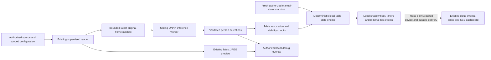

# Phase 5 proposal: person detection and table occupancy estimation

> **Approved RF-DETR execution — 2026-11-08:** The founder separately approved the official Nano checkpoint and exact 65-package isolated exporter. [The implementation record](phase_explanations/PHASE_05.md) now documents genuine local CPU inference, private hashes/export recipe, numerical comparison, shadow integration and actual 445-test/browser evidence. Only synthetic footage is authorized; no positive-person/restaurant accuracy is claimed. The earlier review/YOLOX acquisition gates below preserve history and are superseded only for the explicitly approved RF-DETR artifact/toolchain. No Phase 6, commit or push is approved.

> **RF-DETR follow-up amendment, 2026-11-08:** After the partial implementation, the founder requested RF-DETR Nano as the next real detector candidate. [The concrete artifact/export review](PHASE_05_RFDETR_REVIEW.md) now defines its exact provenance, license notices, proposed isolated dependency lock, architecture changes, risks and separate acquisition approvals. The founder explicitly confirmed no authorized person footage is available and kept that evaluation pending; do not open `SR.mp4`. The earlier YOLOX hold is preserved. No RF weights, new installation or RF implementation is claimed. The original proposal and verification context below remain history where superseded by this amendment.

**Prepared:** 2026-11-08, Asia/Dhaka. Evidence timestamps are stored in UTC.
**Current status — 2026-11-08:** the founder approved this architecture and implementation after the proposal was delivered. The three exact runtime additions were subsequently approved and installed; **YOLOX weight download is explicitly held pending license clarification**, and only synthetic footage is authorized. [PHASE_05.md](phase_explanations/PHASE_05.md) records the partial implementation and actual checks. Phase 5 is not complete; no pretrained inference, real-person evaluation, commercial clearance or Phase 6 is claimed. The original proposal and planning verification below are retained as history.
**Product authority:** [Master Blueprint](MASTER_SPEC.md#phase-5---ai-detector--table-occupancy-state-engine), especially sections 5–8, 11–13 and 17.
**Foundation:** [Phase 4 explanation](phase_explanations/PHASE_04.md). Local/GitHub `main` checkpoint `143831395429785a2a5647b7317aafc0fe4fdea7` saves Phase 4; its publication was verified after separate founder approvals. Earlier documents saying that checkpoint is pending preserve their preparation history.

**Reading guide:** Sections 4–5 explain model/dependency choices; 6–13 explain the proposed system; 14–16 cover evaluation/security; 18–20 give the implementation sequence, acceptance checks and decisions for approval. Nothing in this file claims Phase 5 is already built.

## 1. What this phase means

Phase 4 opened a camera picture and let a person draw where a table is. Phase 5 asks: **is there reliable evidence that people are occupying that table, and has that evidence remained stable long enough to change its estimated state?**

A person detector finds rectangles around visible people. It does not automatically know which person is seated, which table they belong to, whether someone is a customer or employee, or whether a table is clean. We must build and test the geometry, timing, uncertainty and staff rules around that detector.

For example, a person briefly walking past A01 should not start a dining session. Consistent evidence near A01 for an initial proposed ten seconds may produce an OCCUPIED estimate. After a confirmed occupied session, an initial proposed 25 seconds of reliable vacant evidence may produce RESET_PENDING: “Table A01 may need cleaning.” Only the permitted staff confirmation path can make it ready again. These durations are starting hypotheses, not measured restaurant thresholds.

The first implementation should be a **supervised local AI test workflow with a read-only shadow floor view**. “Shadow” means an estimate used to evaluate the AI without writing over the real dashboard's stored states. Reliable device identity, delivery and cloud ingestion remain Phase 6. This boundary needs founder approval before implementation.

## 2. Exact Phase 5 scope from the blueprint

The Phase 5 milestone requires a replaceable person detector with documented software/weight licenses; mapping detections to calibrated polygons; confidence thresholds and temporal filtering; a deterministic table-state engine; tests for arrival, departure, brief occlusion, staff crossing, low confidence, outage, manual override and resume; and local-only authorized development overlays. Its exit condition is passing deterministic tests, table events from authorized videos, safe UNKNOWN handling and no fabricated accuracy claim.

| Requirement | Planned Phase 5 deliverable | Boundary |
| --- | --- | --- |
| Pluggable licensed person detector | Typed `Detector` interface, deterministic fake and one approved ONNX implementation | No training from scratch, cloud inference or provider lock-in |
| Detections with timing and confidence | Scoped frame/result metadata, normalized person boxes and raw detector scores | Scores are not advertised as occupancy probabilities |
| Person-to-table mapping | Reviewed seating association regions, table polygons, exclusion areas and ambiguous-assignment handling | No automatic assumption that a tabletop polygon contains people's feet |
| Stable states | Pure state engine, configurable persistence/grace periods, monotonic timing and explicit unknown reasons | No automatic cleanliness or service-completion claims |
| Manual precedence | Tests and local projection that respect current manager/staff state and revision | AI cannot block/reopen, confirm cleaning, or silently override protected manual states |
| Authorized-video events | Bounded local transition reports, stable within-run event/session identifiers and provenance | Not an SQLite outbox or a cloud delivery guarantee |
| Local annotated debugging | Explicit development mode plus current preview permission; bounded local export only if chosen | No public video endpoint or automatic cloud upload |
| Regression/documentation | Retain all 333 foundation tests; add meaningful new cases; write PHASE_05.md after actual completion | This proposal is not that completion explanation |

Phase 6 owns device pairing, separate machine credentials, durable SQLite outbox, idempotent authenticated upload, outage/restart replay and device heartbeat. Phase 7 owns completing real event-to-task/analytics integration. Phase 9 owns full measured pilot evaluation. Phase 5 still needs a smaller, reproducible development evaluation to choose a useful detector; it must not present that as pilot validation.

## 3. What exists now, and what is missing

These are source/package/hardware observations made during planning, not new application test results.

| Existing foundation | Consequence for the plan |
| --- | --- |
| `VideoSource` supplies BGR pixels, sequence, UTC/monotonic receipt times and optional media position | Reuse the original decoded image and clock metadata |
| `Capture` currently exports only latest JPEG preview/health to its parent | Add a bounded internal inference path; do not treat the JPEG web endpoint as a new camera source |
| Decoder is a daemon child supervised by the local server; Windows Job Object cleanup exists | Inference must be a sibling worker owned by a parent supervisor, not a child spawned from the daemon decoder |
| Scoped camera/table/zone APIs, complete zone revision history and typed display metadata exist | Load approved configuration using existing authorization; preserve saved Revision 7 |
| Local companion requires an eligible role/location plus explicit expiring camera permission | Reuse that protection; inference cannot quietly become a permanent anonymous background camera reader |
| Six states, staff actions, tasks, ordered events, PostgreSQL RLS and SSE already work with DEMO observations | Reuse semantics later; do not post AI observations through the manager-only DEMO route |
| `TableEvent.confidence` exists, but dashboard contracts have no complete live-AI diagnostic contract | Do not put an invented number in that field or claim live AI integration already exists |
| The generated MP4 contains colored table shapes and a moving marker, without real people | Useful for decode/geometry/negative-path plumbing; insufficient evidence of person-detection accuracy |
| Reference reel exists, but its presence is not footage authorization | Do not decode/use it for model evaluation without separate permission |
| No ONNX Runtime, ONNX, PyTorch, TorchVision, RF-DETR or Ultralytics package is installed | Package/model work remains an approval gate |

The last checkpoint verification passed **333 tests**, including all earlier 262 cases, in 69.43 seconds with one existing Starlette/HTTPX warning. Its nine implementation-time browser groups and founder-confirmed Revision 7 reload are documented in PHASE_04.md. **Those tests were not rerun during this documentation-only planning task.** No person detector or restaurant occupancy accuracy has been evaluated on this machine.

## 4. Researched pretrained model choices

Research below uses official project/model documentation, checked on 2026-11-08. Numbers are publishers' general **COCO object-detection benchmarks**, usually across 80 object classes. COCO AP is a benchmark score across confidence/overlap thresholds; it is not the percentage of restaurant tables classified correctly. Different publishers, input sizes, precision settings and hardware prevent a direct restaurant-quality or CPU-speed ranking.

| Candidate | Published benchmark/context | Commercial licensing and deployment considerations | Proposed use |
| --- | --- | --- | --- |
| **YOLOX-Tiny / YOLOX-S** | Tiny: 32.8 AP, 416 input, 5.06M parameters/6.45 GFLOPs; S: 40.5 AP, 640 input, 9M/26.8 GFLOPs. Compute counts are not local latency measurements | Repository is Apache-2.0; official pre-generated ONNX releases avoid a PyTorch deployment dependency. Exact release/weight notice coverage still needs an artifact-specific record | Tiny is the first low-complexity CPU benchmark candidate; compare S if distant/small people are missed |
| **RTMDet-tiny** | 41.1 box AP at 640; 4.8M parameters. Publisher reports 2.34 ms on a T4 with TensorRT FP16, not this PC | MMDetection repository is Apache-2.0; exact weights and export/runtime components require separate review. PyTorch/MMCV/MMDeploy tooling increases initial setup complexity | Second-stage alternative if initial candidates fail quality/speed balance |
| **Original RT-DETR-R18 / RT-DETRv2-S** | Original R18: 46.5 AP; v2-S: 48.1 AP, 640, 20M parameters. Published 217 FPS uses T4 TensorRT FP16 | Original repository is Apache-2.0; verify the selected weights/export. An Ultralytics port carries its own licensing terms; do not assume the original license covers that wrapper | Alternative for evaluation; do not infer CPU speed from its GPU benchmark |
| **RF-DETR Nano detection** | Publisher reports 48.4 AP at 384, 30.5M parameters, 2.3 ms on T4 TensorRT FP16, batch 1/model-only | Current official documentation explicitly places Nano/Small/Medium/Large detection under Apache-2.0, including commercial self-hosting. Other sizes can use PML terms. ONNX export exists, but export tools add dependencies | Strong comparison candidate with unusually clear model licensing; CPU benchmark and exact export verification still required |
| **Ultralytics YOLO family, e.g. YOLO11/YOLO26 small variants** | Broad pretrained ecosystem and export tooling; no local benchmark was run | Vendor states AGPL-3.0 or Enterprise terms for its code/models. Closed proprietary embedding needs an approved licensing approach; Enterprise pricing is by quote | Not the default for this proprietary startup; consider only after explicit license/cost approval |

Sources: [YOLOX official ONNX models](https://github.com/Megvii-BaseDetection/YOLOX/blob/main/demo/ONNXRuntime/README.md), [YOLOX license](https://github.com/Megvii-BaseDetection/YOLOX/blob/main/LICENSE), [RTMDet results](https://github.com/open-mmlab/mmdetection/blob/main/configs/rtmdet/README.md), [MMDetection license](https://github.com/open-mmlab/mmdetection/blob/main/LICENSE), [original RT-DETR results](https://github.com/lyuwenyu/RT-DETR#readme), [RT-DETR license](https://github.com/lyuwenyu/RT-DETR/blob/main/LICENSE), [RF-DETR results/licensing](https://github.com/roboflow/rf-detr#readme), and [Ultralytics' licensing statement](https://www.ultralytics.com/license).

### Recommended selection process

Start with ONNX Runtime's CPU provider and **benchmark an officially distributed YOLOX-Tiny ONNX artifact after its weight-license review**. Compare YOLOX-S when useful and **RF-DETR Nano** on the same authorized clips, with the same state-engine rules. Do not implement every detector initially. If YOLOX's exact weight rights cannot be documented, stop that artifact path and use a cleared candidate; a permissive repository headline alone is insufficient.

The recommendation is an engineering hypothesis: a small pre-exported model reduces installation/export complexity on this CPU. It is not a claim that YOLOX is the most accurate restaurant detector. Select the operational default only after measured per-table quality, CPU latency, memory and uncertainty coverage. RF-DETR's stronger published generic benchmark does not establish superiority on overhead/occluded restaurant footage; its official [CPU benchmarking guidance](https://rfdetr.roboflow.com/latest/cookbooks/export-cpu/) also distinguishes CPU timings from GPU headlines.

No required hosted inference fee is proposed. Permissive components generally avoid a per-camera model royalty subject to their actual terms; hardware, electricity, annotation, installation and support still cost money. Enterprise licensing or paid exporter/support services would need a separate quote/approval. Changing a model to ONNX does not erase its original license.

### Artifact acceptance record

Before downloading/loading an implementation artifact, record its exact model/variant, publisher, immutable repository revision/release, official weight URL, SHA256, software license, weight-license evidence, redistribution/NOTICE obligations, training-data provenance where available, input/output contract, class mapping, opset, precision, exporter and export configuration. Preserve upstream notices. Pin an artifact rather than loading “latest.”

If a publisher does not provide a checksum, record a locally computed hash after an approved download and preserve its source provenance; that hash detects later changes but does not itself prove authenticity. An exported ONNX file needs its own hash plus a link to the original weights and export recipe. Record licensing ambiguity explicitly and require qualified review before a customer deployment; do not assume dataset, weight and code licenses are identical.

## 5. Dependencies and hardware

### Current host and proposed runtime

Read-only Windows inventory found an **Intel Core i5-8265U, four cores/eight logical processors, about 15.9 GiB RAM, and Intel UHD Graphics 620**. No NVIDIA adapter was reported by that inventory. This is a development machine, not a certified restaurant edge configuration.

Use CPU-only inference first, one source, batch size one, and approximately 1–3 sampled frames/second, initially 2. This is a workload target, not an achieved speed. Limit inference thread counts while benchmarking alongside the existing Docker API/PostgreSQL/web stack. Do not install a CUDA package on the assumption that any GPU supports CUDA. Try another accelerator, quantization or hardware only after measuring the CPU path and obtaining any required installation/purchase approval.

| Component | Current observation / proposal | Approval boundary |
| --- | --- | --- |
| Python/OpenCV/NumPy | Existing Python 3.14.0, OpenCV headless 4.13.0.92, NumPy 2.5.4 | Preserve existing versions; no second OpenCV variant |
| `onnxruntime` CPU | Public PyPI release metadata currently lists **1.31.1**, Python >=3.11 and a Windows AMD64 CPython 3.14 wheel. MIT license | Candidate only; exact transitive resolution, advisories, wheel hashes, import and inference tests required before calling it compatible |
| Runtime supporting packages | Current ORT metadata declares flatbuffers, NumPy, packaging and protobuf >=4.25.8 | Resolve/pin/review the complete graph without silently upgrading existing packages |
| `onnx` | Optional model validation/export inspection; metadata currently lists **1.23.2** and a Windows CPython 3.14 wheel; it also needs protobuf >=6.31.1 and ml_dtypes | Not automatically required for every inference run; separately include in an exact package approval if used |
| PyTorch/TorchVision/export tooling | Not installed; avoid for the first official pre-exported YOLOX ONNX path. RF-DETR or another export may require a separate project export environment | Review exact versions/licenses/security/size and ask before installation. A universal Python RF-DETR wheel does not prove all its native dependencies work on Python 3.14 |
| GPU providers/driver/runtime, OpenVINO/WinML | Optional later benchmark paths | No driver, system runtime or alternate Python installation without approval |
| Annotation/evaluation tools | Begin with private structured interval labels and existing browser/Python tools | Any new labeler, SaaS uploader, dataset download or package needs review; no automatic cloud upload |

Sources: [ORT 1.31.1 release files](https://pypi.org/project/onnxruntime/1.31.1/), [ONNX 1.23.2 release files](https://pypi.org/project/onnx/1.23.2/), [ORT MIT license](https://github.com/microsoft/onnxruntime/blob/main/LICENSE), and [official installation requirements](https://onnxruntime.ai/docs/install/). The installation docs identify Windows C++ runtime requirements; availability was not verified here. Wheel metadata is evidence of a published build, not a successful local installation or security clearance. Current package names/versions must be rechecked at the installation gate.

Test the exact model's ONNX opset/operators against the selected runtime; an older official export and a current runtime are not assumed compatible simply because both use ONNX. Record the actual successful load/inference combination rather than promoting the metadata candidate to a tested dependency pin.

Request approval with exact pins, full dependency changes, licenses, vulnerability results and rollback/reproduction steps. The existing shared environment must not be destabilized. If dependencies conflict, propose an isolated project environment using an available compatible runtime; do not silently replace Python or install build tools. The founder's earlier decision to use `python -m` rather than install setuptools remains applicable.

### Performance and cost limits

Propose an initial benchmark of at least ten minutes per selected profile after model warm-up, with a longer soak before claiming sustained support. Record sample rate, input resolution, pre/inference/postprocess p50/p95 latency, source-to-result age, dropped samples, peak/process memory, CPU load, temperature/throttling where available and dashboard responsiveness. Pin model/provider/thread configuration and report the actual clip/hardware.

For 2 FPS, a rough processing budget is 500 ms per sample; aim to keep p95 below that with margin, or reduce the rate/model size. This is not a promise this laptop meets the budget. Never let a growing queue manufacture old “live” results. If overload prevents fresh reliable observations, report UNKNOWN/analysis overload. Published GPU timings do not predict this machine's sustained CPU behavior. Eight or sixteen GB as a generic hardware label is insufficient; certify a measured combination. No edge hardware purchase is recommended yet.

## 6. Local processing architecture

The decoder and inference processes should be **siblings supervised by the local parent**, each with bounded startup/shutdown and Windows lifetime cleanup. The current decoder is a daemon process; spawning another multiprocessing child from it is not a valid design. Preserve its independent preview/health path so a slow or failed model does not freeze video calibration or the existing dashboard.

Add a separate internal latest-frame mailbox, initially one pending bounded BGR frame with dimensions/type checks. Drop old pending samples instead of blocking decoding. A copied NumPy queue is simpler for the first implementation; account for serialization/copy memory and native allocations in the benchmark. Shared memory is an optimization only if measurements justify its additional lifetime/leak complexity. One bounded Python queue is not a guarantee against every native memory failure.

The inference worker loads one approved local model, warms up, validates contracts and processes current frames. It must not download weights automatically, contact a hosted inference endpoint or open another camera stream. The parent owns source identity, calibration/config revision and permission checks; a model output cannot redefine them.

Maintain separate **source health** and **analysis health**. A picture can remain ONLINE while analysis is loading, slow, crashed or invalid. In those cases clear stale overlays and make AI estimates unverified/UNKNOWN while preserving protected human states. Model errors use safe reason codes, not native exception text containing paths or credentials.

## 7. Frame and detection contracts

Each internal frame needs organization/location/camera identity derived from validated configuration, source generation, unique sequence, original dimensions, UTC receipt timestamp, monotonic receipt timestamp and optional media presentation position. Results add model/config/calibration revision, inference duration and output-validity status. Reject results from another source, tenant, generation or expired calibration, even if the numerical table ID happens to match.

The model adapter must document and test its exact input size, NCHW/NHWC layout, BGR/RGB order, numeric range, normalization, padding, resizing and output decode. These differ between models. In particular, do not copy another detector's “RGB divided by 255” preprocessing into YOLOX without verifying its artifact contract.

For a letterboxed input, save scale and x/y padding. Convert boxes back by removing padding and dividing by scale, then clamp/validate against the **original frame**, and only then normalize to 0–1. This must agree with the original-image coordinates saved by Phase 4. Rotation/mirroring saved for the preview are display transforms; they are not permission to reinterpret the original polygon coordinates.

Validate finite coordinates/scores, class mapping, nonzero area, bounded detection count and tensor sizes. Model-specific person class IDs are not assumed to be the same across exports. Keep only person candidates for association, but understand that filtering outputs does not necessarily eliminate the model's computation for the other classes.

Apply model-appropriate duplicate removal: class-aware NMS for an export that needs it; do not apply another detector's NMS blindly to a transformer/set-prediction output. Test crowded overlapping people so duplicate removal does not systematically discard seated guests. Tracking/re-identification is not required initially. Add anonymous short-lived IoU/motion association only if evaluation demonstrates a benefit; never add facial identity, embeddings for cross-camera re-identification or employee identity classification.

## 8. Associating people with table polygons

### Table outlines and seating evidence are different

A polygon around the tabletop may exclude the people sitting around it. A lower-center foot anchor is useful for some camera angles, but feet can be hidden or outside that polygon. Simply counting anchors inside the saved tabletop is therefore an unsafe general rule.

For each primary table/camera pair, review the existing outline and configure a separate **seating association region** if needed, plus aisle/doorway exclusion regions. Store the association profile against the exact existing zone revision and original view. Do not silently enlarge or overwrite founder-saved Revision 7. A revised seating profile is separately versioned and visible to an authorized installer/manager.

### Proposed mapping procedure

1. Run detection on the complete allowed frame, preserving the original geometry. Prefer one primary camera per table in this milestone.
2. For each person candidate, compute documented anchors such as lower center and a torso point, plus overlap with the reviewed seating region. The selected anchor/profile is per camera angle and evaluated, not chosen per frame to force a desired result.
3. Ignore clearly unrelated aisle detections for positive occupancy, while treating uncertain people close to a table boundary as ambiguity. An exclusion must not turn a possibly hidden guest into confident vacancy.
4. Accept a table assignment only when geometry is strong and clearly better than neighboring assignments. Each detection contributes to at most one table. A tie, shared border, unexplained overlap or likely duplicate becomes an ambiguity flag; do not choose the nearest table arbitrarily.
5. Produce table observations: POSITIVE, RELIABLY_VACANT_CANDIDATE or UNCERTAIN, with reason codes. Empty model output alone cannot establish reliable vacancy.
6. Pass observations and their freshness/visibility context to the state engine; boxes do not directly set operational state.

Objectively test anchors, polygon overlap, border tolerances and de-letterboxing with fake boxes. Then validate actual assignments on people seated around real/staged tables. No one anchor, overlap fraction or IoU threshold is universally correct. Small person/table overlap is common because a box includes background and the table may be occluding the person.

### Different layouts and angles

Create a versioned profile for each camera view: primary tables, association regions, exclusions, permitted frame shape, calibration revision, thresholds and installer visibility assessment. Support rectangular/round tables through polygons, booths through reviewed seating regions, and dense layouts through explicit ambiguity. Joined/moved tables require a reviewed configuration change; do not double-count a person across multiple operational table IDs. Multi-camera fusion stays later work.

Evaluate high-mounted oblique and near-overhead views separately. General pretrained people models may miss the top of a seated person's head/body, children, wheelchair users, dark clothing, backlit diners and people behind booths. Do not infer invisible tables. Mark unsupported views unmonitored/UNKNOWN and consider repositioning the camera before buying a more complex model. Zoom/crop/physical rotation or a changed field of view invalidates association review; a resolution-only resize with unchanged field of view still requires transform tests.

## 9. Confidence, counts and uncertainty

Keep the following concepts separate:

| Quantity | Honest interpretation |
| --- | --- |
| Detector score | Model-specific ranking/strength for a person box; for some YOLOX exports this combines objectness and class score |
| Association quality | Geometric fit/margin for a particular reviewed table region |
| Temporal support | Fraction/duration of recent reliable observations supporting an estimate |
| Visibility/freshness | Whether the view and recent source/model results support making a decision at all |
| Table evidence quality | A documented heuristic LOW/MEDIUM/HIGH band derived from those components |
| Occupancy probability | **Unavailable/null until separately calibrated and evaluated**, not “one minus the largest detection score” |

Do not print “95% sure the table is occupied” because a box score is 0.95. Preserve the component scores, quality flags and reason codes so mistakes can be explained. If a numerical table score is useful for internal diagnostics, identify it as a heuristic, version its formula and never portray it as a calibrated probability. Keep existing cloud `confidence` null unless its precise meaning and contract have been approved.

Visible-person count is optional and remains an estimate. Dedupe boxes, show a smoothed count only on reliable views, and use null/unknown when occluded or ambiguous. It is not the number of paying customers or total party size. Do not clamp to configured seats to conceal a bad estimate; flag an implausible result for review. Raw per-person detections should normally remain transient local memory.

Known poor visibility, invalid calibration, model/decoder failure, stale results, out-of-order generations, overload and ambiguous table assignments require abstention. Some occlusions cannot be discovered from a single detector alone; an ONLINE camera is not proof every seat is visible. The operator's visibility review and empirical tests are essential, and remaining hidden-guest errors must be reported.

## 10. Stable temporal evidence and failure handling

Proposed starting settings, all requiring evaluation and founder review:

| Setting | Initial hypothesis | Safety rule |
| --- | --- | --- |
| Sample rate | 2 FPS, trial range 1–3 | Time logic uses elapsed time, not “N frames always equals N seconds” |
| Positive-entry score | Example 0.60 | Tune per artifact/camera; low-score nearby boxes remain ambiguity evidence rather than disappearing into “empty” |
| Positive-retention score | Example 0.40 | Hysteresis avoids flicker; this is not probability calibration |
| Stable arrival | Example 10 seconds | Require multiple distinct reliable samples and sufficient coverage; two frames separated by a long gap cannot satisfy it |
| Brief observation gap | Example up to 2 seconds while already occupied | Hold a labeled last-known estimate briefly; do not accumulate vacancy during missing/ambiguous evidence |
| Stable departure | Example 25 seconds | Only after a confirmed occupied session and sustained reliable vacancy; no empty-to-clean transition |
| Source stale threshold | Preserve current Phase 4 five-second watchdog | Do not relax it to the blueprint's illustrative ten seconds silently |
| Analysis result age | Initial maximum around two seconds, adjusted with measured sampling/latency limits | Never use an old result as fresh evidence; record actual tested values |

Use a rolling time window, minimum distinct samples and a bounded maximum observation gap. Compute temporal support over reliable covered time; missing intervals must not count as negative evidence or as additional stable positives. Low confidence is different from a high-quality vacant observation. Start/reconnect/model or calibration changes reset candidate windows. Repeated polling of the same frame cannot advance them.

Short staff crossings usually fail the arrival persistence/seat-region checks. Staff lingering next to a table can still look like guests; do not promise employee/customer discrimination from a generic person detector. Reflections, screens/posters, nearby queues and partial bodies need explicit negative examples. Correct calibration and threshold tuning precede any extra tracking or model training.

Live timers use monotonic time. For controlled offline evaluation, use a separate media-time clock so accelerated replay does not change the labels' ten/25-second meanings. Do not mix these clock domains. If a clip's original capture UTC is unknown, label UTC as processing/receipt time and keep the separate media position; never invent the restaurant's historical event time. Store UTC and display location IANA time zones as elsewhere in the project.

## 11. State machine and staff confirmation rules

Separate three layers: the visual observation, the locally inferred lifecycle, and the effective state after manual precedence. UNKNOWN is a canonical state; REVIEW/low-confidence text is an explanation/flag, not an unapproved seventh state.

| Current context | Input | Proposed effect |
| --- | --- | --- |
| UNKNOWN with no trusted prior ready/occupied session | Reliable vacant view | Keep UNKNOWN; allow an explicit permitted initial-ready confirmation path |
| UNKNOWN/AVAILABLE with eligible unprotected lifecycle | Stable positive person evidence | Project OCCUPIED, create one local occupancy session and start its timer |
| OCCUPIED | Brief detection loss/known occlusion | Hold only the bounded last-known estimate, then UNKNOWN if unresolved; never treat this as a departure |
| Previously OCCUPIED | Sustained reliable vacant evidence | Project RESET_PENDING once for that session; emit “may need cleaning” |
| RESET_PENDING | More empty frames | Remain RESET_PENDING; do not make AVAILABLE |
| RESET_PENDING before cleaning starts | Stable occupancy returns | Project OCCUPIED and mark the earlier reset proposal superseded, consistent with existing occupancy-returned semantics; do not mark cleaning completed |
| CLEANING, confirmed by staff | Any AI presence/vacancy | Preserve CLEANING; show conflicting evidence as a warning until staff resolves it |
| OUT_OF_SERVICE | Any AI result | Preserve the manager block until an authorized manager/admin reopens it |
| Manager reopens | Permitted manual event | UNKNOWN pending revalidation/ready confirmation, never automatic AVAILABLE |
| Staff explicitly marks ready | Current authorized/manual revision and reliable vacant evidence in the eventual shared operational path | AVAILABLE from a human action; never from model output alone |
| Camera/model/authority failure | Automatic unprotected state | UNKNOWN/unverified; clear candidate evidence and stale overlays |
| Camera/model failure during a protected manual state | Failure flag | Preserve the manual state and its recorded timestamp; set readiness/evidence unverified and exclude from verified-ready counts |

An existing staff-confirmed AVAILABLE state can become OCCUPIED on a later stable arrival. Its protection against a source failure is not permanent immunity from future legitimate occupancy. Conversely, no detector can reopen a manager block, complete a cleaning task, or restore verified readiness merely because it sees no person.

The engine should preserve its last reliable occupied/session context across UNKNOWN **within a running analysis session**, so a reconnect cannot emit multiple departures for the same session. Reset evidence windows on the gap and require a new complete grace period. Track departure-emitted status separately from the visible UNKNOWN label. Out-of-service/ready commands close or supersede lifecycle context explicitly.

On a process restart, do not restore an inferred AVAILABLE or resume old monotonic timers from a log. Start fresh UNKNOWN, reload current protected human state, and revalidate the model/calibration/permissions. Phase 5 local event reports do not provide durable operational recovery; that requires the Phase 6 design and tests.

Manual commands/snapshots need revision ordering. Ignore older snapshots; reset/reconcile evidence on a newer command. If the manual snapshot becomes stale/unavailable, do not make a fresh operational claim. In the shadow design there is no central state write to race with staff; future Phase 6 ingestion must recheck the latest database revision/override atomically, rather than trusting a device's cached manual state.

## 12. Events and the existing dashboard

### Phase 5: local read-only shadow display

Add a clearly labeled local analysis panel with table ID, inferred state, elapsed confirmed-state timer, visual observation, evidence quality/reasons, source/analysis health, last-result age and model/calibration versions. Show comparison with the most recent authorized manual/dashboard snapshot. Inferred/debug information is never presented as a staff confirmation or a canonical cloud update.

Read manual state using the existing scoped dashboard API through the per-human local client, with passive checks and a measured freshness limit. Existing staff actions remain on the normal protected Next.js/FastAPI workflow. Do not add an alternate local button that bypasses backend role/revision/CSRF checks. Local inference/debug viewing still requires the eligible setup role and active camera grant; floor staff do not acquire video rights through the new panel.

For each actual stable transition, create a minimal local event with event UUID, analysis run/occupancy session ID, scoped camera/table identity, previous/new state, processing UTC and optional source media position, stream generation/sequence, model hash/config/calibration revision, reason codes and confidence-kind information. Mark `source=ai_local_shadow` and non-authoritative/replay status explicitly. Keep boxes/images out of these reports.

An optional bounded private JSON/JSONL report supports reproducible tests; it is not a delivery queue, not an acknowledgement system and not a promise of crash-safe synchronization. Do not write per-frame logs indefinitely. Use new unique export names, configured size limits and no automatic deletion/overwrite of existing founder files. When a quota is reached, report that recording stopped.

### Phase 6/7 integration contract, not an early shortcut

After separately approved pairing and durable delivery, the future path is: **paired device -> validated scoped event -> controlled database transaction -> existing table/task/event/audit rules -> SSE -> existing dashboard**. The server derives organization/location from device pairing, validates camera/table ownership and versions, deduplicates event IDs, rechecks manual precedence, and creates at most one applicable reset task per occupancy session. Staff still explicitly acknowledge/start cleaning/mark ready. Events cannot call the staff-ready action or manufacture a trusted human actor.

Do not POST model results to `/demo/events`, use an administrator database connection, place human passwords in a background worker, or add an unauthenticated ingestion route. The cloud floor stays its honest DEMO workflow during Phase 5. The local shadow view demonstrates the detector-to-event slice; live AI-driven central floor updates and operational staff/AI conflict reconciliation remain blocked until the secured integration exists.

The master also requires autonomous local detection through internet outages in the eventual product. Phase 4 interactive preview currently fails closed when human authority cannot be checked. Phase 5 must preserve that rule, not silently remove expiry to claim offline operation. Pure deterministic/offline development evaluation is separate from granting unattended camera access. Long-lived independent device processing authorization and offline policy need Phase 6 approval.

## 13. Configuration, APIs and database changes

**Default proposal: no PostgreSQL migration is needed for the Phase 5 shadow slice.** Existing organization/location/table/camera/zone APIs and history provide the authoritative geometry and manual snapshots. No current records, credentials, camera status or occupancy rows need rewriting.

Persist local analysis configuration as private immutable revision files, scoped by validated organization/location/camera UUIDs: selected approved model manifest, camera view/zone revision, seating/exclusion regions, thresholds, processing limits and developer-mode flags. Maintain an atomic current-revision pointer and retain prior revision files. Configuration is disabled until explicitly validated/started. The server constructs paths under a fixed private root; request bodies cannot supply arbitrary filenames or model URLs.

Proposed local endpoints, **not existing APIs**:

| Route family | Responsibility and authorization |
| --- | --- |
| `/local/v1/analysis/config` GET/PUT | Read scoped configuration; save a new expected-revision snapshot. Installer geometry rights follow existing setup policy; manager/admin approves operational thresholds. Require fresh camera authority, Origin/CSRF for changes and strict schemas |
| `/local/v1/analysis/start` and `/stop` | Explicit per-session lifecycle, fixed approved model/source selection, conflict prevention and bounded cleanup |
| `/local/v1/analysis/status` and `/tables` | Passive, authorized local health/shadow observations; never renew idle sign-in or return frames to unpermitted roles |
| `/local/v1/analysis/events` | Bounded/paginated local run events; scoped read permission and safe metadata only |
| `/local/v1/analysis/debug-export` | Optional development-only export with current preview permission, explicit user choice, private output and quotas |

Final route names are implementation choices; each added route needs positive/negative tenant, location, role, session and CSRF tests. Geometry/threshold writes need request identity and expected-config revision, atomic history, safe conflict responses and no cross-camera/session cache reuse. Append redacted local audit metadata for processing start/stop/config/export, including UTC and actor/scoped IDs without secrets.

If implementation proves that shared durable settings or an extra cloud field are essential, present that addition before coding it. Any database migration must be additive, preceded by a private backup and isolated restore rehearsal, and preserve migrations 0001–0006 and all existing records. Do not add dormant device/outbox/ingestion tables just to blur phase boundaries.

## 14. Dataset and evaluation design

### Evidence levels

1. **Deterministic fixtures:** fake detections/clocks exercise geometry, time and state rules. They can be perfectly labeled but do not measure a pretrained detector's visual accuracy.
2. **Current synthetic MP4:** proves decode/sampling/preview/transform/failure plumbing and is a negative/shape test. It contains no real person arrivals; fake boxes over it must be labeled SIMULATED.
3. **Founder-controlled staged person clips:** explicit participant/operator authorization, varied arrivals/departures/staff crossings, seating views and occlusion. Needed for a meaningful real-person functional test.
4. **Operator-authorized restaurant clips:** written purpose, access, retention and deletion terms. Needed to establish restaurant-specific quality and generalization, with appropriate jurisdiction/participant review before pilots.

No authorized positive-person evaluation corpus was established by this planning review. Acquiring one is a real dependency; a passing fake-box demonstration cannot substitute for it. Do not scrape public CCTV, use the reference reel without permission, or upload footage to a cloud annotation/training service by default.

COCO may be a useful optional generic person benchmark, but not proof of restaurant performance or blanket media rights. Its official terms distinguish annotation licensing from image ownership/use; inspect per-image rights and notices before any use. Do not assume another public pedestrian dataset permits this startup's commercial use. [COCO terms](https://cocodataset.org/dataset/termsofuse.htm).

### Development corpus and labels

Propose an initial staged corpus of roughly 10–20 short clips, with at least two placements and daylight/evening examples, before expanding with authorized restaurant footage. That is a debugging starting point, not a sufficient pilot sample size. Include seated/standing people, empty tables, multiple parties, a long staff stop, children/mobility aids where authorized, tight adjacent tables, reflections/screens, dark/backlit views, guests partly hidden, an unavailable table and interrupted/restarted sources.

Store a private manifest containing opaque clip ID/hash, rights/consent reference, local path, organization/location/camera context, viewpoint, source resolution/FPS, calibration/profile revision, capture-time provenance, permitted use and retention. Do not put real clips, participant names or customer identifiers in Git.

Label table occupancy/visibility intervals and arrival/departure events independently of model output. Keep staff actions/cleaning confirmation in a separate trusted-action timeline; empty video cannot label a table clean. Sample person boxes/table associations on representative frames and errors rather than forcing exhaustive per-frame box annotation first. Have a second person review a subset and record disputed/uncertain labels instead of forcing false precision.

Split by recording session/camera/location, preferably hold out an unseen camera/restaurant. Adjacent frames from the same clip must not appear in tuning and final test sets. Tune thresholds on a development split, freeze model/config/calibration hashes, then run the held-out split once and report all failures. Later training, if separately approved, requires its own training split and rights; do not train on the final test clips.

### Report these metrics separately

| Layer | Metrics and meaning |
| --- | --- |
| Person detection | Person precision/recall and AP50/AP50:95 if the labels support them; include box matching rules and difficult-view slices |
| Table association | Correct table assignment rate, ambiguous/unassigned rate, duplicate assignments and cross-table errors |
| Occupancy/state | Time-weighted confusion matrix/per-state precision/recall, false occupied/vacant rates, duration error; report per table/view and aggregate |
| Abstention | UNKNOWN/unmonitored coverage, labeled occlusion time and quality versus coverage; do not inflate accuracy by hiding most difficult time as unknown |
| Transitions | Arrival/departure precision/recall, missed events, duplicate transitions, false reset proposals and confirmation-delay distributions |
| Counts, if enabled | Visible-count absolute error, bias and occlusion coverage; no “exact customers” claim |
| Runtime | Pre/inference/postprocessing latency, receipt/result age, effective sample rate, drops, peak memory and CPU alongside the existing app |
| Safety | Prohibited transitions, manual-state violations, unauthorized reads/exports, expired-session access and video/credential leakage; any such failure blocks release |

Separate intentional ten/25-second stability delays from model processing delay. The master target of under five seconds is event-receipt-to-dashboard delivery, not a promise to detect departure before its grace period; cloud delivery is not measured in the Phase 5 shadow view.

Include clip/table/event counts, evaluated durations, class balance, model/artifact/config versions, hardware, missing/ambiguous periods and failure examples. Use clip/session-level uncertainty intervals when the sample size allows; adjacent frames are correlated. A short clip with zero false resets does not prove the master target of at most one false reset per table-shift. Full shift exposure and pilot reporting belong to Phase 9.

The master target of at least 90% table-state accuracy remains a **pilot target**, alongside per-state quality and UNKNOWN coverage, not a Phase 5 result or an unconditional deployment gate passed by this proposal. Confirm exact development/pilot acceptance thresholds and representative dataset size with the founder before claiming model readiness.

## 15. Automated and manual testing plan

| Test group | Required cases |
| --- | --- |
| Detector contract | Correct class mapping/preprocessing, padding reversal, finite/bounded outputs, empty valid result versus failure, duplicate suppression, corrupted/mismatched artifact and wrong tensor shape |
| Geometry | Every supported rotation/mirror/letterbox/resize, anchor outside tabletop but inside reviewed seating region, concave polygons, exclusions, shared boundaries/ties, invalid view/revision, adjacent and joined tables |
| Time/state | Arrival/departure thresholds just below/at/above boundary; different FPS; skipped/duplicate/out-of-order frames; wall-clock jump; brief/long occlusion; staff crossing/lingering; low-score evidence; known poor visibility; outage/model crash; reconnect/EOF/loop/restart |
| Human rules | No vision-only READY, no block/reopen by AI, cleaning/blocked state protection, manual-ready during source loss unverified, later stable arrival, old/new manual revision conflicts, resume after UNKNOWN without duplicate departure |
| Resource safety | Single active source/model; hung native inference; worker kill and parent death; repeated start/stop/switch; queue overload; stopped recording quota; no accumulating native sessions/memory |
| Authorization/privacy | A/B and same-organization denied location; altered camera/table/config/model IDs; source alias reuse; anonymous/staff/expired/revoked/disabled access; config-write CSRF/Host/Origin; passive idle/absolute expiry; debug export after revocation; canary secrets/native logs/process args; no frames in API requests |
| Persistence | Saved local config survives restart; immutable prior revisions; stale expected revision/reused request key; calibration invalidation; founder Revision 7 and all prior records unchanged |
| Real-model smoke | Approved exact weights actually load; known authorized positive/negative clips produce valid person results and a local table event sequence; compare observed output to labels rather than fixture expectations |
| Regression/UI | All 333 current cases retained; Python lint/dependency checks, frontend types/build, existing staff/SSE workflow, local mobile/keyboard usability, permission loss/offline banners and no console errors |

Most unit tests use a fake detector and fake clock, so they do not need a model download or GPU. Keep actual-model integration checks separately identified and mandatory before Phase 5 is declared to have real detection. Hosted CI can run deterministic checks without private footage; no private clip should be uploaded as a CI artifact. If an external CI model fixture is desired, review rights, artifact download/hash/network policy and added dependencies first. Report any unavailable hardware tests as unavailable, never as passes.

Manual founder demonstration after implementation: use a newly isolated AI test location/configuration, keep Revision 7 untouched, explicitly grant/start local analysis, show a labeled real/staged person clip plus boxes/table mapping, watch stable arrival/departure proposals, test an occlusion and a camera/model failure, apply manager/staff state examples, restart/reload config and try B's IDs. The central DEMO dashboard must continue operating independently and remain labeled honestly.

## 16. Security, privacy and operational risks

- **Model supply chain:** permit reviewed local artifacts only, verify hashes/licenses/opset and cap model/tensor/output sizes. Disable arbitrary custom operator libraries, remote code, automatic downloads and URL-based model selection. Reject unreviewed ONNX external-data paths; do not let a model read outside its approved artifact root. ONNX is not a security sandbox: even a conforming graph can exhaust compute/memory. [ORT validation guidance](https://onnxruntime.ai/docs/), [ONNX assurance scope](https://github.com/onnx/onnx/blob/main/docs/AssuranceCase.md).
- **Checkpoint/export security:** avoid untrusted `.pth`/pickle files in the deployed edge path. If an approved export needs PyTorch, isolate that workflow, use its supported restricted loading where possible and review current advisories; restricted loading is not a complete safety guarantee. Never set `trust_remote_code` or unsafe deserialization merely to make a random download work. [PyTorch security](https://github.com/pytorch/pytorch/security), [serialization limits](https://docs.pytorch.org/docs/stable/notes/serialization).
- **Camera and preview authority:** preserve Phase 4's LAN allowlist/RTSP gateway, Windows secret store, per-human camera grants, exact local Host/Origin/CSRF checks and expiry. No model worker gets a SaaS administrator password or writes directly to PostgreSQL. No cross-location frame/result/config cache.
- **Privacy:** boxes/short-lived anonymous association stay local and transient; no face/voice/identity recognition, demographic classification or employee scoring. Overlay exports remain potentially identifiable footage and require explicit local development consent, access/retention review and quotas. Opaque IDs and aggregate counts can still be sensitive; minimize persistent reports.
- **Consent and data rights:** permission to view a camera is not automatically permission to retain clips, train a model, share footage abroad or publish examples. Record the allowed purpose. Operator/participant notices and applicable legal review remain pilot gates; this proposal is not legal compliance certification.
- **Physical view limits:** do not invent occupancy for blind tables, use uniform-based staff identity, or claim a camera cannot be fooled by reflections, stale repeated imagery or hidden guests. Record unsupported camera/angle conditions and test them.
- **Existing findings:** the historical npm audit has eight affected entries (one high/seven moderate); no fresh audit is claimed. The preserved weak database administrator password, production identity/MFA/recovery, TLS/secrets, non-root image hardening, external security review and physical-camera certification remain unresolved deployment gates. Continue approved local development only; no public/pilot deployment with unresolved high-risk findings. Follow [the rotation procedure](DATABASE_CREDENTIAL_ROTATION.md) under separate approval.

## 17. Proposed files and responsibilities

These are future changes, not files created by this planning task.

Edge module names below are relative to `services/edge-agent/src/`; existing tests live under `services/edge-agent/tests/`. Keep these changes in the current package rather than creating a parallel application.

| Area | Proposed work |
| --- | --- |
| `restaurant_edge/detectors/base.py`, `onnx_detector.py`, `model_manifest.py` | Typed replaceable detector, approved artifact/contract and local runtime validation |
| `restaurant_edge/association.py` | Canonical boxes, seating/exclusion regions and ambiguous assignments |
| `restaurant_edge/observations.py`, `state_engine.py`, `analysis_events.py` | Typed observations, pure temporal reducer/manual precedence and minimal local events |
| `restaurant_edge/analysis_config.py` | Strict scoped immutable local config revisions and validation |
| `restaurant_edge/analysis.py` or supervisor module | Sibling worker lifecycle, bounded queues and distinct inference health |
| Existing `capture.py`, `process_guard.py`, `cli.py` | Optional raw-frame inference handoff, cleanup, explicit analysis/evaluation commands; preserve calibration-only behavior |
| Existing `companion.py` and local static assets | Authorized analysis/config routes and read-only shadow/debug UI using existing protections |
| Edge requirements/lock review | Exact optional AI runtime requirements only after permission; avoid importing ONNX at startup when AI is disabled |
| Edge tests and private evaluation helper | Geometry/state/security/worker fixtures plus an explicitly identified real-model test and development report |
| Cloud API/Next.js | Default Phase 5 proposal requires no new cloud ingestion or canonical-state write path; existing contracts/actions remain intact |
| Documentation | Model/license decision record, reproduction instructions, actual PHASE_05.md on completion, index and affected prior-phase notes |

Avoid building a second general-purpose dashboard, annotator SaaS, training framework, identity system, detector zoo or operational event bus in this phase. Reuse the current local canvas and backend boundaries.

## 18. Step-by-step implementation roadmap after approval

| Milestone | Work | Evidence before continuing |
| --- | --- | --- |
| P5-A: decisions and baseline | Approve scope below; re-read rules/spec; verify current 333-test foundation, source checkpoint and private-file exclusions; inventory hardware and footage rights | Dated baseline, unchanged original data/Revision 7, explicit list of unresolved inputs |
| P5-B: artifact and dependency gate | Select initial candidate(s), document exact software/weight rights, pins/hashes/advisories and expected environment changes; request installation/model acquisition permission | Written approval; no unresolved license ambiguity for a loaded artifact; no silent existing-package upgrades |
| P5-C: deterministic domain contracts | Implement fake detector/clock, observation/config/event types and source/tenant/generation identity; add pure geometry tests | Correct boundaries/transforms and no new cloud behavior |
| P5-D: state engine first | Build time-based arrival/departure, uncertainty, session/dedup context, manual precedence and restart safety independently of any model | All required deterministic scenarios pass; no prohibited READY/block/reopen transitions |
| P5-E: real detector adapter | Install only approved packages, load approved local ONNX, implement exact preprocess/decode/person filter and bounded output; benchmark authorized clips | Actual positive/negative person inference and recorded CPU/memory measurements; failures honestly listed |
| P5-F: supervised pipeline | Add one bounded inference mailbox/sibling worker; preserve preview and independent health, drop old work, terminate hung readers/inference | Stop/reconnect/crash/parent-death/overload tests pass with no stale-state claims |
| P5-G: reviewed table mapping | Validate tabletop versus seating geometry; bind per-camera profile to existing zone revision; tune only on development clips | Labels show correct/ambiguous assignments; saved Revision 7 is preserved; hold-out split remains untouched |
| P5-H: local explanation and controls | Add explicit analysis start/stop, protected read-only shadow floor, quality reasons and optional authorized overlays/export | Tenant/location/session/CSRF negatives, clear DEMO/recorded/live labels, mobile/keyboard checks |
| P5-I: development evaluation | Freeze chosen model/config and run held-out labeled clips; produce reproducible per-layer metrics/errors and unsupported views | No omitted failure clips or invented percentages; founder can assess remaining false positives/negatives |
| P5-J: regression and handoff | Rerun all 333 previous tests plus new tests, appropriate builds/lint/browser checks, data/secret/preservation comparisons; fix failures and rerun affected checks | Actual PHASE_05.md, updated phase index, model/license record, founder demonstration and stop before Phase 6 |

Use milestones rather than a guaranteed calendar. Footage acquisition, commercial rights, CPU performance and difficult views can materially change effort. A missing authorized positive clip or unresolved weight license blocks the affected real-model milestone; complete independent deterministic work without pretending that blocker has disappeared.

## 19. Acceptance checklist

| ID | Required result before claiming Phase 5 complete |
| --- | --- |
| P5-01 | Every loaded model has exact source/hash/input/output/class/opset/license evidence; unapproved artifacts fail safely |
| P5-02 | Real approved pretrained inference runs on an authorized positive-person clip; fake/shape-only tests are identified separately |
| P5-03 | Original-coordinate person-to-table mapping passes transform/ambiguity tests and reviewed clip examples; unknown views abstain |
| P5-04 | Deterministic arrival/departure/occlusion/staff/low-confidence/outage/manual/resume cases pass using time-based windows |
| P5-05 | Vision cannot confirm READY/cleanliness, reopen/clear blocks, end cleaning, or override current manual revisions; no duplicate departure within a session |
| P5-06 | Actual source/model failure/overload clears stale visual results and marks unverified state; preview/calibration/cloud DEMO workflows survive an inference failure |
| P5-07 | Local config/revisions survive restart while inferred readiness/timers are safely revalidated; previous founder data and Revision 7 remain intact |
| P5-08 | All added endpoints pass A/B, denied-location, role, revoked/expired/absolute/idle, disabled-account, Host/Origin/CSRF and source-switch negatives |
| P5-09 | No raw-video/box/credential cloud transfer or Git exposure; authorized debug export works only within its local development permissions/quotas |
| P5-10 | One selected configuration has measured local performance and reproducible held-out development metrics, including UNKNOWN coverage/errors; no pilot-accuracy guarantee |
| P5-11 | Existing 333 tests remain passing; new checks/builds and actual hardware limitations are documented without silently skipping the real-model requirement |
| P5-12 | PHASE_05.md has every AGENTS-required explanation section and actual results; founder reviews demo; no Phase 6, commit/push or deployment starts without its own authorization |

## 20. Decisions requested from the founder

1. **Local-first ONNX/CPU approach:** a replaceable detector with one source and one supervised inference worker; benchmark before buying hardware.
2. **Model selection gate:** initial YOLOX-Tiny/S versus RF-DETR Nano evaluation subject to exact weight/export license review; no Ultralytics dependency without an approved licensing decision.
3. **Scope of integration:** Phase 5 local read-only shadow states/events, with real canonical cloud updates/device authorization/durable delivery deferred to Phase 6. Existing dashboard/staff workflows remain authoritative.
4. **Geometry/configuration:** separately versioned local seating/exclusion profiles tied to the existing cloud zone revision, preserving Revision 7; no database migration by default.
5. **State defaults/manual rules:** approve testing, not marketing, of the example 10-second arrival/25-second departure and five-second source watchdog; protect manual states and keep UNKNOWN distinct from vacancy.
6. **Footage and diagnostics:** identify permitted staged/restaurant person clips and their rights; approve any local overlay retention/export policy. The generated no-person MP4 alone is insufficient for the actual detection milestone.
7. **Install/download permission:** review the exact package/model acquisition proposal before installing/loading new components; training/fine-tuning remains a separate approval and is not needed initially.
8. **Completion standard:** functional/local development evidence is Phase 5; unattended operation, pilot hardening and commercially meaningful accuracy need later approved milestones.

Approving this plan does not itself approve unspecified packages, a paid model license, arbitrary footage, a public deployment, a Git push or later-phase implementation. Stop here for founder review.

## 21. Planning verification record

This task read source/documentation and official public model/license/runtime metadata. It did not install/import a new AI package, download model weights, train/run a detector, open footage/cameras, call resource mutations, migrate a database, change application code or alter Docker services.

Documentation-only verification on 2026-11-08:

- Reviewed the required AGENTS, master specification, handoff, roadmap and Phase 4 explanation against actual frame/capture/permission/workflow/model contracts.
- Created this plan and updated seven existing Markdown files: root README, handoff, roadmap, Phase 4 proposal/checkpoint/explanation, and phase explanation index. Publication notes supersede pending-status wording while preserving dated test/preparation records.
- Compared against a private 123-file starting inventory: every original file remains; all original non-documentation files, `.env`, Git configuration, installed package versions and HEAD are unchanged. The master remains byte-identical to the supplied blueprint.
- Scanned all 124 Git-eligible files against 50 privately collected candidate values plus credential patterns and sensitive-path checks: no actionable findings. All 14 ignore probes passed, including `.env`, `.secrets/`, footage, weights, databases, environments and generated frontend files. This is a bounded review, not a guarantee against every possible secret.
- Checked 91 local document links/anchors and `git diff --check`: passed. Official external sources were researched separately; a link count is not a claim that every historical external URL was live-tested.
- A fresh read-only remote lookup matches local/GitHub `main` at `143831395429785a2a5647b7317aafc0fe4fdea7`. Planning changes remain unstaged; no commit, push or remote change was made.
- No application test suite or model benchmark was run for these documentation edits. **333 passing foundation tests remain the dated Phase 4 checkpoint result**, and AI accuracy/performance remain unmeasured.

The supporting baseline/package-metadata/verification records stay private under ignored `.secrets/`; no credential values are reproduced here. Database preservation for the planning task follows from making no database requests or migrations, not from claiming a new live database verification. Phase 5 remains unimplemented; stop for founder approval.
