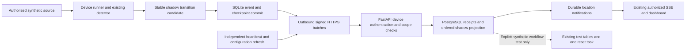

# Phase 6 proposal: reliable and secure edge-to-cloud synchronization

> **Resumed verification - 2026-11-11:** [The phase explanation](phase_explanations/PHASE_06.md#resumed-final-verification---2026-11-11) records 529 passing tests, six browser groups, fresh outage/restart/preservation checks and the retained native loading failure. Its API table documents consolidated heartbeat/configuration/lease and manager commands; `/v1/edge/events` now matches the blueprint with `/batches` retained for compatibility. A general paginated history endpoint/UI is not implemented. Earlier proposal names and checks below are historical. No Phase 7, commit or push.

> **Implementation outcome - 2026-11-08:** The founder approved this architecture, the local one-hour lease and exact project dependencies. Both additive migrations were rehearsed, separately approved and applied. [PHASE_06.md](phase_explanations/PHASE_06.md) records actual behavior: 526 tests, six browser groups and verified local outage/restart recovery. AI remains shadow-only; representative accuracy/deployment gates remain. Original planning measurements below are dated design evidence. No Phase 7, commit, push or public deployment.

**Prepared:** 2026-11-08, Asia/Dhaka; stored event and verification times use UTC.  
**Status:** Approved design, implemented and verified in the local/synthetic scope. See the phase explanation for final evidence and limitations.
**Foundation:** Published Phase 5 checkpoint `ae19ec81f342d17730ddd48845a5862a2d56a99a` on `main`. Its publication was verified during the preceding approved push. This planning task does not re-verify GitHub or rerun application tests.  
**Authority:** [MASTER_SPEC.md](MASTER_SPEC.md#phase-6---reliable-edge-to-cloud-synchronization), sections 5, 7–13 and development milestone 6; [AGENTS.md](../AGENTS.md).  
**Prerequisite evidence:** [Phase explanations 00–05](phase_explanations/README.md), [handoff](CODEX_HANDOFF.md), [roadmap](implementation_plan.md), [Phase 5 plan](PHASE_05_IMPLEMENTATION_PLAN.md) and [checkpoint review](PHASE_05_CHECKPOINT.md). Earlier results and approval records remain historical.

## 1. What this phase means

The restaurant computer is the **edge device**. It reads authorized video and runs the existing detector locally. The backend is the shared service that supplies restaurant accounts and the dashboard. Phase 6 builds the protected delivery connection between those two parts.

For example, a device produces event E17, meaning “the local shadow engine observed a possible departure.” It first saves E17 to a local SQLite database. If the internet disconnects, E17 stays there. After reconnection it sends E17 over HTTPS. If the response is lost, it sends the **same event ID** again. The backend recognizes the duplicate and does not repeat its effects.

Reliable delivery does not make an AI observation correct. The default cloud destination will remain a clearly labeled **shadow observation**, separate from operational table states and staff tasks. Synthetic fixtures can test the existing task workflow under the restricted test policy in section 3. Real-person and restaurant occupancy accuracy are still unverified.

### Small vocabulary guide

- **Outbox:** a local list of messages waiting for safe delivery, like email waiting to send.
- **TLS/HTTPS:** an encrypted connection that also checks the backend's certificate and identity.
- **Device key and signature:** a private machine credential and a proof that its owner sent particular message bytes; not proof that the AI is correct.
- **Public fingerprint:** a readable identifier derived from the public key. It is safe to compare during pairing and cannot sign messages by itself.
- **Acknowledgement/receipt:** the backend's confirmation that it durably recorded a particular message and its result.
- **Idempotency:** retrying the same operation has one effect rather than doing the work twice.
- **Lease:** temporary permission that expires unless renewed under the approved rules.
- **RLS:** PostgreSQL rules that restrict which restaurant/location records a request may access.
- **SSE:** the existing one-way live notification connection from the backend to an authorized browser.
- **Engine checkpoint:** saved local processing context for recovery. It is different from a Git checkpoint, which saves source files.

## 2. Exact approved-roadmap requirements

These are requirements from the master blueprint, not features already implemented:

| ID | Phase 6 requirement | Evidence required after implementation |
| --- | --- | --- |
| P6-01 | Durable SQLite outbox before network transmission | Committed events survive a forced process restart; nothing is sent before its local commit |
| P6-02 | Securely pair an edge device to exactly one location | Manager-approved pairing, proof of key possession, immutable location binding and negative pairing tests |
| P6-03 | Authenticated event batches over TLS | Actual verified HTTPS transport, typed bounded batches and rejected invalid credentials/certificates |
| P6-04 | Derive organization/location from the authenticated device | Forged organization, location, camera and table references fail at API and database boundaries |
| P6-05 | Deduplicate by event ID | Duplicate posts and lost acknowledgements have one database effect; changed-payload reuse is rejected |
| P6-06 | Retries/backoff and restart replay | Recover from network errors, backend failure and a real 15-minute test outage without losing committed events |
| P6-07 | Handle out-of-order delivery | Missing/late events do not move a live projection backward or overwrite newer staff actions |
| P6-08 | Heartbeat metrics and device-offline dashboard banner | Distinguish device contact, camera freshness, inference health, queue backlog and browser disconnection |
| P6-09 | Reject revoked credentials | Revocation, expiry, rotation and concurrent revocation/ingestion tests pass |
| P6-10 | No duplicate tasks after duplicate delivery | A restricted synthetic integration case creates exactly one actual reset task and retains that one task after repeated posts |

The master completion boundary is durable disconnect/restart recovery, duplicate-safe effects and rejected revoked devices. The master also requires local video minimization, backend tenant/location enforcement, UTC storage, human precedence and honest UNKNOWN/offline behavior. Its under-five-second event-receipt-to-dashboard delay is a **target to measure**, not a result of this plan.

## 3. Scope, safety and the Phase 7 boundary

**Recommended initial execution scope:** local development, synthetic locations and existing generated MP4 only. A paired device does not grant new footage rights or clear Phase 5 evaluation gates. Existing recordings, including `SR.mp4`, remain unauthorized.

Use two server-controlled device purposes. A caller cannot choose a more privileged purpose in an event:

| Purpose | Allowed effect |
| --- | --- |
| `AI_SHADOW` — default | Persist minimal AI observations, delivery receipts, scoped shadow history and health; never change operational table state or create operational staff tasks |
| `SYNTHETIC_WORKFLOW_TEST` — explicit opt-in | Accept deterministic fixture events at a specifically approved synthetic test location to exercise the existing Phase 3 workflow and task uniqueness |

The test purpose requires all of: server test/DEMO flag enabled, a location explicitly marked synthetic, a manager/admin-approved test binding, and an allowlisted fixture contract. It cannot accept actual AI output as a fixture or be enabled at a customer location. Use a new synthetic test location/tables; do not reset existing demo tables. Most tests use the isolated test database.

This gives P6-10 a meaningful test: first delivery creates **one real `staff_tasks` row in the test database**, then duplicate and concurrent posts leave exactly one. Merely showing zero tasks in shadow mode would not satisfy that requirement. The test adapter invokes a separately authorized internal transition service; it must never call browser DEMO endpoints or impersonate a human user. Preserve existing role, revision, manual-state and readiness checks when sharing transition logic.

General real-AI-to-operational-state/task integration, analytics, CSV exports and the complete connected cleaning workflow remain **Phase 7**. Phase 6 adds no new general task categories or automatic ready/clean confirmation. Real/pilot activation requires separate footage, quality and deployment decisions; successful synthetic delivery is not that approval.

## 4. Current source findings and constraints

| Existing component | What the source actually does | Phase 6 implication |
| --- | --- | --- |
| `cloud_client.py` | Per-human in-memory session/cookie/CSRF client; fixed API origin; passive metadata reads | Add a separate device client. Do not save human passwords/sessions for unattended delivery |
| `companion.py` | Local preview tied to an eligible human, expiring grant and frequent cloud checks | Preserve fail-closed preview; device processing consent is a new, separate permission |
| `analysis.py` | Requires fresh manual metadata; unverified after about three seconds and stops after four seconds without it | A retrying sender alone cannot provide offline inference. Add a distinct device runner/policy, retaining the interactive lab's safeguards |
| `state_engine.py` | Local events are a bounded in-memory deque; event UUIDs exist but are not durable | Persist transitions at creation, not by periodically draining a deque that can discard entries |
| Calibration and seating | PostgreSQL zone/history plus separate private local seating revisions | Preserve cloud Revision 7 and local Revision 1. Bind events to approved geometry/configuration revisions |
| API models/migrations | Tenancy, staff tasks, table events and RLS exist through `0006`; no device/outbox/ingestion model | Add forward migrations; do not rewrite revisions 0001–0006 |
| `Camera.status` | Database constraint permits only `NOT_CONFIGURED` | Introduce separate runtime camera-health records; do not write ONLINE into the constrained metadata column |
| `TableEvent` and SSE | Table events require a table ID; shared location revision orders committed events | Device-wide heartbeat notifications need a separate scoped publication record; never invent a table ID |
| `AuditLog.actor_id` | Required foreign key to a human user | Keep human administration audits; add device audit records rather than fake human accounts |
| Runtime privileges | Restricted API login, controlled functions, RLS and transaction-local human identity | Add explicit device context and narrowly controlled machine writes without granting broad table mutation |

Read-only inventory during planning: working Python is 3.14.0; SQLite library **3.50.4**; HTTPX **0.28.1**, keyring **25.7.0**, ONNX Runtime **1.31.1**, FastAPI **0.162.0**, SQLAlchemy **2.1.8**, Alembic **1.20.1**, Uvicorn **0.54.0**. `cryptography` is **not installed in the working `.venv`**. API/CI Python remains a different environment; the isolated model exporter must not become the sync runtime.

## 5. Proposed architecture



Retain the modular monolith, existing PostgreSQL, Next.js and SSE. No MQTT broker, Kafka, Redis, Celery, Kubernetes or new cloud video service is needed. One initial runner processes **one active camera/source at a time**, as the master allows. Different locations use different paired device identities and private queues. Multiple camera bindings can be modeled and tested, but simultaneous camera inference is not a supported capacity claim.

### Choices proposed for founder approval

| Choice | Recommendation and tradeoff |
| --- | --- |
| Device authentication | Per-device Ed25519 key and RFC 9421 HTTP Message Signatures over verified TLS; keeps private device keys off the backend, but adds a reviewed crypto/signature dependency boundary |
| Pairing | Short-lived public challenge, proof of private-key possession, then explicit human approval of the full public fingerprint; no enrollment password in browser responses |
| Local storage | Python `sqlite3`, single database owner, rollback journal and `synchronous=EXTRA`; favors simpler durable transitions over maximum write throughput |
| Initial cloud effect | AI shadow by default; narrowly restricted synthetic fixture adapter proves existing task idempotency |
| Offline processing | Separate camera-processing consent and finite offline lease; human preview remains independently expiring and fail closed |
| First operating system | Existing Windows user account and explicitly selected Windows Credential Locker. Other systems/service accounts remain unsupported until tested |
| Local TLS | Additional loopback-only Uvicorn HTTPS listener from the same backend code, e.g. port 8443 if free, with private test certificates and explicit CA trust in the device client |

Opaque bearer tokens would be simpler but are copyable secrets and would not give per-request signature coverage. Mutual TLS is another sound option but adds client-certificate issuance/revocation operations. Neither alternative is silently selected. Do not implement a homemade cryptographic algorithm or custom signature canonicalization.

## 6. Device registration and camera assignment

Proposed pairing flow, all over verified HTTPS:

1. The edge CLI generates a device key locally and saves the private material only in a new Windows Credential Locker namespace. It prints a **public fingerprint**, not a private key/password. Refuse plaintext storage fallback or accidental overwriting of an existing identity.
2. The unpaired CLI requests a short-lived enrollment challenge using its public key and a random request UUID. Pending requests carry **no organization/location authority**. Apply body/rate/global pending-request limits before expensive verification.
3. The server returns a public nonce and request ID, proposed lifetime **10 minutes**. The edge signs that challenge, including its request ID and an enrollment-specific domain/tag. Reusing an expired/consumed challenge fails. Neither nonce nor fingerprint is a secret credential.
4. A manager, organization admin or owner signs in normally, has explicit access to the target location, and checks the **full SHA-256 public-key fingerprint** against the device's local display. A short label alone is not sufficient. Installers can initiate setup but cannot approve themselves.
5. The human approval API atomically consumes the proved request, binds a new device ID to exactly that organization/location, assigns its purpose and approved camera list, and writes an audit. The authenticated human's location grant establishes scope; unpaired request fields cannot do so.
6. The device polls using proof of the same private key, then learns its assigned device ID and safe configuration. Unproved polling cannot reveal location/account details. A consumed request cannot be approved again by another tenant.
7. Register a camera/table binding with expected revisions. Check the camera, table, zone and device share the same tenant/location. Store calibration revision, seating-profile digest/revision, model identity/hash, policy revision and a binding epoch. Local source filenames, RTSP URLs/passwords and seating-profile contents are not sent.

Device location/organization is immutable. Moving hardware to another location means explicitly revoking the old registration and creating a new identity/binding. Old queue records must never be relabeled for another restaurant.

For each table, allow one active **primary camera/device binding**. This prevents two independent processors from publishing competing observations for one table. Calibration, assignment or model-policy changes advance the binding/policy revision; old observations remain history and cannot become current. Camera-to-device assignment must be represented with scoped foreign keys and uniqueness, not an unchecked JSON camera list.

Also allow only one active device owner per camera. A device may hold several approved camera metadata bindings within its one location, but the initial runner can activate only one of them at once. Reassignment retires the old binding epoch; it never gives the old device access to another location or promotes its delayed events.

## 7. Device authentication, TLS and revocation

**Installed-library follow-up:** The approved `http-message-signatures==3.0.0`
has a `body=` argument and verifies Content-Digest when given the exact bytes.
Both deployed mirrors pass those bytes and require the complete component set.
The older candidate-documentation caution below remains review history; native
digest/tamper tests and the current explanation describe the implemented boundary.

Use a reviewed implementation of [RFC 9421](https://www.rfc-editor.org/rfc/rfc9421.html), with a fixed Ed25519 algorithm policy and required covered fields. The candidate [http-message-signatures project](https://github.com/pyauth/http-message-signatures) supports the standard; its [documentation](https://pyauth.github.io/http-message-signatures/) documents Ed25519 and warns that **body-digest checking remains the caller's responsibility**. A library import alone is not sufficient verification.

- Sign the method, authority, target URI, content type and `Content-Digest`, with created/expiry timestamps, key ID, nonce and a fixed application tag. Reject missing required coverage, unknown algorithms/labels, duplicate ambiguous headers and signatures over an unrelated route.
- Compute and verify the SHA-256 digest of the **exact bounded received body bytes**, before trusting parsed event content. [RFC 9530](https://www.rfc-editor.org/rfc/rfc9530.html) specifies the digest fields. Reject duplicate JSON keys, NaN/infinity, unexpected fields, compression and oversized bodies.
- Proposed request validity is **two minutes**, with at most **two minutes clock skew**. Persist nonce uniqueness per key with a retention window covering validity plus skew, e.g. ten minutes. A request replay is rejected; a legitimate retry gets a fresh signature/nonce and keeps the original event IDs/content.
- Look up the public key only through a narrow authentication function; after signature verification, derive scope from its active device registration. Recheck key/device status and scope inside the ingestion transaction, including after lock waits. Authenticate **before** answering duplicate-event queries.
- Never send device credentials through the Next.js browser proxy, URLs, local storage or logs. Device requests cannot use human endpoints; a human cookie is not device authentication. Public key fingerprints may be displayed; private keys never enter browser responses or fixtures.
- The separate device HTTPX client allows only an explicitly configured HTTPS origin, verifies its certificate/hostname, disables redirects/environment proxies, bounds timeouts/connections/response sizes, and accepts no browser-supplied target. Never use `verify=False`. [HTTPX SSL configuration](https://www.python-httpx.org/advanced/ssl/) supports explicit CA trust and local HTTPS testing.

For the local integration harness, issue private test certificates after the dependency gate, start the existing Uvicorn code with TLS on loopback, and trust only that test CA in the device client. Preserve the existing HTTP web/API development paths and ports. This verifies the **edge transport**, not production TLS for the whole website. Do not install a CA globally, expose new ports publicly or provision a public domain in this milestone. Future public ingress/proxy canonicalization and certificates need deployment review.

Revocation disables the device and all processing leases at the server. Requests beginning after revocation commits must fail; in-flight writes and revocation are serialized by device-row locking so their commit order is explicit. Queued events from a revoked identity are retained locally, not silently delivered through another device. Key rotation uses an approved new public fingerprint and proof of possession; use a short, explicit overlap and retire the old key. Undelivered event bytes/IDs remain unchanged and can be signed with the new active key of the **same** device. A compromised device requires explicit recovery, not automatic re-enrollment.

## 8. Offline processing permission is separate from preview

Pairing authorizes the machine to communicate; it does not automatically authorize video processing or viewing. A manager/admin must separately enable the exact camera, local synthetic source, reviewed configuration and model for device processing. Keep the current synthetic-only restriction until a separate footage decision.

Propose a server-issued integrity-protected processing lease, **one hour by default**, capped at one hour initially, refreshed while connected. It identifies device/location/cameras, source classification, allowed model/configuration hashes, policy revision and UTC expiry. Protect cached lease integrity and use monotonic elapsed time during a running process. Server signing keys, if used for portable lease validation, stay private and require their own rotation/recovery procedure.

During a normal network outage, the device runner may continue **local shadow inference** within that lease, saving transitions to SQLite. It retains the last protected human state but treats new staff context as unavailable. Cloud-side reconciliation always rechecks newer staff revisions. Offline observations never become proof of readiness.

The existing human companion still clears/stops its preview and lab on expired/revoked grants, failed authorization or session expiry. Device processing is separately supervised and does not share its browser session. Device delivery/heartbeats and passive views never extend human idle or absolute expiry.

An offline server cannot instantly notify a disconnected device of revocation. The server rejects all later delivery immediately; local processing stops at lease expiry or earlier locally known revocation. **This bounded revocation delay is a real limitation.** After a runner/OS restart, uncertain clock, expired lease or inability to validate authority, require online reauthorization before resuming capture; already committed events still survive and remain queued. Initial offline continuity therefore covers a running authorized process, not indefinite processing or automatic offline restart after reboot. Founder approval of this tradeoff is required.

Refactor reusable processing/supervision only as needed for this separate runner. Do not remove the current interactive lab's three/four-second manual-metadata safeguards to make outage tests pass. After reconnect/restart, refresh configuration/manual state, start a new source generation, and rebuild stable evidence before presenting a current estimate.

## 9. Versioned event contract and ordering

Add an explicit shared contract, with matching backend and edge validation and OpenAPI/JSON Schema examples. The existing local shadow dictionary is useful input, not already a cloud protocol. Initial event types should cover stream start/end, camera/analysis health changes, shadow state proposals and manual-context references. Heartbeat is a separate current-health request, not one durable event per video frame.

| Field group | Meaning and validation |
| --- | --- |
| Identity | Stable random `event_id`, device ID, device stream epoch and persistent integer event sequence. IDs and ordering counters survive process restart |
| Scope | Camera/table/binding identity and, when present, claimed organization/location. Derive authoritative ownership from the device; reject any mismatch |
| Version | Envelope/event schema version, allowlisted event type and server-enforced source purpose |
| Time | UTC `occurred_at` from processing/receipt, separate server `ingested_at`, optional media position, frame age and clock-quality flag |
| Provenance | Model ID/hash, zone revision, seating profile digest/revision, policy/binding epoch and source generation/frame sequence |
| Evidence | Allowlisted reason, proposed state, evidence band/coverage and optional bounded detector score. No invented occupancy probability |
| Reconciliation | Last observed human revision and occupancy episode ID where relevant; these are checks, not permission to override current staff state |

Persist the immutable event bytes/hash once. Request signatures, key IDs and retry timestamps belong to the transport envelope and may change without changing event identity. Canonical event encoding must be versioned and tested consistently; request signatures use library-standard HTTP serialization and the exact request body, not a hand-built cryptographic format.

Do not upload images, JPEGs, crops, boxes, face/body features, audio, recordings, source filenames/RTSP strings, user passwords or arbitrary free-text diagnostic payloads. Table transition metadata is enough for this phase. A cryptographic signature proves which registered key sent an observation, **not that its AI interpretation is truthful**.

### Sequence numbers, gaps and stale events

- Allocate a strictly increasing device event sequence in the same SQLite transaction as its event. Source frame sequence, source generation, device event sequence and cloud location publication revision are **different counters**.
- Maintain server uniqueness for global event ID and for `(device, stream_epoch, event_sequence)`. Same ID and same immutable content is a duplicate; changed content, another device or conflicting sequence is a conflict, never an overwrite or a disclosure of someone else's event.
- Initial sender uses one in-flight batch and ascending sequence. Backend still handles reordering from retries/concurrency. Durably store later events as pending until missing earlier dispositions arrive. Bound gaps/pending storage, e.g. 1,000 sequence positions; exceeding the window requires reconciliation.
- A durable receipt is not necessarily “applied to the latest view.” Return distinct accepted/pending/history-only/rejected dispositions and a contiguous committed cursor. Late history must not move current state backward.
- A rejected event with a valid owned envelope may receive a terminal rejection receipt containing only identity/hash/reason. The device quarantines its original record. Crossing a rejected/missing-state boundary makes affected evidence UNKNOWN until a fresh generation/context is established; never infer a departure across a gap.
- Old-generation, outdated calibration/policy, stale manual revision and delayed outage observations are retained as history or rejected with safe reasons. They cannot replace a newer shadow estimate, clean confirmation or manager block. Never order state solely by caller timestamps or HTTP arrival order.
- Restore of an old outbox or cloned device storage can fork a sequence. Detect the conflicting ID/hash/counter and stop that stream for operator review. Do not silently reset its sequence, create a second writer or move its queue to another identity.

Initial clock freshness limits are proposed policy values, not restaurant thresholds. Old queued observations remain deliverable as history; do not reject a legitimate 15-minute queue simply because its `occurred_at` is older than the request-signature window. Re-sign the current delivery request instead. If device time is unreliable, flag timing uncertainty and refuse live projection; do not invent a capture time from MP4 media position.

## 10. Durable local outbox and crash recovery

The local database is a small private notebook of **event metadata**, not video. Use a new private directory such as `.secrets/phase6/<device-id>/outbox.sqlite3`, with an explicit device/scope identity header. Keep it on the local disk, outside Git, network shares and shared synchronization folders. Verify ignore rules for the database and journal sidecars. Use Windows folder/file ACLs; SQLite itself is not encryption. Disk encryption remains a deployment decision, and device/camera private keys stay out of this database.

### SQLite mode and the newly identified runtime risk

The working interpreter reports SQLite **3.50.4**. SQLite documents a rare corruption bug affecting WAL mode with concurrent connections in that version range; fixes include **3.50.7** and **3.51.3**. This is an upstream finding, not observed project corruption. See [SQLite's WAL-reset notice](https://sqlite.org/wal.html).

Use **rollback-journal `DELETE` mode**, a single owning database thread/connection, explicit transactions and `synchronous=EXTRA` for the first outbox. Read back the configured pragmas and refuse an unexpected mode; do not silently enable WAL. EXTRA adds a durability precaution beyond FULL for rollback-journal commits. [SQLite synchronous documentation](https://sqlite.org/pragma.html#pragma_synchronous) explains the distinction. This avoids the documented WAL-specific path without installing anything; it is not a complete SQLite security audit. Enabling WAL later needs a separately approved patched runtime/provider and compatibility/crash tests.

Python provides [explicit SQLite transaction controls](https://docs.python.org/3.14/library/sqlite3.html#transaction-control). Specify the transaction mode rather than inheriting changing defaults; support/test the actual Windows 3.14 and API/CI Python environments. Durability also depends on filesystem/storage behavior; process-kill tests do not certify power-loss behavior on every disk. [SQLite atomic-commit assumptions](https://sqlite.org/atomiccommit.html) explain that practical boundary.

### Local records and commit boundary

| Local structure | Purpose |
| --- | --- |
| Identity/schema metadata | Device/location/stream identity, schema version and next sequence; no private signing key |
| Outbox | Event UUID/sequence, immutable typed payload/hash, created time and delivery state |
| Delivery attempts | Attempt count, next retry time, bounded safe reason code and in-flight lease |
| Acknowledgements/quarantine | Validated server dispositions and retained rejected/conflicting event references |
| Engine checkpoint | Last durably committed transition, occupancy episode identity and configuration/manual revisions; not reusable old visual evidence |
| Approved configuration/lease cache | Minimum scoped metadata and permission deadlines; no raw video or camera passwords |

The event producer must use a commit barrier:

1. Compute a candidate stable transition without exposing it as durably accepted.
2. In one local transaction, allocate the sequence, insert immutable event data and update its checkpoint.
3. Commit successfully; only then expose the committed transition to the sender or durable local history.
4. On commit failure, retain the previous committed checkpoint, stop admitting transitions and report storage failure/UNKNOWN. Do not claim the transition was saved or send an unsaved event.

Do not periodically poll the current 1,000-entry deque and call that durable delivery. That design can lose events before the next poll. Keep the existing optional lab behavior intact; add the durable boundary in the new runner path. Network I/O must never hold a SQLite transaction or block the decoder/preview permission checks.

One process owns a device queue; reject a second runner through an OS-level lock plus database identity checks. Readers/sender request short operations from its owner. On restart, recover expired in-flight delivery leases and resend the **original** pending IDs/bytes. Reload configuration and human context before new capture; start fresh visual evidence rather than replaying old monotonic timers or inferred AVAILABLE.

Proposed limits: up to **100,000 retained rows or 256 MiB**, whichever comes first, plus disk-free checks and a warning well before the limit. These are design defaults to load-test. Never evict pending/rejected transitions to keep the UI green. At capacity or storage failure, stop admitting new durable observations and show an explicit recording gap; heartbeat/storage warnings remain best effort. No indefinite outage/storage guarantee is possible.

Initially retain acknowledged and quarantined records too. Retention/pruning needs a separately reviewed policy; do not silently delete original business files, accepted-event history, deduplication receipts or unacknowledged records. Corruption recovery preserves the affected files, reports the problem and uses a reviewed backup/recovery procedure; it never recreates an empty queue over a damaged one. Disk loss without a backup cannot be recovered by software promises.

## 11. Batches, acknowledgements, retries and recovery

Proposed limits: at most **100 events**, **128 KiB total body** and **8 KiB per event**; build a smaller batch when the byte limit is reached. Keep one delivery batch in flight per device. Use separate bounded heartbeat/configuration work so backlog replay cannot starve health checks.

Backend processing order:

1. Enforce stream/body limits before unbounded buffering, require TLS/device route, and verify signature/body digest/freshness/nonce.
2. Resolve and lock the active device/key; validate every envelope's ownership and assigned camera/table references. A foreign scope fails the batch without leaking records.
3. Inside a database transaction, record new validated events/receipts. Exact duplicates reuse their prior disposition. ID/hash/sequence conflicts roll back the batch and return a safe conflict.
4. Unsupported event versions/types or invalid event semantics with an otherwise trustworthy owned envelope receive explicit per-item rejection receipts; store only safe IDs/hash/reason, not unvalidated arbitrary payloads. Malformed JSON/envelopes have no acknowledgement and fail the entire request.
5. Apply only contiguous eligible items to shadow/health projections. Under the synthetic workflow test policy, apply its existing-workflow effect atomically with its receipt. Serialize devices/tables/location publication in a documented consistent lock order compatible with the existing table-then-location workflow.
6. Commit before returning acknowledgements. A failed transaction returns no success receipt. Responses list event ID, sequence, hash and disposition; do not return secrets or mirror arbitrary inputs.

The sender accepts an acknowledgement only if TLS and its strict response schema pass and every acknowledged ID/hash/sequence belongs to the submitted batch. A truncated/malformed response, unknown ID or lost response leaves delivery uncertain; resend with the same event IDs and a fresh request signature. Store acknowledgement results in a local transaction. “Accepted” means durable backend responsibility, not live AI correctness or staff approval.

Propose HTTP 200 for a successfully committed batch response, with an explicit disposition for every submitted event, including pending/rejected items. Do not equate HTTP 200 with every event being usable. For a successful response require exactly one matching disposition per submitted ID; a missing item makes acknowledgement handling uncertain. Non-200 authentication/conflict/schema responses do not imply any accepted item unless the documented typed contract explicitly says otherwise.

| Response/failure | Planned behavior |
| --- | --- |
| Timeout, connection failure, HTTP 408/5xx | Keep pending; exponential retry with jitter |
| HTTP 429/503 with valid bounded Retry-After | Respect it; do not flood while the backend is recovering |
| HTTP 401/403, revoked/expired/invalid signature | Stop protected delivery; surface credential/policy failure. Do not loop through human passwords or auto-register another identity |
| HTTP 409 identity/hash/sequence conflict | Quarantine/stop the affected stream for review; never overwrite or invent a replacement ID for an already committed transition |
| Valid per-item terminal rejection | Retain locally as quarantined with a safe reason; continue only according to ordered-gap safety rules |
| HTTP 413 | Split a valid batch by count/bytes; quarantine an individually oversized event rather than dropping it |
| Other permanent schema errors | Keep original records for diagnosis; no infinite rapid retry |

Suggested network backoff uses full jitter with an exponential ceiling starting at one second and capped at sixty seconds. Persist attempts/retry intent across restart; use monotonic timers within a running process and conservative UTC handling after restart. These values need tests; they are not delivery guarantees. Do not stop retrying transient outages after an arbitrary small number of attempts, but bound rate, worker resources and disk use.

The delivery guarantee is **at least once with duplicate-safe database effects**, not exactly-once networking. Keep cloud deduplication receipts for this phase; deleting them or restoring an older database can invalidate that guarantee. Test backup/restore reconciliation before any later retention policy.

## 12. Proposed PostgreSQL changes and tenant enforcement

Add new structures through reviewed forward revisions after `0006`; tentative grouping is `0007` for identity/permissions and `0008` for ingestion/projection/publication. Confirm numbers against the actual head before implementing. Do not edit old migration files or reset existing records.

| Structure | Important fields/constraints |
| --- | --- |
| Private pairing requests | Public key/fingerprint, public challenge, proof status, expiry/consumed time; restricted access, bounded enrollment abuse/retention |
| `edge_devices` | Device UUID, immutable organization/location, label, purpose, enabled/revoked status, server last-seen time and configuration revision |
| Device keys/nonces | Scoped device/key relationship, public key, validity/revocation/rotation fields and unique short-lived request nonce; no stored device private key |
| Camera and table bindings | Scoped device/camera/table/zone references, primary-writer uniqueness, assignment epoch, approved model/profile/configuration fingerprints |
| Processing permissions/leases | Explicit manager-approved scope, policy version, expiry and revocation metadata |
| Edge event receipts | Global unique event ID, unique device/epoch/sequence, immutable hash, safe disposition, occurred/ingested UTC timestamps and source purpose |
| Shadow projection and stream cursor | Latest eligible sequence/configuration/manual context; history-only and unknown/gap reasons; separate from operational table state |
| Runtime health | Server receipt time, camera/analysis status, frame age, queue depth/oldest age, last delivery and safe resource metrics |
| Device audit records | Real device actor, location, action/reason, safe IDs and timestamps; human administration continues using existing audit records |
| Location sync notifications | Location-scoped durable revision/type and optional device/table reference for SSE invalidation, without requiring a fake table |

Use composite foreign keys for organization/location/device/camera/table relationships, immutable ownership and RLS. Keep all runtime roles non-owner/non-superuser without BYPASSRLS or migration/truncate powers. New device reads see only assigned camera/table/configuration metadata; device identity cannot read users, memberships, other cameras, preview grants or unrelated task history. Human lists/history use existing explicit grants and role restrictions.

The existing transaction-local human setting is not a device permission. Add verified device identity context, clear incompatible principal context, and test pooled connections across A human → A device → B device → anonymous. A narrow authentication lookup may need a SECURITY DEFINER function to find public keys before scope is set. Controlled write functions must explicitly recheck device/key/assignment state, use safe fixed search paths/qualified names, and revoke public execution. [PostgreSQL RLS documentation](https://www.postgresql.org/docs/16/ddl-rowsecurity.html) explains owner/bypass limits; [SECURITY DEFINER guidance](https://www.postgresql.org/docs/16/sql-createfunction.html#SQL-CREATEFUNCTION-SECURITY) explains function-owner hazards. Neither RLS nor signatures eliminate the risk of a compromised backend/OS account.

Do not grant the runtime direct access to the existing private human `identity` schema or relax its startup privilege checks. Place any new private device bootstrap/key structures behind specifically granted functions in a separately reviewed protected schema, with tests proving there is no new human-identity read path.

### Migration safety after implementation approval

1. Inventory the real migration head, original container/volume, existing business/user rows, cloud polygons/history and local seating files. Keep comparisons private.
2. Create and inspect a new private PostgreSQL backup before any business schema change. Preserve all existing archives.
3. Restore to a separately labeled isolated test database and apply/reapply forward migrations. Test legacy reads, model/schema consistency, existing staff actions, RLS, sentinels, users/password hashes and complete revision histories.
4. Rehearse local outbox schema migration on copies of newly created synthetic queues; test crash/rollback and old queue replay. Never attach or alter an unrelated SQLite file.
5. Only after rehearsal, apply reviewed migrations through the existing administrative management path; never put administrator credentials into the runtime image. Provision only necessary runtime functions/grants.
6. Recheck original records, cloud Revision 7, private seating Revision 1, credentials and original Docker volume. Do not seed over existing restaurant tables. Correct problems through forward fixes, not destructive downgrades.

No backup, migration, database connection, seed or container operation is performed by this planning task.

## 13. Proposed API surface and permissions

Names below are proposed contracts, not routes currently available. Keep `/v1/edge/events` and `/v1/edge/heartbeat` from the master. Publish strict request/response/error schemas in OpenAPI before implementation integration.

| Method/path | Authentication and purpose |
| --- | --- |
| POST `/v1/edge/pairing-requests` | Rate-limited bootstrap; public key/request UUID only, returns public challenge |
| POST `/v1/edge/pairing-requests/{id}/proof` | Prove the same private key signed the unexpired challenge; no tenant access |
| GET `/v1/edge/pairing-requests/{id}/status` | Proof-bound bootstrap polling; scoped registration returned only to its proved key after approval |
| POST `/v1/locations/{location}/edge-devices/pairing-approvals` | Human manager/admin/owner with explicit grant, CSRF, fingerprint and one-use request approval |
| GET `/v1/locations/{location}/edge-devices` | Permitted location users; safe inventory and bounded health summary, no credentials |
| PUT `/v1/locations/{location}/edge-devices/{device}/bindings` | Human manager/admin/owner; expected revision, explicit camera/primary-table/model/profile review and audit |
| POST `/v1/locations/{location}/edge-devices/{device}/processing-permissions` | Human manager/admin/owner explicitly enables/revokes scoped processing; audited |
| POST `/v1/locations/{location}/edge-devices/{device}/revoke` | Human manager/admin/owner; idempotent audited revocation |
| POST `/v1/locations/{location}/edge-devices/{device}/key-rotations` | Human manager/admin/owner approves proof-bound new public key; no private key in request/response |
| GET `/v1/edge/config` | Active device signature; only its camera/table/policy/manual-context metadata |
| POST `/v1/edge/processing-lease` | Active device plus explicitly enabled processing scope; returns bounded lease metadata |
| POST `/v1/edge/events` | Active device signature; bounded durable event batch and per-item dispositions |
| POST `/v1/edge/heartbeat` | Active device signature; current bounded health, no video |
| GET `/v1/locations/{location}/edge-events` | Manager/admin/owner; scoped paginated shadow/delivery history, no raw payload dump |
| Existing dashboard/stream routes | Human session and explicit location grant; extend with safe device/shadow fields and notifications |

Staff see operational health for their granted location but cannot pair/reassign/revoke devices or view setup previews. Installers retain their existing camera/setup role; enrollment initiation is not administrative approval. An owner/admin still needs an explicit location grant. All human mutations retain CSRF, exact-origin, expected-revision and retry-key behavior; device signatures do not authorize staff actions.

Return generic authentication/not-found errors for foreign identities. Use useful fixed reason codes for an authenticated device's own schema, stale policy, sequence gap, lease and storage errors. Do not echo database exceptions, request signatures, keys, raw URLs or arbitrary decoder errors. Rate-limit enrollment and device traffic separately from human login; persisted/server-shared enforcement is needed before public deployment.

## 14. Heartbeats and the existing dashboard

Proposed heartbeat cadence is **15 seconds**, with offline status after **45 seconds** without a server-received valid heartbeat. These defaults must be measured. Camera last-frame age and inference freshness remain independent, stricter signals; an online computer can have a disconnected camera or failed detector.

Report only allowlisted small metrics: agent version, server last contact, current source/analysis reason, frame age, queue depth/oldest age, delivery status, disk-space warning, sampled CPU/memory and current policy/model fingerprints. No command line, OS username, source path, credentials, raw traceback or frame image. Device-reported quality is not hardware attestation.

The dashboard will add:

- A location device summary: **NOT PAIRED**, **ONLINE**, **RECOVERING/BACKLOG**, **OFFLINE**, **REVOKED**, or **CONFIGURATION/STORAGE ERROR**.
- Separate camera/inference freshness and an explicit **SHADOW AI — unvalidated** estimate alongside the staff-controlled table state.
- “Last received” and queue/backlog labels, showing late delivery as historical rather than current.
- A clear banner when live device evidence is unavailable. A manually confirmed AVAILABLE/CLEANING/OUT_OF_SERVICE state and its timestamp are preserved, but unavailable evidence is not counted or styled as verified current readiness.
- Existing protected staff controls and timers. Only manager/admin roles get device administration controls; pairing never grants preview rights.

Browser-to-server SSE connectivity and edge-to-server connectivity are separate. A healthy SSE heartbeat must not make an offline camera appear online. Leaving the dashboard open never renews the human session.

Store event/contact timestamps in UTC and display history using the location's existing IANA time zone. Elapsed timers use monotonic/server-offset handling, not changes in local wall-clock labels. Preserve New York daylight-saving repeated-hour and Asia/Dhaka coverage; Phase 6 does not add analytics.

Add a bounded backend health monitor in the existing application lifecycle, using a narrow controlled database operation and server time. Serialize status changes so multiple API workers cannot publish duplicate offline transitions. Publish on meaningful changes; do not append a noisy history event for every identical heartbeat. Dashboard snapshots include server-calculated freshness deadlines so the browser can stop displaying freshness even if a monitor/update is delayed. On API/browser interruption, retain the existing last-known/stale behavior.

For SSE, add `location_sync_notifications` alongside existing table events, allocate revisions from the **same locked `location_operations` counter**, and replay the two durable logs together in revision order. Snapshot and replay must have no commit-order gap. Do not insert device-wide records into `table_events`, which requires a real table ID. Existing activity responses continue returning actual table events; edge history has its own typed API. The current browser's change handler already reloads its authoritative snapshot, so new invalidation kinds can reuse that mechanism with explicit types and expiry tests.

Reconnect sequence: establish fresh authenticated contact → refresh configuration and manual context → reconcile receipts/sequence gaps → drain bounded batches without starving heartbeat → rebuild current source evidence → display fresh shadow data. Replayed historical events alone cannot make the device LIVE or reset a staff timer. No polling/stream can keep a human sign-in alive.

## 15. Technologies, dependencies and hardware

| Technology | Reuse/proposal and limitation |
| --- | --- |
| Python `sqlite3`, `ssl`, UUID/hash/time libraries | Already available; no SQLite server or package install needed. Runtime version/journal precautions in section 10 are mandatory |
| Existing HTTPX 0.28.1 | Separate outbound device client, deadlines, TLS and bounded batches; do not upgrade it merely to use a signature package example |
| Existing FastAPI/Pydantic/SQLAlchemy/Alembic/PostgreSQL | Device routes, typed contracts, durable receipts, RLS, locks, constraints and additive migrations |
| Existing keyring 25.7.0/Windows Credential Locker | New explicit namespace for device private keys; current camera credentials remain untouched |
| Proposed `cryptography` | Ed25519 signing/verification and local test certificate/lease tooling; absent from working runtime and subject to exact package review/approval |
| Proposed `http-message-signatures` and required dependencies | Candidate standard signature serialization/verification layer. Upstream currently declares `cryptography` and `http-sf`; confirm exact release/wheels and HTTPX/ASGI adaptation before choosing a lock |
| Existing Next.js/TypeScript/SSE | Device settings, health banner, scoped shadow view and durable invalidations; no new npm package planned |
| Existing pytest/Edge browser tooling | Real PostgreSQL/TLS/socket/process/browser checks plus fake-clock unit tests; no testing framework install presumed |

The candidate signature library is Apache-2.0 with attribution/NOTICE obligations; [its upstream license guidance](https://pyauth.github.io/http-message-signatures/#license) is not a dependency approval. Cryptography's [upstream license](https://github.com/pyca/cryptography/blob/main/LICENSE) permits Apache-2.0 or BSD terms, and its [Ed25519 API](https://cryptography.io/en/stable/hazmat/primitives/asymmetric/ed25519/) documents signing/verification. Exact chosen releases, supporting native wheels/OpenSSL, hashes, license files, Python 3.12/3.14 compatibility and advisory results remain **unreviewed installation gates**. Upstream main-branch metadata is not a pinned release lock. Do not call the candidates vulnerability-free.

Before installation: resolve without installing, record exact wheel hashes/transitive changes, review official notices/advisories and existing API constraints, prove the dependency proposal does not force HTTPX/framework/model upgrades, then obtain specific founder approval. Do not install optional `httpx2`, requests, another model, exporter, driver, broker, system OpenSSL or global CA merely because an example uses it. If API lock changes are needed, review them explicitly before rebuilding an image.

The existing i5-8265U/approximately 16 GB host measured **1.973 completed FPS** in the earlier ten-minute synthetic sequential harness, with roughly **381 MiB** end-of-run model-process working set. Those are historical one-run measurements, not Phase 6 capacity. Sync adds disk flushes, network/signature work and queue storage. Measure their effect on freshness/UI/CPU/RAM without claiming multi-camera support, real-time CCTV FPS or sustained full-pipeline latency from the older harness. No GPU is required for the first transport tests.

## 16. Unresolved Phase 5 and deployment requirements

| Open issue | What remains necessary | Effect on Phase 6 |
| --- | --- | --- |
| No authorized person footage | Explicit authorization, representative dining clips and independent labels, including seated/occluded people, lighting and staff crossings | Does not block delivery/security tests; blocks restaurant accuracy claims and live operational AI activation |
| Person/occupancy quality unverified | Person precision/recall, wrong-table assignment, UNKNOWN coverage, false reset alerts and transition delay evaluation | Keep shadow and synthetic test labels; do not invent results from an empty geometric MP4 |
| Intermittent MP4 timing assertion | Decide and test intended pacing: source-timeline catch-up versus minimum inter-frame spacing | Address a narrow pacing milestone before relying on timing-sensitive pipeline acceptance; do not skip/weaken the existing case |
| Finite CPU evidence | Full supervised-pipeline latency, disk/network overhead, thermal/long-running behavior and real person-rich scenes | Measure transport and inference separately; one active camera initially |
| Native codec/model audit and physical CCTV | Authorized hardware/codec/security checks | Simulated failure tests remain distinct; no hardware certification |
| YOLOX weight rights/download held | Separate rights clarification and approval | Continue current approved RF-DETR; no replacement acquisition needed |
| npm high/moderate findings | Fresh scoped advisory/reachability review and separately approved compatible remediation | Restricted local work can proceed under the existing decision; no public/pilot deployment with unresolved high-risk findings |
| Weak preserved database administrator password | Approved [rotation/recovery procedure](DATABASE_CREDENTIAL_ROTATION.md) before shared/pilot exposure | Do not rotate as part of planning or repurpose it for devices |
| Production identity/TLS/operations | MFA/recovery, website TLS, image/user hardening, retention, incident response, external security/legal review and customer consent | Phase 6 transport tests do not certify a pilot/public service |

### The MP4 timing investigation must remain visible

The Phase 5 checkpoint first had **444 passes and one failure**: about **148.41 ms** between two 5 FPS frames versus a 150 ms assertion minimum. Both frame-rate cases passed separately and in ten more two-case runs; a subsequent full run passed **445 tests, one warning, 94.62 seconds**. No test was weakened/skipped.

A separate diagnostic deliberately delayed the first read by 70 ms. Both frames stayed ordered, but source-timeline scheduling produced a 123.130 ms gap rather than the normal 198.811 ms. This demonstrates the mechanism, not the exact scheduler event in the first failure. Pacing code/test match Phase 4; the issue remains **unfixed and load-sensitive**. See [the full checkpoint explanation](phase_explanations/PHASE_05.md#fresh-automated-checkpoint-results).

After Phase 6 approval, first define the playback contract and add deterministic injected-clock/decoder-delay coverage. If minimum spacing is intended, fix the implementation and keep the existing assertion. If deliberate catch-up is intended, obtain a focused behavior decision and use meaningful start-anchored assertions plus retained real integration coverage. Do not merely increase tolerance, add retries-until-green, remove the case or silently alter timeouts. Run the affected tests and full regression sequentially, without a competing frontend build, then test realistic contention separately. Unresolved pacing cannot be described as fixed by a passing rerun.

The recommended decision is **minimum nominal spacing for delivered MP4 replay frames**, anchored to actual delivery rather than compressing the next gap after a delayed first read. Keep frame ordering/media positions and the existing assertion, and measure the resulting replay delay. Live camera sampling must still discard obsolete frames rather than build a backlog. This recommendation is a future behavior change requiring Phase 6 approval; it is not applied here.

## 17. Development sequence after explicit implementation approval

Each step has a reviewable output and evidence gate. Stop on security/data-loss failures and fix/rerun affected checks before broadening scope.

1. **Re-establish baseline.** Read permanent rules/current code again; rerun all existing 445 cases with four real-model cases enabled, separately record any timing failure, and capture private database/profile/credential/source hashes. Do not substitute the older pass for this future run.
2. **Resolve the narrow pacing contract.** Investigate the existing timing issue as described above. This is a relevant video reliability change, not an excuse for unrelated refactoring. Keep behavior decisions explicit and tests meaningful.
3. **Freeze protocol and decisions.** Approve device roles, fingerprint enrollment, signature profile, SQLite mode, lease/offline-restart tradeoff, shadow/synthetic-test scope, bounds and receipt semantics. Produce shared schema examples/test vectors first.
4. **Review dependencies before installation.** Exact releases, hashes, licenses, advisories, transitive changes and Windows/API compatibility; obtain separate installation approval. No model download/training is required.
5. **Backup and rehearse migrations.** Private archive, isolated restoration, additive identity/ingestion schema, RLS/grants and model comparison. Test old rows, functions and revisions before applying to the retained development volume.
6. **Build device identity and pairing.** OS-protected key, proof-bound enrollment, manager approval, one-location scope, camera/table bindings, key rotation and revocation; verify negative paths before video integration.
7. **Build the outbox independently.** Single owner/lock, atomic transition/event/checkpoint, immutable IDs/sequences, journal/flush checks, acknowledgement/quarantine, capacity/corruption behavior and forced-restart recovery using deterministic synthetic events.
8. **Build verified HTTPS transport and ingestion.** Local private test CA/listener, standard request signatures, separate device context, strict size/digest checks, durable receipts and concurrent duplicate/conflict/revocation tests. Verify no secrets/raw video in payloads or logs.
9. **Add ordering and shadow reconciliation.** Reorder windows, history-only replay, configuration/manual revision barriers, current unknown/freshness handling and atomic cloud publication. Keep real AI away from operational state/task writes.
10. **Connect the device runner.** Reuse Phase 4 capture/Phase 5 detector/domain logic under separately approved processing leases. Persist transition creation atomically; demonstrate synthetic MP4 inference with no cloud raw video, including model/source failures and EOF. Preserve the interactive preview and its expiry behavior.
11. **Add heartbeat and dashboard integration.** Device settings, scoped safe health, server offline transitions, durable SSE replay, last-known indicators, shadow labels, mobile/keyboard operation and passive human expiry.
12. **Prove task idempotency narrowly.** Use the explicitly gated synthetic fixture adapter and isolated/new synthetic tables to create one reset task, repeat the delivery concurrently and after lost acknowledgements, and confirm one task/one state effect. Verify staff CLEANING/ready and manager blocks cannot be undone by old observations.
13. **Run outage/recovery and contention checks.** At least one actual **900-second network outage** in a controlled local harness, plus edge/backend restarts, backlog replay, revoked keys, disk/clock faults and SSE reconnects. Do not change the PC's global firewall or disconnect unrelated applications.
14. **Finalize verification and documentation.** All prior and new tests, frontend/static/browser checks, data-preservation comparison and secret review; create `phase_explanations/PHASE_06.md` with actual counts/commands, files, limits and clear simulated/physical distinctions. Show a founder walkthrough, stop after Phase 6 and request review. Git commit and push still each require their own approval.

## 18. Expected implementation file areas

These are proposed names/areas, not files created by this planning task. Split them only when it improves clarity; keep the existing modular monolith.

| Proposed or affected area | Purpose |
| --- | --- |
| `services/edge-agent/src/restaurant_edge/device_identity.py`, `device_client.py` | Explicit device key store, enrollment, standard signatures and fixed HTTPS destination |
| `.../outbox.py`, `sync.py`, `device_runner.py` | SQLite commit/replay, bounded retries/acks, processing-lease supervision and lifecycle |
| Existing `state_engine.py`, `analysis.py`, `capture.py`, `cli.py` | Minimal reusable transition/commit hooks, separate runner commands/policies and existing preview compatibility |
| Existing `cloud_client.py`, `companion.py`, local static files | Preserve per-human boundaries; expose safe local device status only if needed, never private keys |
| `services/api/src/restaurant_api/edge_security.py`, `edge_schemas.py`, `edge_routes.py`, `edge_ingestion.py` | Device authentication, strict contracts, scoped management/delivery and duplicate/order/reconciliation logic |
| Existing `models.py`, `database.py`, `management.py`, `main.py` | Add scoped entities/context/grants/lifecycle and optional local TLS app wiring |
| `services/api/migrations/versions/0007_*.py`, `0008_*.py`, matching static SQL | Forward-only identity, ingestion, RLS, controlled writes and durable publication changes |
| Existing `workflow.py`, `workflow_schemas.py` and new publication helpers | Preserve human actions, extend snapshot/SSE for safe device notifications and synthetic test integration |
| `apps/web/app/settings/` and `dashboard/` | Pairing approval/bindings/revoke UI, health/shadow types, offline banner and safe existing staff workflow |
| `packages/contracts/` | Versioned event schema/examples and consistency tests; no unreviewed frontend generator dependency |
| API/edge test suites and `scripts/verify_phase6_*.py` | Unit, real PostgreSQL/TLS, process recovery, 15-minute outage and installed-Edge checks; private evidence outputs |
| Approved dependency locks, Compose/test TLS configuration, CI | Only after review/approval; preserve existing versions, localhost bindings and original volume |
| `docs/phase_explanations/PHASE_06.md` and affected docs/indexes | Actual beginner explanation after implementation, not a premature completion record |

Abbreviated `...` continues the preceding edge package directory. Do not add private certificates, keys, queue files, generated videos, model assets, recordings, raw reports or credentials to Git/build contexts.

## 19. Test and acceptance strategy

All items below are **planned**, not results. Separate deterministic arithmetic/protocol tests, real native/model/TLS/database/process checks, and eventual authorized restaurant evaluation.

| Test group | Required checks |
| --- | --- |
| Regression | Preserve all 445 previous cases, including the original Phase 1–4 tests and four opt-in real RF-DETR checks; no skipping/weakening to claim success |
| Pairing | Full flow, missing proof, wrong fingerprint, expired/consumed challenge, concurrent A/B approval, disabled human/member/grant, role denial, ownership immutability and one-use behavior |
| Signature/TLS | Actual localhost TLS, trusted/untrusted/expired/wrong-host certs, body tampering, omitted coverage, wrong method/path/authority, algorithm confusion, repeated nonce, stale/future signature and duplicate header/JSON ambiguity |
| Device authorization | Revoked/expired/rotated key; device-versus-human route separation; revocation during lock waits and replay; no cookie/session lifetime extension |
| Tenant/location isolation | A device/user cannot read/write B's events/health/configuration; same-organization ungranted location, foreign camera/table/zone, nested IDs and guessed duplicate IDs fail at API and direct restricted SQL |
| Durable outbox | Commit-before-send, kill before/after local commit, second-writer rejection, locked/full/corrupt disk, capacity warnings, immutable payloads, safe migration and restored-old-queue fork detection |
| Delivery semantics | Concurrent duplicates, lost response after DB commit, backend rollback/crash, malformed acknowledgement, extra/missing/changed ID/hash, permanent rejection, 429/backoff and no retry storm |
| Ordering/reconciliation | N+1 before N, bounded gap, changed generation/assignment/calibration, old manual revision, clock jumps, future times, historical replay and no false live/reset/readiness transition |
| Real outage | A controlled 900-second cut of only the test edge-to-backend path; monotonic timestamped outage interval, counts/hashes before/after, continuing permitted local event creation, replay and one-effect results |
| Restart | Restart sender/edge/backend at meaningful commit boundaries; queue survives, no new IDs for old events, lease/reauthorization limits honored and original staff timers preserved |
| Task uniqueness | Restricted synthetic fixture creates one real reset task; repeated same event and different event IDs for the same occupancy episode still leave one task; concurrent retries cannot duplicate state/audit/publication effects |
| Staff precedence | CLEANING, manager OUT_OF_SERVICE and staff-confirmed ready remain protected; late AI history cannot undo them or claim cleanliness; reopen returns the existing safe UNKNOWN path |
| Health/SSE/browser | Device outage while browser remains connected, camera failure with device online, backlog recovery, expiry with no new messages, ordered Last-Event-ID replay, location switch, session/grant loss, mobile/keyboard and old-view cancellation |
| Privacy/resources | Only allowlisted metadata reaches the test HTTPS receiver; no frames/paths/keys in requests/responses/logs. Check OS/process sockets for the exercised harness, bounded queues/workers/RSS and cleanup after crash/EOF |
| Database preservation | Backup restore/rehearsal, original rows/password hashes, zone/history Revision 7, seating Revision 1, source credentials, original migration files and Docker volume remain intact |
| Static/frontend | Ruff, pip compatibility, JavaScript syntax, TypeScript, lint, production build, quiet Compose config and actual browser integration; hosted CI result only if independently observed |

Use generated footage and synthetic event fixtures for the full initial matrix. Do not describe a fake detector or transport fixture as real-person evaluation. Actual RF-DETR on the existing generated MP4 verifies inference integration and resource behavior, not positive person recognition. A blocked camera or model must not stop staff controls or expose another restaurant's data.

For the 15-minute check, use a controlled local fault gateway/transport harness, not a fake clock as the only evidence. Maintain an independent real heartbeat connection and a real TLS/server/database path when testing selective failures. Record a full outage and a separate restart scenario if reauthorization means capture must pause after restart. Accelerated fake-clock unit cases are useful but clearly separate. Packet/socket checks are bounded to the exercised local environment, not proof against every malicious native dependency.

The full 900-second outage must cut **both event delivery and heartbeat/configuration contact** for that test device, while leaving unrelated applications alone. A separate selective batch-failure case leaves heartbeat working to verify that backlog cannot starve health. Use a deterministic synthetic event producer to generate known queued transitions/counts during the long outage; label them fixtures. Run actual RF-DETR/generated-MP4 integration separately, since a no-person clip is not expected to produce a scripted dining sequence.

Report delivery metrics separately from AI metrics: created/received/duplicate/rejected counts, queue age/depth, replay duration, attempts, event-receipt-to-dashboard latency and CPU/RAM/disk overhead. Do not add together separate p95 stage timings and call the sum a measured end-to-end p95. No person precision/recall or restaurant occupancy accuracy exists without authorized labels.

## 20. Windows 11 execution and verification plan

This planning task runs no application tests, video, model or migration. Future implementation verification starts from the existing project `.venv`, retained configured images/volume and a clearly isolated test database. Preserve an existing `.env`; never copy a blank template over it.

Existing commands below are a **future regression checklist**, not commands executed for this proposal:

```powershell
Set-Location E:\Restaurent_startup
git status --short --branch
docker compose config --quiet
# Confirm the separately marked test database is available before integration tests.
# Do not point test configuration at the restaurant database.
$env:RFDETR_TEST_CATALOG = (Resolve-Path .secrets/phase5/models/catalog.json).Path
.\.venv\Scripts\python.exe -m pytest services/api/tests services/edge-agent/tests -q -p no:cacheprovider --tb=short
.\.venv\Scripts\python.exe -m ruff check --no-cache services/api services/edge-agent
.\.venv\Scripts\python.exe -m pip check
node --check services/edge-agent/src/restaurant_edge/static/editor.js
node --check services/edge-agent/src/restaurant_edge/static/analysis.js
Push-Location apps/web
npm run lint
.\node_modules\.bin\tsc.cmd --noEmit --incremental false
npm run build
Pop-Location
```

Run the full Python suite and frontend build sequentially first to avoid confusing the known timing investigation with build contention. Then run deliberate contention/load tests separately. An actual model catalog is needed to exercise the four genuine-model cases; report missing artifacts as a limitation rather than silently counting skipped cases as verified.

Pair/run/status/rotation commands and Phase 6 test scripts **do not exist yet**. The implementation explanation must provide their exact final Windows commands only after building/testing them. Do not paste a speculative CLI into a terminal or start a camera simply by importing a module. No global Python, Windows service, firewall, certificate-store or npm installation is presumed.

The founder walkthrough after implementation will pair a synthetic A device, approve its fingerprint/camera/purpose, verify HTTPS delivery, observe local shadow data, demonstrate a distinct synthetic task retry case, cut only the test delivery path for 15 minutes, reconnect/replay, revoke the device and compare Restaurant B. Preview still needs its own expiring human consent. Capture screenshots/reports privately and state exactly which portions were simulated.

## 21. Approval gates and what remains blocked

Founder approval is required before Phase 6 implementation, especially these proposed choices:

1. Ed25519/RFC 9421 device requests, manager-approved fingerprint pairing, one-location identity and restricted role matrix.
2. The separate processing permission and one-hour lease, including bounded offline revocation and online reauthorization after restart; existing human preview rules remain intact.
3. Shadow-by-default cloud integration, plus the explicitly restricted synthetic fixture path for actual task-deduplication acceptance. Real operational AI activation stays blocked.
4. Single-owner SQLite rollback journal with EXTRA synchronization, explicit capacity/quarantine behavior and no automatic history/pruning policy; no silent runtime upgrade or WAL activation.
5. Narrow MP4 pacing-contract work and full regression preservation; no weaker assertions to hide failure.
6. The private backup/isolated rehearsal/forward migration procedure and local TLS test-listener/certificate scope.

An implementation approval is **not** permission for unspecified installations, model downloads, major dependency upgrades, destructive operations, public deployment, real footage, commits or pushes. Exact new dependencies require their own concrete version/hash/license/security review and installation approval. Phase 7–10 features remain outside this plan.

Safe without real-person footage: pairing, TLS/signatures, authorization/RLS, SQLite durability, batches/receipts, ordering/retries/restart, heartbeats, offline UI, synthetic task deduplication, metadata privacy checks and real-model generated-video integration. Blocked without representative authorization/evaluation: real-person accuracy, restaurant table assignment/occupancy quality, calibrated operational thresholds, physical CCTV certification and customer-facing autonomous activation.

## 22. Actual planning verification

This section records this documentation task only; implementation acceptance checks above remain pending.

- Read the permanent rules, complete master scope, handoff, explanations for Phases 00–05, prior plan/checkpoint/dependency decision records and the relevant current source/schema/permission/transport/UI boundaries.
- Confirmed local branch `main` and clean starting HEAD `ae19ec81f342d17730ddd48845a5862a2d56a99a`. The previous approved push independently verified the same GitHub commit; no new remote mutation or lookup is required for planning.
- Read package metadata and the SQLite library version without installing/importing a new model or connecting to a database. Consulted official protocol/library/database sources for the design; compatibility/security review of exact future dependencies remains pending.
- The latest **historical** full suite is 445 passes in 94.62 seconds with one warning, following the retained 444-pass/one-failure timing run. Existing browser/CPU/manual results remain their dated evidence. No application test/build/benchmark was rerun for this documentation-only task.
- **Documentation checks passed:** 116 local file/section links, ten master acceptance items, balanced fenced examples and `git diff --check`.
- **Bounded security review passed:** 159 Git-eligible files checked against 54 privately collected credential candidates and credential/path patterns, zero findings; all 23 sensitive/generated ignore probes passed. This is not a complete security audit.
- **Preservation checks passed:** all 158 original eligible files remain present; only six existing Markdown files changed and this proposal was added. Application/source/test/configuration/lockfile hashes, installed dependency versions, private `.env`, Git configuration and parent HEAD remain unchanged. Nothing is staged. No database connection, container change, installation, commit or push occurred. Private verification evidence remains ignored; no Phase 7 work was performed.

After implementation, create the actual `docs/phase_explanations/PHASE_06.md` with objectives, features/status, file purposes, technology explanations, execution flow, tested Windows commands, actual results, problems/solutions, limits and summary, and update its index. Do not create a completion explanation or claim Phase 6 passes merely because this proposal exists. Stop for founder review.
