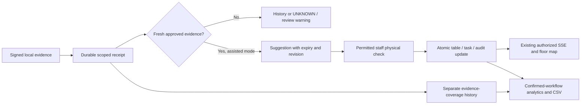

# Phase 7 plan: reviewed table workflow, analytics and CSV exports

**Phase 7 checkpoint verification — 2026-11-12:** Fresh complete regression passes **650 tests**, zero skips, plus **eleven browser groups** and frontend/Python checks. The founder verified A02 totals and opened its CSV in Excel. All 615 current baseline records, credentials/calibrations and the database volume are preserved. [The exact 55-file checkpoint review](PHASE_07_CHECKPOINT.md) records security findings and separate commit/push approval gates. Earlier 636/210-test results below remain historical.

**Later A02 Analytics correction — 2026-11-12:** The original DEMO scenario
summary gap is fixed with a read-only projection. Current follow-up verification:
210 relevant tests, eleven isolated browser groups and exact deployed A02 checks.
[Actual results](phase_explanations/PHASE_07.md#a02-demo-analytics-correction--2026-11-12).

**Prepared:** 2026-11-11, Asia/Dhaka. Stored event times remain UTC.
**Status:** Approved by the founder; implementation passes 636 tests and ten isolated browser groups. Separate business migration/activation approval was granted; exact additive `0009`, restricted grants and matching local API/web/TLS code are active. All 580 original records and protected credentials/calibrations are preserved; existing locations remain OFF. The design below preserves the original planning record. [Actual results](phase_explanations/PHASE_07.md) and [separate migration review](PHASE_07_MIGRATION_REVIEW.md) distinguish implementation, isolated synthetic tests and approved local activation from unverified real-world AI accuracy/public deployment.
**Foundation:** Published Phase 6 commit `fd983c7a656ab36f031db2900ef15a3da1362cbe`
on `main`. Its separately approved publication was verified on 2026-11-11 with
matching local, tracking and GitHub hashes. This planning task does not push or
recheck GitHub, run inference, access a database, or install software.
**Authority:** [MASTER_SPEC.md](MASTER_SPEC.md), development milestone 7 and
sections 7, 10, 11.4 and 13; [AGENTS.md](../AGENTS.md).
**Inputs:** [handoff](CODEX_HANDOFF.md), [roadmap](implementation_plan.md),
[Phase 6 explanation](phase_explanations/PHASE_06.md), actual API/edge/web source,
existing migrations, and the published [checkpoint review](PHASE_06_CHECKPOINT.md).

## 1. Exact approved roadmap and the safety boundary

The master milestone is **Cleaning workflow, analytics and exports**:

> Connect edge state-change events to staff tasks and dashboard updates. Implement
> one open reset-pending task per relevant table session, task acknowledgement,
> Start cleaning, Mark ready, and full audit logging. Implement daily/hourly
> occupancy, state durations, reset delay and simple CSV export with correct IANA
> time-zone handling. Add tests for date boundaries, missing-camera periods and
> manual overrides.

Its completion condition is a complete occupied-to-clean-to-available workflow
that is visible and reported correctly. This includes reports and exports, not
just new buttons on the floor map.

This plan proposes a **human-reviewed integration first**. An AI suggestion is
not an accepted business fact. While representative AI accuracy is unverified,
normal device observations cannot directly change operational occupancy or create
an operational cleaning task. A permitted staff member confirms a proposed
arrival/departure after checking the actual table. A confirmed departure creates
one reset task. Only a permitted human can confirm readiness.

This is a deliberate activation safeguard, not a claim that the blueprint's
future automatic occupancy behavior has been validated. Automatic arrival/reset
behavior is exercised only by explicitly isolated deterministic test fixtures.
Real unattended AI-to-operational-state activation remains blocked until footage,
evaluation, installation security and a separate founder decision justify it.
Vision can **never** independently confirm cleanliness or mark a table AVAILABLE.

Out of scope: public/pilot deployment, new cameras or footage permissions, model
training/downloads/replacement, facial recognition, audio, staff performance
scoring, POS/reservations, push notifications, predictions, billing, and Phases
8-10 implementation. No existing record, file, queue or volume may be reset.

## 2. What exists and what actually needs building

The latest completed Phase 6 verification recorded **529 passing tests**, one
existing warning and six real browser groups. It also recorded a 900.001-second
outage recovering 16 events, actual isolated database/API restart, and preserved
records/calibrations. These are dated results, not new tests for this proposal.

| Existing source | Actual behavior | Phase 7 work |
| --- | --- | --- |
| API `workflow.py`, `workflow_schemas.py` | Floor snapshots, tasks/actions/activity, ordered SSE and revision/idempotency checks already exist | Extend the workflow; preserve the existing DEMO contracts |
| `models.py`: `StaffTask` | One task row per table/session, plus at most one OPEN/ACKNOWLEDGED/IN_PROGRESS task per table | Reuse both uniqueness rules; handle corrections without duplicate tasks |
| `0003_dashboard_security.sql` | Staff acknowledge/start/ready; manager/admin block/reopen; task/state/event/audit/receipt commit together | Share controlled transition logic without treating a machine as a human |
| `device_protocol.py` | Version 1 sends scoped state/reason/context IDs, not numeric confidence or evidence duration | Add a separately versioned evidence contract; never invent missing confidence |
| `state_engine.py`, `analysis_config.py` | Local filtering, scores, geometry quality, temporal coverage and manual precedence exist | Capture a truthful summary at evidence/transition creation |
| `durable_engine.py`, `outbox.py` | Events and checkpoints commit before sending; immutable queued bytes | Preserve durability and old queued messages during protocol rollout |
| `0008_rejected_context.sql` | Ordered receipts, rejection/context boundary, shadow-only AI; stale/protected results become history | Derive suggestions atomically, with fresh policy/context checks |
| `edge_routes.py`, `edge-health.tsx` | Scoped health/latest shadows; old shadows go stale | Add reviewed suggestions and table-specific freshness, not a raw-payload browser |
| Dashboard `page.tsx` | Existing task controls and a separate shadow panel; some banners still describe the earlier DEMO-only floor | Update explanatory UI only when the new connection is genuinely enabled |
| Operational events/tasks | Saved state/timestamps; historical event payloads do not consistently identify occupancy sessions or reliable camera coverage | Add provenance/session/coverage records; label incomplete old history |
| Reporting | No implemented analytics or CSV endpoint | Build scoped aggregation, a manager report page and safe CSV |

The current ready action requires confirmation and ONLINE/VACANT operational
information. Phase 6 shadows do not populate those fields. Copying a shadow state
into them would silently change the safety boundary. Phase 7 must introduce a
reviewed evidence path, not reuse an old persistent DEMO VACANT observation as
proof about a real camera.

## 3. Three kinds of information, with separate authority

Useful terms: a **receipt** means the backend saved a message, not that the AI was
right. A **revision** is a version number used to detect a stale browser action.
An **occupancy session** is one recorded table-use episode, not a customer identity.
A **task attempt** is one proposed reset within that session, allowing an incorrect
attempt to be retained without creating duplicate task rows. **Idempotent** means
retrying the same request does not repeat its effects. **RLS** means database
rules that limit which restaurant/location rows an application request may see.

| Information | Meaning | What it can do |
| --- | --- | --- |
| AI observation | The local detector/association engine reports evidence | Update shadow information and, if enabled and eligible, a suggestion |
| Operational state | A permitted human confirmed the table workflow | Drive staff tasks, operational timers and confirmed-workflow reports |
| Source quality/health | What is currently observable and how recently | Withhold verified availability, expire suggestions and label report gaps |

Processing permission, human preview permission and workflow participation are
three separate approvals. Pairing or enabling background processing must not
implicitly grant camera preview or operational automation.

Proposed per-location modes, defaulting to OFF for every existing location:

- **OFF / shadow only:** preserve Phase 6. No operational suggestions/effects.
- **ASSISTED_REVIEW:** managers explicitly enable suggestions for approved
  camera/table/model/profile bindings. Staff must inspect and confirm before an
  operational arrival/departure is recorded. Initial activation is local and
  synthetic only; customer activation still requires separate approval.
- **Synthetic acceptance fixture:** internal tests only, requiring DEMO mode,
  an explicitly synthetic new test location, approved fixture bindings and the
  existing isolated-test-database restriction. It is not a menu option that lets
  real AI impersonate a fixture. Existing Phase 6 fixture permissions stay narrow.

Disabling assisted review supersedes pending suggestions, with audit history,
and prevents new ones. It does not erase tasks, undo staff choices, or silently
disable a separately approved edge processing lease.

## 4. What staff and managers will see

Keep the existing restaurant/location switcher, colored floor cards, timers,
task list and live connection indicator. Add a small **Needs review** area:

- "Table 4: possible arrival. Check the table before confirming."
- "Table 4: possible departure. This does not confirm the table is clean."
- Evidence age, source health, approved profile/model version, and a readable
  quality reason. A detector score is labeled as a model score, never accuracy.
- Confirm after physical check, dismiss, or request manager review. Stale,
  conflicted or withdrawn suggestions cannot be accepted from an old browser tab.

Example, using synthetic fixture evidence and human actions:

1. Table 4 is staff-confirmed ready. Its operational state is AVAILABLE.
2. Stable arrival evidence creates a suggestion. The floor does not silently turn
   occupied. Staff check, confirm arrival, and the server records OCCUPIED and a
   new server-controlled occupancy session.
3. Later, stable vacancy evidence creates a departure suggestion for that session.
   Staff check and confirm vacancy. The server enters RESET_PENDING and creates
   exactly one RESET task: "Table 4 may need cleaning."
4. Acknowledge records that someone saw the task; it does not mean cleaning began.
5. Start cleaning records CLEANING. Incoming AI cannot cancel that staff action.
6. After physical preparation and a current empty-table check, staff explicitly
   choose Mark ready. The task completes and the table becomes AVAILABLE.
7. The next report separates time occupied, waiting to clean and cleaning time.

Use the task wording "may need cleaning," not a vision-generated cleanliness
claim. Clicking a status is not permission to view CCTV. Staff without preview
permission inspect the physical table; the human preview system is unchanged.



## 5. State, task and manual-priority rules

| Trigger | Operational result | Safety requirement |
| --- | --- | --- |
| Eligible AI arrival/departure | Suggestion only | No direct canonical state/task mutation |
| Human confirms arrival | OCCUPIED; create or reuse the relevant canonical session | Current scope, table/proposal revisions, physical check and no protected-state conflict |
| Human confirms departure | RESET_PENDING; one RESET task for that session | A confirmed occupied session exists; fresh matching departure context |
| Acknowledge | OPEN to ACKNOWLEDGED | Matching active task; keep RESET_PENDING and its timer |
| Start cleaning | Task IN_PROGRESS; table CLEANING | Current RESET_PENDING task and expected revision |
| Mark ready | Task COMPLETED; table AVAILABLE | Explicit human confirmation, physical ready/empty check and allowed current readiness context |
| Manager blocks | OUT_OF_SERVICE | Preserve manager-only permission, reason and audit |
| Manager reopens | UNKNOWN | No automatic AVAILABLE; repeat the permitted readiness confirmation |
| Camera/AI/network becomes stale | Unverified display/UNKNOWN evidence; withdraw actionable suggestions | Never infer vacancy or readiness from loss of evidence |
| AI conflicts with CLEANING or OUT_OF_SERVICE | Conflict/history only | Preserve the manual state and timestamps |

Preserve Phase 3's tested DEMO behavior. New assisted actions use a distinct
validated path; they must not relax old mark_ready checks. In the new path,
source failure or conflicting current positive evidence blocks readiness by
default. A manager can investigate/correct the conflict, not silently override it
with a camera-derived ready state. An offline physical-inspection exception is
**not** proposed for this phase; it would need a separate safety decision.

Even a manually confirmed AVAILABLE state becomes **unverified availability**
when current source evidence is unavailable. Preserve the stored manual decision
and timer, show the warning, and exclude it from a currently verified-ready count.
Keep source confidence separate from a staff-confirmed cleaning fact.

A physical-check attestation is an authenticated human assertion with a timestamp,
scope and version, not independent proof that the person inspected or cleaned the
table. The backend enforces authorization and workflow rules, not the truth of
that person's statement.

## 6. Confidence, temporal evidence and a compatible device contract

### Why version 1 is insufficient

Version 1 contains no numerical score, window duration, sample coverage or
per-table recurring freshness evidence. It is also transition-oriented: an
unchanged table can have no new transition for a long time. A device heartbeat
proves contact, not that every table was just seen or is empty. Do not turn a
heartbeat or a missing transition into qualified table coverage.

Propose a strict **version 2** metadata schema, keeping the same bounded signed
HTTPS transport. It needs two distinguishable kinds: stable state transition and
bounded per-table evidence snapshot. Include only:

- Existing event/device/stream/sequence, organization/location/camera/table/binding
  IDs, binding epoch, source generation and UTC observation time.
- Occupancy-session context, current manual revision, calibration/profile/model
  hashes, and evidence-policy version/fingerprint.
- Evidence kind POSITIVE, VACANT or UNCERTAIN; fixed reason/quality codes; nullable
  detector/association scores with defined aggregation, not an invented probability.
- Analyzed sample count, covered duration, window duration, maximum observation
  gap, visibility-reviewed flag and measured frame age. Bound all numbers and
  relationships; NaN/infinity, unknown fields and arbitrary text are rejected.

Do not include bounding boxes, people identities, images, RTSP URLs, human
credentials or traces. The signed summary remains a device claim, not independent
verification of its correctness. A compromised authorized device remains a risk.

Record scores/coverage at the transition that produced them; do not attach a later
frame's score to an earlier transition. VACANT may have a null person score:
absence of a person detection is not a 100% confidence measurement.

Existing local defaults are entry score 0.6, retention 0.4, 10 seconds arrival,
25 seconds departure, minimum three samples, 80% temporal coverage, two-second
gap/fresh-result settings. These are **development settings, not validated
restaurant thresholds**. Carry the exact approved policy and compare evidence
against it. Missing visibility review, inadequate coverage, ambiguous association,
unsupported clock/context, changed geometry or low quality means UNKNOWN/review.

Start recurring snapshots at a proposed ten-second cadence per active table,
grouped into durable commits/batches rather than one event per frame. Immediately
report a meaningful evidence/health transition. Snapshot cadence and explicit
coverage expiry are distinct from the 15-second device heartbeat. Measure overhead
before finalizing these values; do not claim extra camera capacity. At 64 tables,
one hour at that cadence is approximately 23,040 snapshot records before other
events; this is arithmetic, not a measured disk/capacity result. Test queue limits
and lease expiry, and pause rather than evict pending records when full.

### Rollout without breaking old queues

Version 2 snapshots during CLEANING/OUT_OF_SERVICE may update the **separate
quality ledger** after authorization/context checks, never the operational state.
Otherwise the existing protected-state ingestion rule would suppress the fresh
empty-table information needed for a later human ready check. Keep v1's tested
protected/history behavior. A CURRENT_HUMAN_STATE echo, AVAILABLE/CLEANING state
or ordinary snapshot can never become an automatic arrival/departure/ready action.
Only the explicitly defined stable transition kinds can propose arrival/departure.
Test readiness after cleaning with fresh context, not stale pre-cleaning evidence.

Deploy/test a backend accepting explicitly supported v1 and v2 contracts before
enabling v2 sending through a server capability flag. Today unsupported versions
receive terminal rejection and a fresh-context boundary; sending v2 early is unsafe.
Keep frozen v1 schemas/hash behavior and all old queued bytes/IDs unchanged. Old
v1 messages remain shadow/history and cannot acquire fabricated v2 evidence.
Only new events use v2 after negotiation. Retain the mirrors/parity tests, body
limits, sequence/replay checks, SQLite commit barrier, TLS verification and finite
processing lease. No extra model or inference dependency is needed.

## 7. Safe processing, retries, ordering and conflicts

Prefer bounded synchronous derivation in the existing backend/PostgreSQL
transaction, not a new broker/service. When an ordered receipt reaches a terminal
classification, a narrowly controlled internal function considers it for the
current workflow policy and records a unique derived effect. Receipt, effect,
suggestion and durable SSE invalidation commit together. The acknowledgement
means durable receipt/derivation, not human approval or correct AI inference.

The live path checks all of the following again server-side:

1. Device/key status, tenant/location ownership and active camera/table binding.
2. Contiguous stream position, unchanged payload identity, supported schema and
   fresh source generation/context, including the 0008 rejection boundary.
3. Current processing/workflow approvals and exact calibration/model/profile/
   evidence policy versions. Enabling a policy applies only to fresh future
   evidence, not a replay of all stored receipts.
4. Source and table evidence freshness, window completeness and quality. Keep
   Phase 6's 30-second live-event age limit as an upper bound; proposed suggestion
   acceptance also requires a current matching snapshot no older than 15 seconds.
   Final bounds must be explicit/configured/tested, not silently extended on retry.
5. Current table, task and manual revisions. A later staff action or manager block
   wins. Human acceptance rechecks device/source/policy state after any lock wait.

One pending suggestion per relevant table/action/session is refreshed or
superseded. Refreshing does not make an old browser acceptance valid: its expected
suggestion version must match. Stale/conflicting suggestions cannot create tasks.
Unchanged evidence snapshots must not generate duplicate alerts or transition
events; coalesce UI invalidations when meaning has not changed.

Use a unique receipt/effect key, existing unique event IDs, server-controlled
session mapping and existing task constraints. Same request key/body returns the
original result only after current authorization is checked; changed body or stale
revision on a new request returns 409. An identical committed retry does not
reapply the operation or reset its timer. No read-then-insert race without a
database constraint.

Never send AI through browser DEMO routes, use a staff password for a background
worker, or fabricate a human actor. A human-reviewed change records the actual
human and links the originating evidence. Machine receipt actions retain device
audit provenance. Keep the existing global lock order: applicable device/binding
locks, table rows in stable order, then location publication row; human operations
must not acquire these in a conflicting order. Rollback/crash tests must prove
there is no receipt acknowledgement followed by a lost derived effect.

Delayed/out-of-order receipts keep their original UTC times/IDs. Pending gaps,
history-only, revoked, rejected, stale or superseded evidence cannot rewind a
live timer, create a new live task or undo a staff decision. Historical evidence
can be labeled for report coverage only when its timing/context are defensible;
otherwise retain an unknown gap. No catch-up replay of old staff alerts.

## 8. Incorrect predictions and corrections

Most errors stop before operational impact: uncertain evidence does not create an
actionable suggestion; staff can dismiss a wrong suggestion with a fixed reason
such as staff_crossing, wrong_table, guests_still_present or insufficient_view.
Keep the evidence link and decision for debugging; dismissal is not model training.

For an already accepted mistake, provide a manager correction flow with expected
table/task/session versions, physical verification and a reason. Preserve the
original event and add a correction record; never delete or silently rewrite it.
Correcting occupancy does not itself confirm cleanliness or mark ready.

Important uniqueness edge case: the existing task constraint permits **one task
row ever per table/session**, not unlimited replacement tasks after cancellation.
If a false departure was confirmed and guests are still present, cancel that reset
attempt, restore the reviewed occupancy context, and keep the same task identity.
If the same session later genuinely departs, reopen that task with a **new audited
attempt**, not a second task row. Proposed append-only attempt history preserves
the cancelled attempt/times; the task row remains the current projection.
Its original created_at is not rewritten. Expose current_attempt_started_at/
pending_since for the current task timer, and use valid attempts for analytics.

After a completed ready confirmation, a genuine new occupancy session receives a
new task identity on its later departure. Any attempt to reopen a completed task
from old evidence is rejected. If staff have started cleaning or a manager blocked
the table, new arrival evidence becomes a conflict, not automatic cancellation.
Ambiguous return/restart/party/session mapping requires manager review; never
invent a new visit simply because an edge process restarted.

## 9. Proposed additive database changes

Final names/revision grouping are to be settled during implementation. The latest
recorded head is 0008; confirm it before reserving 0009/0010. Reuse tables,
task statuses, receipts and publication infrastructure that already exist.

| Proposed structure/change | Purpose and constraints |
| --- | --- |
| Location workflow policy and policy history | OFF default; reviewed binding scope, evidence rules, version, actor, enabled-after boundary; immutable history |
| Workflow suggestions | Scoped source receipt/session, target action, eligibility/reason, expiry, expected operational revision and proposal version; unique source/effect and bounded active suggestions |
| Derived effect / human decision records | Exactly one receipt consideration; immutable approve/dismiss/correct outcome, real actor, prior/result versions, evidence link and idempotency fingerprint |
| Occupancy session details/mapping | Server canonical session linked to table and source episode; confirmed arrival/vacancy times, provenance, correction links; no source UUID trusted across devices/locations |
| Reset task attempts | Unique task/attempt number, original/current lifecycle times and cancellation/completion/correction provenance; one current attempt; original task uniqueness retained |
| Table evidence/coverage intervals | Bounded summaries and known/unknown intervals with generation/config/time basis; distinct from operational table state; no per-person identities or raw frames |
| Event/task supplemental fields | Nullable session/provenance/correction/current-attempt links and actor basis as needed; preserve old rows and published contracts through explicit adapters |

Every new scoped entity needs organization/location keys, immutable ownership,
composite references for receipt/device/table/task/session, backend role checks,
RLS, suitable indexes and bounded reads. Do not grant runtime direct broad
mutation or private identity-schema access. SECURITY DEFINER functions use fixed
safe search paths, narrow grants and internal helpers inaccessible to clients.
RLS does not remove owner/superuser bypass; preserve a non-owner/non-superuser
runtime without BYPASSRLS. [PostgreSQL's RLS reference](https://www.postgresql.org/docs/16/ddl-rowsecurity.html)
documents those limits.

Legacy records retain their actual provenance, not a new claim that they were
AI-confirmed. Backfill only facts that are provable from existing history. Where
older events cannot identify a complete session, report state-time totals with
an incomplete-history flag; do not invent visit counts or full session durations.

### Migration execution gates after implementation approval

1. Capture a fresh private inventory of current records, original container/volume,
   users/password hashes, credentials, calibration and seating files. The earlier
   533-record snapshot is historical, not permission to overwrite newer records.
2. Create/inspect a new private backup; preserve earlier archives.
3. Restore to a new isolated test database. Rehearse migration, repeated upgrade,
   old reads/actions, runtime grants/RLS, constraints and model/schema comparison.
4. If a new unique constraint finds conflicting old data, stop and report it;
   never delete, merge or cancel records automatically to make migration succeed.
5. Present exact migration risks/results and obtain separate approval before
   applying to the existing database. Use bounded lock/statement timeouts.
6. Apply forward only; preserve frozen 0001-0008 SQL and existing credentials.
   Compare every protected original row/file afterward, allowing only explicitly
   documented counters from approved runtime activity. No automatic downgrade or
   restore over the business database.

## 10. APIs, sessions, tenant isolation and browser behavior

Keep the existing human session/CSRF/origin and device signature systems separate.
Suggested routes below are **not implemented**. Publish typed schemas/OpenAPI and
negative authorization coverage before connecting UI controls.

| API | Proposed authorization and behavior |
| --- | --- |
| Existing POST `/v1/edge/events`, `/v1/edge/heartbeat` | Existing device identity only; compatible bounded evidence/capability support; never staff-ready permission |
| GET `/v1/locations/{id}/workflow` | Staff/manager/admin with explicit grant; one consistent operational/task/suggestion/freshness cursor snapshot |
| GET `/v1/locations/{id}/workflow-suggestions` | Same operational roles/grant; bounded keyset pagination and fixed safe fields |
| POST `/v1/locations/{id}/workflow-suggestions/{suggestion}/decisions` | Staff normal arrival/vacancy confirmation or dismissal; manager-only correction/conflict resolution; CSRF, physical-check attestation, request key and expected versions |
| POST `/v1/tables/{id}/workflow-actions` | Explicit new reviewed ready/inspection action where required; permitted staff, current task/session/evidence and finite one-use attestation; no arbitrary state setter |
| Existing POST `/v1/tables/{id}/actions` | Preserve acknowledge/start_cleaning/mark_ready and manager-only block/reopen semantics; share safe transaction logic rather than weaken old gates |
| GET/PUT `/v1/locations/{id}/workflow-policy` | Manager/owner/org_admin with grant; writes require CSRF, expected policy revision and audited explicit confirmation |
| GET `/v1/locations/{id}/analytics` | Manager/owner/org_admin plus grant; bounded dates, group, basis, table filter; no raw payloads |
| GET `/v1/locations/{id}/analytics.csv` | Same report scope/role and calculation; no public export links |
| Existing location activity/tasks/stream | Preserve current contracts; add explicitly typed proposal/correction/attempt/quality invalidations and optional safe fields |

Installers cannot approve operational suggestions or read analytics merely because
they can configure a camera. Devices cannot read reports or use human actions.
Owners/admins still require explicit location grants. Staff cannot block/reopen
tables, change evidence thresholds or resolve managerial corrections.

Foreign tenant/location table, task, source, suggestion, session and receipt IDs
must be rejected even if the caller can access both places. Derive ownership
server-side; do not trust organization_id in a body. Use consistent not-found
errors and scoped composite keys. Recheck after waits and before idempotent replies.

GET reports, export reads, suggestions, passive viewing and SSE do not refresh
human idle expiry. Absolute expiry always applies. Only eligible intentional
CSRF-protected human writes count as activity; a background poll or device message
does not. Preview grants/deadlines and device restart reauthorization stay separate.
Recheck stream/export permissions during bounded streaming work; revoke on the
next authorization boundary, without promising recall of bytes already delivered.

On restaurant/location switch, clear old results and abort/ignore old fetches.
Use the existing shared durable location cursor for ordered notifications; publish
only after commit. A stale tab displays STALE, disables unsafe actions, reloads a
snapshot and receives a useful 409 when it attempts an obsolete action. Do not
queue new staff confirmations offline. Retrying an already submitted request must
retain its original request key and body, not silently issue a second operation.

## 11. Analytics: exact meanings before writing queries

Use saved events/session/task-attempt history, not a count of current table rows
or SSE deliveries. Repeated snapshots, acknowledgements and same-state events do
not restart a state interval or create extra visits. Return units, basis, sample
count, incomplete/censored count, coverage and calculation version with metrics.

| Report metric | Proposed definition |
| --- | --- |
| Recorded state duration | Elapsed UTC seconds in each operational state intersected with the report window, including UNKNOWN and OUT_OF_SERVICE |
| Hourly/daily recorded occupancy | OCCUPIED state-time by table/bucket from accepted operational events; label as recorded/confirmed workflow, not measured real-world occupancy accuracy |
| Average occupied duration | Complete valid confirmed arrival-to-vacancy sessions; separate sessions crossing boundaries/open at cutoff and report the denominator |
| Wait to start cleaning | Valid attempt started_at minus its pending_since; acknowledgement does not end this wait |
| Cleaning duration | Valid staff-completed attempt completed_at minus started_at |
| Reset delay / time to ready | Valid completed reset attempt completed_at minus pending_since, including waiting and cleaning; separately display pending-state duration |
| Completed resets / turnover | Count valid staff-confirmed completed attempts/sessions by completion time; do not count CANCELLED rows just because completed_at is populated |
| Live/open work | Open/current attempt age as of a stated report cutoff; never treat an unfinished duration as zero or a completed reset |
| Evidence coverage | Qualified table-time divided by configured usable table-time; show missing, uncertain, interrupted and unconfigured time separately |
| Optional observed occupancy estimate | Supported occupied evidence-time divided by known/qualified evidence-time; label ESTIMATED, include coverage and exclude unknown gaps |

Initial calculation policy: completed-session/attempt averages use records ending
within the requested period and their full valid durations, even when they began
earlier. State-time bucket totals instead clip to each bucket. Explicitly label
that difference; provide cross-boundary/open counts. Missing essential timestamps,
clock inconsistencies or unresolved corrections are excluded with reason counts,
not silently clamped or filled. Empty denominators produce null/not enough data.

Example: ten tables over an hour provide 600 table-minutes. If 100 are out of
service, there are 500 usable table-minutes. If only 300 have qualified known
evidence and 180 are occupied, the estimate is 60% occupied with 60% coverage,
not proof of 60% occupancy for all tables. This is a calculation example, not a
measurement of the restaurant or model.

Preserve separate CONFIRMED_WORKFLOW, ESTIMATED_EVIDENCE, LEGACY and DEMO/fixture
bases. Never mix fixture or shadow data into confirmed customer totals. Human
acceptance timing uses server-recorded confirmation time within the committing
transaction; show earlier AI observed_at separately
as an estimate. Do not backdate operational timers from delayed device events.
Reports describe recorded workflow, not exact seating time before someone checked.

## 12. Missing periods, corrections and time zones

Build half-open intervals `[start, end)` using an event predecessor at/before the
window and the next actual transition or report cutoff. No predecessor means
unknown history; the current row is not evidence of the whole previous day.
Count only time after a table was created/configured. Preserve state and source
quality as separate timelines, so manually confirmed CLEANING can remain recorded
while camera coverage is unknown. Do not fill a camera gap with AVAILABLE.

Per-table snapshots establish bounded known intervals under the approved evidence
policy; no new snapshot past expiry closes coverage to UNKNOWN. A fresh heartbeat
alone cannot reopen per-table coverage. Clock-uncertain/late offline evidence is
marked separately and cannot repair live readiness. A later correction retains
the original history, excludes invalid attempts from confirmed summaries, and
shows the correction count and calculation cutoff/version.

Date input is interpreted in the **location's stored IANA zone**, not the founder's
Bangladesh zone or browser zone. Proposed API: `from=YYYY-MM-DD` inclusive and
`to=YYYY-MM-DD` exclusive; the UI can translate an inclusive end-date picker.
Convert local boundaries to UTC, split intervals at real bucket boundaries, and
subtract UTC instants for elapsed seconds. Do not assume a local day is always
86,400 seconds. A repeated fall-back hour needs UTC bucket boundaries and offset
in its label; a missing spring-forward hour must not be fabricated.

Use existing Python `zoneinfo`/available tzdata and PostgreSQL timezone facilities.
Python documents IANA data lookup, Windows fallback and repeated-time handling in
[zoneinfo](https://docs.python.org/3/library/zoneinfo.html); PostgreSQL documents
timezone conversion and truncation in its [date/time functions](https://www.postgresql.org/docs/16/functions-datetime.html).
The planned algorithm above is our application design, not a claim that these
libraries already implement this report. Test the deployed timezone-data versions.

Use America/New_York 23/25-hour transition days, Asia/Dhaka, a half-hour zone,
midnight/month/year boundaries and invalid zones in fixtures. Explicitly handle
unsupported/ambiguous date boundaries; never silently substitute UTC. Report using
the selected location zone as it exists at query time and include that zone in
metadata; historical timezone-change policy must be documented, not inferred.

## 13. Reporting UI, consistent queries and CSV safety

Add a manager Analytics link/page with a date picker, hourly/daily view, table
filter, quality/coverage banner, readable bar charts and a matching data table.
Display reset waiting time separately from time-to-ready. No service-delay or
individual staff productivity claims. Existing HTML/CSS is enough for initial
charts; do not install a charting package merely for the first report.

Use one authorized shared aggregation service for JSON and CSV. Each response
uses a consistent database snapshot and a captured server as_of time/publication
revision. Include range, zone, basis, calculation version, correction/coverage
metadata and cutoff in both formats. Separate requests can see new commits:
refresh/label the export cutoff instead of pretending it is the earlier preview.
Do not promise reproducible historical snapshots that the stored records cannot
reconstruct. Test JSON/CSV equality for the same inputs and stable snapshot.

Initial proposed limits: at most 31 local days, 100 tables and 20,000 exported
rows, plus measured query timeout/concurrency limits. Reject oversized requests
with a clear message or require a smaller range; never silently drop rows. Use
bound parameters, allowlisted group/basis values and indexes. No cross-tenant
cache or unsafely shared report result. Avoid recalculating a full report on every
heartbeat: show a refresh notice or use a bounded debounce for the live period.

Generate CSV using Python's existing csv module and typed server fields. Export
aggregates/operational IDs and reviewed table labels only: no passwords, camera
sources, signatures, raw event JSON, user emails, private audit details or video.
Set private/no-store and a safe server-generated filename; reauthorize every export.

Treat labels as untrusted spreadsheet text. CSV quoting alone is insufficient.
Normalize control characters in exported text, detect leading whitespace/control
and formula prefixes including full-width variants, and prepend a visible literal
text prefix to dangerous labels. Preserve original database labels and document
the export transformation. Test commas, quotes, newlines and formula payloads.
[OWASP's CSV guidance](https://owasp.org/www-community/attacks/CSV_Injection)
explains formula interpretation and why quote/apostrophe techniques can fail on
spreadsheet save/reopen. Actual Excel/LibreOffice round trips need installed
authorized software and must be labeled NOT VERIFIED if unavailable; no
spreadsheet dependency is installed by this plan.

## 14. Technologies, dependencies and unresolved risks

Reuse Python/FastAPI/Pydantic, PostgreSQL 16/SQLAlchemy/Alembic, SQLite/HTTPX,
approved Ed25519/signature packages, OpenCV/ONNX Runtime/RF-DETR, Next.js/TypeScript
and SSE. Use standard csv, datetime and zoneinfo; tzdata is already present in
the working environment. No new package, GPU, broker, Redis, Celery, training
pipeline or cloud video service is proposed. Recheck API-image/CI timezone support
during implementation. An unexpected dependency needs exact review and approval.

| Remaining issue | Consequence / planned handling |
| --- | --- |
| No authorized representative person footage | No person recall, wrong-table, occupancy or false-reset accuracy claim; assisted/synthetic operation only |
| Empty synthetic MP4 | Can prove decoder/model execution and UNKNOWN handling, not positive person recognition; use separately labeled deterministic evidence fixtures for workflow tests |
| Model startup/load sensitivity and old unexplained worker exit | Keep bounded fail-closed supervision; controlled sequential tests and long-running measurement before pilot; do not raise timeouts just to pass |
| Local processing only supports one active synthetic MP4 | No physical webcam/RTSP, customer-camera, unattended service-account or simultaneous multi-camera capacity claim |
| Queue/receipt/coverage growth | Measure added snapshots, disk quota and SQLite flush overhead; no dropping pending events or deleting receipts; retention/compaction remains a separate reviewed task |
| Recorded npm/pip/pytest advisories | Latest November 11 review includes eight npm findings, six pip issues and a pytest issue; no upgrade here. Separate reviewed remediation before public/pilot use |
| Weak preserved administrator password | Keep it private; approved rotation/recovery procedure required before deployment, not a silent Phase 7 change |
| Missing production TLS/MFA/recovery/hardening/external review | Phase 7 is not a public/pilot approval; local one-hour lease stays local-only |
| Legacy incomplete sessions/coverage | Report unknown/incomplete data; no fabricated backfill or trustworthy past occupancy estimate |
| Advisory/security/accuracy evidence has limits | See [dependency review](PHASE_06_DEPENDENCY_REVIEW.md); no fresh vulnerability audit or real-world evaluation was run for planning |

All video stays local. Do not open `SR.mp4` or other recordings; authorization is
still absent. Do not introduce biometric identifiers or private clips into logs,
test fixtures, analytics, exports or Git. Tenant isolation does not itself satisfy
customer consent or jurisdiction-specific legal requirements; those remain
deployment review items, not legal conclusions from this plan.

## 15. Expected files after implementation approval

Names below are proposed, not files created by this planning task:

| Area | Expected changes and purpose |
| --- | --- |
| `packages/contracts/` and API/edge protocol mirrors | Frozen v1 plus bounded v2 evidence, capability and parity tests |
| Edge `analysis.py`, `state_engine.py`, `durable_engine.py`, `device_runner.py` | Truthful window summaries, periodic snapshots, durable grouping and unchanged lease/manual safeguards |
| API new `workflow_review.py`, `workflow_models.py`, `workflow_review_schemas.py` | Policies, reviewed suggestions, scoped transitions, correction/attempt provenance |
| API new `analytics.py`, `analytics_schemas.py` | UTC interval calculations, quality-aware JSON/CSV and authorization |
| Existing `models.py`, `workflow.py`, `main.py`, `management.py` | Safe model/router/grant integration, compatible task/actions/SSE; no duplicated DEMO ingestion path |
| New forward migration versions/SQL | Additive metadata, constraints, indexes, policies and reviewed functions after head verification |
| Web dashboard/types and new review/analytics components/page | Safe suggestions/physical confirmation, source-aware availability, task attempt timers, responsive reports/export |
| API/edge tests and browser scripts | Evidence compatibility, effects/permissions, corrections, analytics/CSV, migrations, security and complete walkthrough |
| `docs/phase_explanations/PHASE_07.md` and index | Actual implementation explanations, file purposes, Windows commands, observed tests/failures/limits after development |
| Architecture/API/handoff/roadmap docs | Current implemented behavior distinguished from this proposal and older historical evidence |

Do not create a Phase 7 completion explanation now: this is not a completed
development phase. Add it when there are implemented features and actual results.

## 16. Step-by-step implementation milestones

1. **Confirm the decision and baseline.** Obtain Phase 7 approval including the
   assisted-review/ready/correction/report definitions. Read permanent rules,
   inspect the current tree, rerun all 529 cases with private native-model opt-in
   enabled, and retain every failure rather than treating the old pass as current.
2. **Freeze domain contracts.** Define state/action precedence, canonical session
   mapping, task attempts, null/quality semantics, report metrics and typed v2.
   Write deterministic failing cases for conflicts, corrections and time boundaries.
3. **Rehearse additive storage.** Inventory/back up, build forward migrations,
   restore to an isolated database, prove preservation/grants/RLS/uniqueness and
   repeated upgrade. Do not apply to the business database without separate review.
4. **Implement the reviewed workflow service.** Keep receipt processing bounded
   and atomic; implement policies, suggestion lifecycle, current authorization,
   idempotent human decisions and audited task-attempt correction. Test with
   deterministic signed metadata in isolated synthetic tenants first.
5. **Add negotiated evidence reporting.** Backend v1/v2 support first, then edge
   summaries/snapshots and durable batching. Preserve queued v1 bytes, one-hour
   lease, source cleanup, human preview and manually confirmed states. Verify with
   the actual model on geometric MP4 without claiming person accuracy.
6. **Connect the live floor and staff UI.** Add suggestions and explicit physical
   confirmations, safe conflict explanations, unchanged protected task controls
   and ordered SSE snapshots. Verify two tenants and same-tenant separate locations.
7. **Build reports from saved history.** Implement UTC interval/attempt/session
   calculations, gaps/corrections/legacy flags, local buckets and bounded APIs.
   Reconcile hand-calculated fixtures before drawing charts.
8. **Add manager reports and safe CSV.** Display metric explanations/coverage,
   filters, honest cutoff metadata and sanitized export text; test role revocation,
   large requests, locale and malicious labels.
9. **Review business activation.** Present exact migration/rehearsal and package
   risks. After separate approval, apply only additive changes and rebuild/replace
   only necessary application services, preserving DB/container/volume/credentials.
   Enable only a new approved synthetic workflow, not existing customer operations.
10. **Final regression and founder walkthrough.** Run the full retained suite,
    new targeted/security/browser checks sequentially where native inference is
    involved; fix errors and rerun affected tests then the necessary full regression.
    Compare original rows/credentials/calibrations/files. Document actual counts,
    timings, failures, simulated vs actual-model evidence and remaining gates.
11. **Stop.** Explain Phase 7 and supply the Windows walkthrough/manual checklist.
    No Phase 8, commit, push or public/pilot activation without separate approval.

## 17. Testing strategy and acceptance criteria

Preserve all 529 existing tests. A future pass must include opted-in actual-model
cases rather than quietly skipping them. Unit geometry/threshold tests, signed
synthetic transport tests, actual RF-DETR on empty generated video, browser tests
and representative authorized-person evaluation are different kinds of evidence.

| ID | Required acceptance check |
| --- | --- |
| P7-01 | OFF remains the default after migration; all old rows/contracts and 529 earlier cases are preserved. No existing tenant silently joins a workflow |
| P7-02 | A signed eligible event creates at most one scoped suggestion. Low quality, missing v2 evidence, invalid/old generation, changed profile, unsupported version and stale source cannot change an operational state |
| P7-03 | Staff-confirmed arrival -> departure -> one task -> acknowledgement -> CLEANING -> explicit confirmed AVAILABLE is visible through real APIs/SSE and recorded in reports, with every actor/evidence link |
| P7-04 | No device message, empty frame, snapshot, reconnect, UNKNOWN, cancellation, time expiry or manager reopen can automatically mark a table AVAILABLE |
| P7-05 | Duplicate batches, lost acknowledgements, concurrent posts and restart replay leave exactly one task row/session, one active task/table, one effect/decision per key and correct durable audit/publication |
| P7-06 | Simultaneous staff actions, source updates, revocation and manager block serialize safely. Stale tab/version returns 409; cleaning/blocks and later manual decisions win |
| P7-07 | Dismissal creates no task. A manager-corrected false departure preserves the old attempt; a later valid departure reuses the same task/session with a new attempt and correct timers/metrics |
| P7-08 | Cross-restaurant and same-restaurant/ungranted-location reads/writes/streams/proposal IDs/task IDs/reports/CSV all fail in both directions; installer/device/anonymous roles cannot perform staff/report actions |
| P7-09 | Passive polls/reports/CSV/SSE do not extend idle expiry; absolute expiry, logout, membership/grant changes and separate preview/device permissions still apply |
| P7-10 | Out-of-order/gapped/15-minute-delayed evidence, processing-lease expiry, offline restart and stale model output cannot rewind timers or generate historical live alerts; queue contents survive failures |
| P7-11 | v1 queued events keep byte/hash identity and safe shadow behavior during v2 rollout. Unsupported capability/version and malformed/oversized/nonfinite/private fields fail closed; restart obtains fresh authority |
| P7-12 | Hand-calculated report fixtures reconcile state-time totals, per-session averages, valid reset attempts/completions, cancellations, open/cross-boundary sessions, corrections and null denominators |
| P7-13 | Date/DST fixtures cover 23/25-hour New York days, distinct repeated-hour buckets, midnight/month/year, Dhaka/half-hour zones, invalid zones and predecessor/missing-history cases without duration double-counting |
| P7-14 | Camera/model/network gaps and heartbeat-only contact reduce coverage, never imply empty/ready. Confirmed, estimated, legacy and DEMO bases stay separate in JSON, charts and CSV |
| P7-15 | CSV uses the same scoped formulas, exposes cutoff/quality/units, rejects oversized exports and safely encodes malicious labels; expired/revoked sessions stop further authorized streaming |
| P7-16 | Real browser walkthrough works at desktop/mobile with keyboard/text status cues, location switches, lost-response retry, SSE disconnect/reconnect and no horizontal overflow |
| P7-17 | Fresh restored-backup migration and post-activation checks preserve every then-current protected record, ten existing users/passwords, Revision 7, seating Revision 1 and all original files/volumes; zero model differences |
| P7-18 | Network/body/log checks show only allowlisted metadata, no raw video/credentials. There are no new downloads/installs, production activation or accuracy claims hidden in the demonstration |

Fault injection must include crashes before/after receipt, effect, task and audit
commit; policy changes while a suggestion is open; conflict between a renewed
camera generation and an old human confirmation; disk full/queue capacity and
blocked sender/lease expiry. Retain no-loss/no-duplicate assertions.

Measure receipt-to-suggestion/dashboard and human-acceptance-to-task/SSE latency
separately under a documented local load; aim for the master's under-five-second
receipt-to-visible-update target without including human thinking time. Report
observed values, percentiles/sample sizes and hardware, not a pilot guarantee.
Measure queue/disk/CPU/memory growth from snapshots; no invented capacity claims.

The master's >=90% accuracy and <=1 false-reset-per-table-shift values are future
pilot targets, **not Phase 7 test results**. Representative evaluation needs
explicitly authorized dining clips, independent labels, at least two placements,
day/evening, busy/empty, occlusion, staff crossings and interruptions. Measure
per-state precision/recall, assignment errors, UNKNOWN coverage, false reset
alerts and transition delay. A good synthetic integration run cannot satisfy that
evaluation. Full measured-pilot tooling remains the later approved roadmap.

## 18. Windows 11 verification and manual demo after implementation

These are future execution instructions, **not commands run for this plan**.
Use the existing project environment; install nothing unless separately approved.
Start only the already configured local stack per the
[Phase 6 instructions](phase_explanations/PHASE_06.md#windows-11-run-and-test-instructions).
Never run migrations against the business DB as a side effect of a test command.

```powershell
Set-Location E:\Restaurent_startup
# Use the marked isolated test database/manifest, never the restaurant database.
$env:RFDETR_TEST_CATALOG = (Resolve-Path .secrets/phase5/models/catalog.json).Path
.\.venv\Scripts\python.exe -m pytest services/api/tests services/edge-agent/tests `
  -q -p no:cacheprovider --tb=short
.\.venv\Scripts\python.exe -m ruff check --no-cache services/api services/edge-agent
.\.venv\Scripts\python.exe -m pip check
Push-Location apps/web
.\node_modules\.bin\tsc.cmd --noEmit --incremental false
npm.cmd run lint
npm.cmd run build
Pop-Location
```

The implementation explanation must add the actual new targeted/browser/migration
commands and results. Do not present proposed test filenames as scripts already
available. Run model suites and browser inference sequentially; keep failure logs.

Founder walkthrough: sign in at localhost:3000, choose the new synthetic test
location, enable reviewed suggestions as its manager, then use signed fixture
evidence to demonstrate confirm arrival/departure, one task, acknowledge, cleaning
and checked readiness. Dismiss an incorrect suggestion, show a manager correction,
disconnect/reconnect, switch to Restaurant B, and verify separate analytics/CSV.
Run the actual geometric MP4/model separately to show UNKNOWN without people.
State clearly which part is simulated and which part actually ran the detector.

## 19. Decisions requested before implementation

| Decision | Recommendation for founder approval |
| --- | --- |
| Initial AI authority | Assisted human review only, OFF default, synthetic local activation; no unattended real AI operational updates |
| Staff vs manager | Staff normal physically checked arrival/vacancy/ready confirmations; managers handle corrections/conflicts, policy, block/reopen |
| Readiness during uncertainty/outage | Fail closed; no offline-readiness exception in Phase 7; preserve existing DEMO semantics separately |
| Evidence compatibility | Strict negotiated v2 summaries/snapshots; v1 shadow compatibility and immutable queued events retained |
| Repeated reset after a corrected false departure | Same unique task/session plus append-only attempt history; preserve cancelled history and correct reporting |
| Reporting basis | Separate recorded confirmed workflow and estimated evidence, with coverage/null/incomplete flags and explicit local-zone metrics |
| Installation/migration | No new dependency planned; exact risks/backup rehearsal and separate approval before any install or business migration |

The founder can approve the plan with these defaults or revise them. A planning
approval does not itself authorize public deployment, new person footage, package
upgrades, model downloads, a Git commit/push or later-phase development.

## 20. Historical planning verification and outcome (2026-11-11)

This task read the permanent rules, master, handoff, roadmap and Phase 6
explanation, checked the published checkpoint evidence and actual source contracts,
and consulted official time-zone/RLS/CSV references. It created this proposal and
updated documentation links/current publication status. It did not run the product
suite, perform a new vulnerability audit, decode video, train/infer, connect to a
database, start/change containers, install packages, stage, commit or push.

Documentation verification on 2026-11-11 checked all **198 pre-existing tracked
files** against a private starting hash inventory. All remain present; only eight
tracked documentation files changed, plus this new plan. Application/test code,
dependency/configuration files, the master specification, `.env`, Git configuration
and HEAD remain unchanged; there are no staged changes or deletions. The check
validated **241 local file links across 38 Markdown files**, **30 sensitive-path
ignore probes**, and strict whitespace in the changed documentation/new plan.
Known-value/pattern review found no actionable new secret disclosure; this does
not resolve the previously recorded weak administrator credential. These are
documentation/repository checks, not a new database-preservation or product test.

The recorded 529-test result and six browser groups remain Phase 6 evidence.
No Phase 7 functionality or new accuracy result exists. After approval, the
implementation must produce `docs/phase_explanations/PHASE_07.md` with actual file
changes, technologies, execution flow, Windows commands, tests, failures/solutions
and remaining limitations, and update the explanation index.

Phase 7 will turn local observations into a reviewable staff workflow and honest
reports. The trust boundary is explicit: AI suggests, permitted humans confirm,
the database preserves the audit trail, and uncertainty remains visible.
