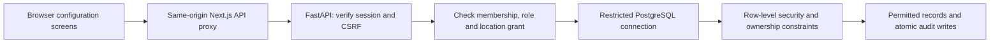

# Restaurant AI Monitoring Architecture

**Phase 4 boundary:** [The phase explanation](phase_explanations/PHASE_04.md) records a Windows-native loopback companion, a supervised video-only decoder and a single latest-frame mailbox. A per-human API session revalidates role/location/explicit camera consent and idle/absolute deadlines. Only IDs, permissions, geometry and audits cross the API boundary; frames and CCTV credentials stay local. A narrow literal-private-IP RTSP/TCP gateway injects Windows-store credentials and rejects other destinations. Additive 0005/0006 provide immutable complete calibration revisions, audited preview grants and a passive session deadline helper. The existing dashboard/SSE never receives camera occupancy in this phase. Physical webcam/RTSP interoperability, independent codec audit and native exploit sandboxing are unverified.

**Status:** Phases 0–4 implemented locally. Synthetic local video/calibration is verified; physical hardware, AI detection, device sync and analytics remain unverified/planned.
**Source:** `docs/MASTER_SPEC.md`

Current source includes local Argon2id authentication, revocable server sessions, strict scoped configuration APIs, explicit memberships/location grants, backend authorization plus RLS, atomic audits, and a DEMO dashboard with saved states/tasks/history and SSE. Phase 4 adds local video readers and camera credential storage; device enrollment/synchronization, inference, analytics and billing remain planned. See [PHASE_03.md](phase_explanations/PHASE_03.md) for current evidence and limits; Phase 2 records remain historical.

## Implemented Phase 3 workflow

The browser loads a consistent PostgreSQL snapshot through the fixed Next.js proxy, then subscribes to an authenticated location stream. A controlled database action function checks current location/role, expected revision and duplicate key, then commits state/task/event/audit/receipt together. Staff cannot generally update table state/configuration columns. Location publication locks preserve committed event order. All new operational tables have RLS and composite scoped references.

GET/SSE reads use passive session validation and cannot refresh idle expiry. Streams use short transactions between bounded replay batches and two-second heartbeats, with disconnect cleanup and per-process admission limits. Active CSRF-protected mutations refresh idle activity but never absolute expiry. The proxy streams incrementally with separate connection/read deadlines; reconnect refreshes the snapshot. Browser selection changes cancel previous reads/streams and clear previous location data.

Synthetic inputs require enabled DEMO_MODE, a marked synthetic location and an assigned manager/admin. They are explicit inputs, not an automatic background simulation or real video frames. Source failure makes unconfirmed observations UNKNOWN while preserving manually confirmed ready/cleaning/blocked states and timestamps, as the founder approved. Offline-source readiness is not counted as currently verified; browser outages show STALE and pause actions. Reopening requires a new ready confirmation. No actual camera-health or measured-confidence claim is made.

## Implemented Phase 2 request boundary



The proxy uses a fixed server-side upstream and forwards cookies/CSRF without trusting client identity headers. Session tokens stay in HttpOnly cookies, with only token digests in the private database schema. Transaction-local `app.user_id` comes from the verified session; row policies derive permissions from enabled database memberships/grants. Request IDs never establish permission. Strict API filters and composite foreign keys prevent cross-location associations, and ownership triggers prevent reparenting.

Runtime uses a non-owner, non-superuser login without `BYPASSRLS` or migration powers. Administrative migration credentials stay outside the running API. Privileged helper functions have fixed search paths and restricted execution grants. Local HTTP cookies are development-only; non-development settings require Secure cookies and HTTPS allowed origins. Managed MFA/recovery and production hardening remain open.

Revisions 0001/0002 create organizations, locations, users, sessions/throttle records, memberships/grants, camera/table/zone metadata, and audits. The founder approved deferring devices/events/tasks and the camera-device foreign key to later migrations. No raw video is read or uploaded by Phase 2.

## Scope

The MVP is a modular monolith with three deployable parts:

1. `apps/web`: Next.js and TypeScript dashboard.
2. `services/api`: FastAPI application with PostgreSQL and Alembic.
3. `services/edge-agent`: Python process that reads an authorized MP4, webcam, or RTSP source, performs local detection, maintains table state, and queues minimal events in SQLite.

Docker Compose is the initial local and pilot packaging mechanism. Microservices, Kubernetes, continuous cloud video, and distributed training are out of scope.

## Data flow

```text
Authorized camera or MP4
  -> edge VideoSource
  -> sampled frames
  -> replaceable PersonDetector
  -> normalized table-zone association
  -> deterministic TableStateEngine
  -> SQLite outbox
  -> authenticated HTTPS event batches
  -> FastAPI validation and idempotent persistence
  -> PostgreSQL current state and history
  -> SSE dashboard updates
```

The edge sends table state transitions, health, confidence, timestamps, and quality metadata. Raw video stays local by default. Any diagnostic clip path requires explicit authorization, encryption, narrow access, and retention limits.

## Ownership boundaries

### Edge agent

- Keeps camera credentials out of the browser and cloud logs.
- Decodes frames and drops stale backlog frames.
- Uses normalized polygons and documented anchor-point association.
- Applies temporal filtering, hysteresis, manual override precedence, and stale-camera UNKNOWN behavior.
- Writes each outgoing event to SQLite before attempting delivery.
- Uses device credentials scoped to exactly one location.

### API

- Authenticates users and devices.
- Resolves organization and location permissions on every request.
- Validates event schema, device/location pairing, timestamps, and idempotency.
- Persists state transitions, tasks, audit records, and health.
- Publishes authorized location updates over SSE.
- Never trusts organization identifiers supplied by an edge event over server-side device mapping.

### Web

- Displays only API-authorized data.
- Shows DEMO data explicitly when in demo mode.
- Provides floor view, task actions, setup/calibration, analytics, administration, and offline/stale indicators.
- Does not connect directly to RTSP sources or receive camera passwords.

## Canonical state rules

- `UNKNOWN`: stale, offline, occluded, or insufficient confidence.
- `AVAILABLE`: visually unoccupied and confirmed ready.
- `OCCUPIED`: stable person evidence.
- `RESET_PENDING`: an occupied session became reliably vacant.
- `CLEANING`: staff is actively resetting the table.
- `OUT_OF_SERVICE`: manager-blocked table.

Vision alone never changes `RESET_PENDING` to `AVAILABLE`. Camera failure never changes a table to `AVAILABLE`. Manual actions and their precedence rules are audited.

## Persistence

PostgreSQL stores organizations, locations, users, memberships, devices, cameras, tables, zones, events, tasks, and audit logs. Important tenant-scoped records carry `organization_id` where practical. All event timestamps are UTC; analytics convert boundaries using the location IANA time zone.

SQLite is an edge-only durable outbox. Event IDs are unique in the cloud. Retries are safe and may replay a request without duplicating effects.

## Real-time behavior

SSE is the initial one-way transport from API to authorized dashboards. The initial page load comes from a normal API query, then the client applies location-scoped state/task events. Reconnect uses `Last-Event-ID` or a fresh snapshot; stale data is visibly marked.

## Explicit non-goals

No facial recognition, audio, emotion detection, covert staff surveillance, service-time claims without trusted inputs, automatic cleanliness claims, public CCTV exposure, or unapproved footage.

## Open decisions for human approval

- Production identity lifecycle, administrator MFA/account recovery, and any later managed-provider migration. Local Argon2id/server sessions were approved and implemented in Phase 2.
- First supported camera/NVR compatibility list.
- Detector and weight licenses for commercial use.
- Exact deployment hardware and supported operating system.
- Continued review/hardening of the chosen backend authorization plus PostgreSQL RLS approach; that architecture decision is resolved for Phase 2.
- Diagnostic video retention and legal/customer notice language.
