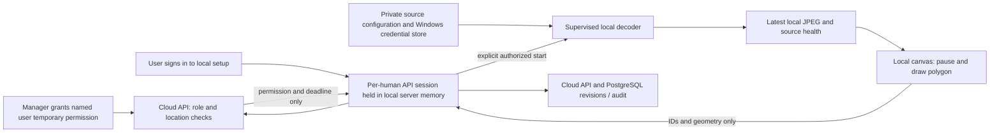

# Phase 4: local video input and table calibration

**Implementation date:** 2026-11-08, Asia/Dhaka. Stored verification times use UTC.
**Authority:** [Master specification](../MASTER_SPEC.md), [approved implementation plan](../PHASE_04_IMPLEMENTATION_PLAN.md), and the founder's Phase 4 implementation/dependency approvals.
**Scope:** Windows-first local input, private preview and polygon calibration. Phase 5 person detection and Phase 6 device synchronization have not started. No Git commit or push was performed.

## Overview and objectives

The existing dashboard knows that a restaurant has tables and cameras. It does not yet know which pixels in a camera image belong to a particular table. Phase 4 provides that setup step.

An authorized person can open a generated MP4 on the restaurant computer, pause its picture, draw a boundary around a table, and save that boundary against the existing camera and table IDs. The boundary is a polygon: an ordered list of corners. Every saved revision is retained. Playing the video does not change occupancy, create cleaning tasks or claim that a table is clean.

The master milestone is met by real synthetic MP4 playback, persisted polygons and visible source failures. Webcam/RTSP adapters are implemented with simulated failure/security tests; physical cameras and specific CCTV codecs have not been certified.

## What was implemented

| Component | What it does | Why it is needed |
| --- | --- | --- |
| Common `VideoSource` | Provides `open`, `read`, `close` and structured frame information | Keeps the rest of the program independent of MP4, webcam or RTSP input |
| MP4 reader/generator | Generates geometric DEMO footage and decodes actual MP4 frames; distinguishes normal file completion | Makes the milestone demonstrable without physical CCTV equipment |
| Webcam adapter | Explicit Windows Media Foundation device selection | Supports later opt-in testing on an authorized Windows camera |
| Restricted RTSP adapter | Connects only to a privately configured literal LAN IP, through a narrow TCP gateway | Keeps source addresses/credentials out of the browser and rejects redirects and other destinations |
| Supervised capture | Separate decoder process, latest-frame queue, configurable sampling, watchdog and bounded reconnect | Prevents a blocked decoder from freezing the local web server or accumulating an unlimited frame backlog |
| Local companion | Authenticated setup site at `http://127.0.0.1:8765` | Shows pictures on the edge computer without a cloud video relay |
| Explicit preview grants | Manager/admin consent for one eligible user, location and camera, with expiry/revocation | Metadata access alone must not silently authorize watching CCTV |
| Polygon editor | Pointer drawing/dragging, numeric corners, keyboard movement, undo, redraw, pause, rotation and mirroring | Makes calibration practical on desktop and mobile-sized layouts |
| Geometry diagnostics | Shape validity, corner count, source dimensions, image coverage and overlap warnings | Helps a person review the setup; these checks are not an AI accuracy/confidence score |
| Revision persistence | Expected revisions, request keys, complete snapshots and audits | Prevents lost concurrent edits and duplicate saves after uncertain responses |
| Separate A/B labs | Two new synthetic calibration locations/cameras/tables | Demonstrates isolation without changing the earlier floor states or business rows |

The cloud settings page contains preview permission controls and a link to the local tool. It does not probe the user's LAN or automatically open a camera. Cloud `Camera.status` stays `NOT_CONFIGURED`: local playback health has no device-to-cloud synchronization yet.

## Technologies in plain English

- **Python 3.14 on this Windows host:** runs the local companion and tests. The existing API container uses Python 3.12. A fresh Linux/macOS installation was not verified here.
- **OpenCV headless 4.13.0.92 and existing NumPy 2.5.4:** decode/generate images without a native GUI window. The reviewed wheel includes FFmpeg; no standalone FFmpeg executable, GPU or model was installed.
- **FastAPI/Uvicorn, HTTPX and Pydantic:** serve the local browser site, validate requests and communicate with the fixed human-account API. HTTPX ignores environment proxy settings and does not follow redirects.
- **HTML/CSS/JavaScript canvas:** draw pictures and table boundaries in the local browser. No new npm package or UI framework was added.
- **PostgreSQL, SQLAlchemy and Alembic:** save scoped metadata, immutable history and grants using additive migrations and database row-level security.
- **keyring 25.7.0 / Windows Credential Locker:** keep camera passwords under the current Windows account. The program selects that backend explicitly and has no plaintext fallback.
- **Windows Job Objects:** tie a decoder's lifetime to its parent process. Closing/crashing the parent terminates the child. This is lifetime containment, not a sandbox against every native decoder vulnerability.

The seven approved additions and license/security evidence are in [the dependency review](../PHASE_04_DEPENDENCY_REVIEW.md). All preexisting host package versions are preserved. The API image now constrains its runtime to the 31 previously installed versions, preventing an unrelated FastAPI upgrade during rebuilding. Existing npm dependencies were not upgraded.

## Step-by-step execution flow



1. The manager signs in to `/settings`, chooses a location/camera and explicitly authorizes a named eligible viewer. Default access lasts 15 minutes; the API allows 60–3,600 seconds and the UI offers 15/30/60 minutes. Multiple unrevoked grants can overlap; revoke every applicable grant to remove that user's access completely.
2. The viewer opens the local companion and signs in. It creates a separate human API session, held only in backend memory. The browser receives its own opaque HttpOnly/SameSite=Strict local cookie and a CSRF token.
3. The local server checks enabled user/membership, role, explicit location access, camera ownership and an active preview grant. Owner, organization administrator, manager and installer are eligible; staff are denied. Installers cannot grant themselves preview access.
4. The user explicitly starts an opaque source alias. The server resolves it against private organization/location/camera configuration. The browser cannot submit an arbitrary URL or filename.
5. A child decodes continuously. Sampling defaults to 2 FPS and accepts 0.5–10 FPS; browser polling is at most approximately 2 FPS. Only one reader and one latest JPEG mailbox are allowed. Frame dimensions are capped at 4096 × 2160 and a JPEG at 2 MB; larger supported inputs are resized for preview while preserving original source dimensions for calibration.
6. Health distinguishes connecting, online, stale, reconnecting, error, normal file end and stopped. A five-second no-frame watchdog terminates a stuck reader. Webcam/RTSP get at most three reconnect attempts with 1/2/4-second delays. Wrong credentials and prohibited destinations require correction. MP4 loops only when explicitly selected and labeled as replay.
7. Frames carry UTC receipt time, monotonic receipt time, sequence/generation and optional media position. Receipt time is not proof of the camera's capture time. Monotonic time controls freshness, deadlines and pacing.
8. The viewer pauses a reference frame. Corners are stored in original-image normalized coordinates: `(0,0)` is the top-left and `(1,1)` the bottom-right. Drawing through rotation, mirroring or letterboxing converts back to that canonical picture. Coverage is polygon area divided by image area, not detection confidence.
9. Saving sends camera/table/location IDs, corners, original dimensions, display transform, request UUID and expected revision. The API validates scope/shape and writes geometry, complete history and audit in one transaction. A stale revision returns HTTP 409. Retrying the same request key/body returns the original result; using that key for a different save returns 409.
10. The companion checks authorization about once per second and before saves. Cached access never exceeds the API's effective human-session or grant deadline. Passive preview/health checks do not renew idle sign-in. Expiry, revocation, logout, source switch or failed authority checks stop capture and clear preview. Local drafts remain unsaved memory; there is no offline synchronization queue.

## Database safety, records and APIs

Private PostgreSQL archives were created before schema changes. One was restored into a separately marked, tmpfs-backed test database, migrated twice to check repeatability, and compared against the original rows before the application database was migrated.

- **0005:** nullable zone `view_metadata`, scoped zone reference constraint, `table_zone_revisions`, `camera_preview_grants`, RLS, immutable history trigger and audited grant/revoke function. Existing zones receive a `legacy_snapshot`; their existing geometry and revisions are not rewritten. Legacy display transforms remain unknown until a person reviews them.
- **0006:** a narrowly scoped read-only helper returns the authenticated human's effective idle/absolute deadline. It does not update session activity.
- Old revisions **0001–0004 remain unchanged**. Downgrades are deliberately disabled; use a separately reviewed forward migration for corrections.
- The runtime can select the new records only through RLS and cannot directly insert/update/delete them. Controlled functions/triggers perform the required writes. Migration/admin credentials remain outside API runtime.
- All 347 original public business/history records and all 10 original user rows/password hashes were compared before/after migration. Final preservation results are recorded below. The demo helper only adds new calibration resources.

| API | Purpose |
| --- | --- |
| `POST /v1/locations/{location}/cameras/{camera}/preview-grants` | Explicit, audited temporary consent |
| `GET /v1/locations/{location}/cameras/{camera}/preview-grants` | Authorized manager list, bounded pagination |
| `POST /v1/locations/{location}/cameras/{camera}/preview-grants/{grant}/revoke` | Audited revocation |
| `GET /v1/locations/{location}/cameras/{camera}/preview-authorization` | Passive current authority/deadline check; no frames or CCTV credentials |
| `GET /v1/locations/{location}/table-zones/{zone}/revisions` | Eligible, scoped complete history; bounded pagination |
| Existing zone POST/PUT | Backward-compatible geometry APIs extended with optional request keys and display metadata |
| Local `/local/v1/...` | Separate login/session/setup/start/stop/health/frame/calibration/revisions routes; not a public cloud video API |

## Created or modified files and their purposes

| Files | Purpose |
| --- | --- |
| `services/edge-agent/src/restaurant_edge/video_sources.py` | Source interface, structured frame, real OpenCV adapters, synthetic generator |
| `.../source_config.py`, `.../secret_store.py` | Private scoped source registry, file/LAN restrictions, Windows credential storage |
| `.../rtsp_gateway.py` | Single-upstream RTSP/TCP policy and credential injection; rewrites camera authorities and removes audio/data tracks |
| `.../capture.py`, `.../process_guard.py` | Supervised reader, sampling/health/reconnect/cleanup and Windows parent-lifetime containment |
| `.../cloud_client.py`, `.../companion.py`, `.../cli.py` | Fixed metadata API client, protected loopback routes and explicit terminal commands |
| `.../static/index.html`, `style.css`, `editor.js` | Responsive editor, diagnostics, transforms, explicit save/reload/history and failure labels |
| `services/edge-agent/pyproject.toml`, `requirements-phase4-windows.txt` | Declared edge requirements, packaged static files and seven approved exact Windows additions |
| `services/edge-agent/tests/test_video.py`, `test_companion.py`, `test_cloud_client.py`, `test_process_guard.py` | Actual MP4/process/Windows-store checks and simulated authority/device/security cases |
| `services/api/src/restaurant_api/models.py`, `schemas.py` | New persistence/typed contracts and backward-compatible zone metadata |
| `.../calibration.py`, `routes.py`, `main.py` | Scoped APIs, idempotency, passive permission/deadline checks and router wiring |
| `.../management.py` | Restricted runtime SELECT provisioning for the new tables |
| `services/api/migrations/versions/0005_calibration.py`, `0006_preview_deadline.py`, `migrations/sql/0005_calibration.sql` | Additive schema, history/grant policies and session-deadline helper |
| `services/api/Dockerfile`, `requirements-runtime-lock.txt` | Preserve previously running API dependency versions during image rebuild |
| `services/api/tests/test_calibration.py`, `test_route_inventory.py`, `test_database_isolation.py` | Security/concurrency/atomicity coverage, five new routes and new migration head; earlier tests retained |
| `apps/web/app/settings/preview-permissions.tsx`, `page.tsx` | Explicit preview grant/revoke controls and local-tool navigation |
| `scripts/prepare_phase4_demo.py` | Additive A/B lab setup and private synthetic MP4/source configuration; no resets or automatic preview grants |
| `scripts/verify_phase4_browser.py` | Installed Edge/real API/DB/local process demonstration; private reports/screenshots |
| README, handoff, implementation/architecture/API/threat docs, dependency review, approved plan and phase index | Current behavior, safety boundaries and actual evidence; earlier phase records retained as history |

Paths abbreviated with `...` continue the full directory in the preceding row. Runtime footage, source definitions, account files, backups and verification artifacts stay ignored under `.secrets/` or `.cache/`.

## Windows 11: run and demonstrate

Use the existing project `.venv`; no new global software is needed. Keep the current `.env` and original Docker volume. The approved dependencies are already installed on this machine. The founder declined installing setuptools, so use `python -m restaurant_edge.cli`; the new console shortcut/editable metadata refresh is not verified and is not needed for these commands.

```powershell
Set-Location E:\Restaurent_startup
docker compose up -d --no-build --pull never --wait --wait-timeout 60

# Adds only missing synthetic calibration resources; never resets earlier records.
.\.venv\Scripts\python.exe scripts/prepare_phase4_demo.py

# Keep this terminal running. Ctrl+C stops the local setup server.
.\.venv\Scripts\python.exe -m restaurant_edge.cli serve --config .secrets/phase4/sources.json
```

1. Open `http://localhost:3000/settings` and sign in with a privately stored eligible demo account. Never paste the credential JSON into chat or Git.
2. Choose **DEMO A Calibration Lab** and its **DEMO synthetic video** camera. Under **Local preview permissions**, leave your user ID filled in, check explicit consent, then choose **Grant local preview**. A fresh grant is required after the verification grants are revoked or expire.
3. Open `http://127.0.0.1:8765`, sign in with that same account and choose the calibration lab, camera and **A Lab Table**. Click **Start local preview**. No webcam or physical CCTV is opened by this demo.
4. See the **DEMO — synthetic video** and **ONLINE** labels. Pause a reference frame, select **Redraw** if reviewing an existing test polygon, click corners around a colored table, then save. Use the numeric controls or arrow keys to refine corners. Rotation/mirroring change the view while coordinates remain tied to the original picture.
5. Open revision history. Stop/sign out, restart the companion and sign in again: the saved boundary and revision load from PostgreSQL. Draft corners that were never saved do not persist.
6. Revoke every active grant for your user/camera from settings while preview is open. The local picture clears and later frame requests are denied. Grant access again explicitly if continuing setup.
7. Repeat with a B account and **DEMO B Calibration Lab**. A's location and saved boundary are inaccessible to B. The normal dashboard remains at `http://localhost:3000/dashboard`.

The browser verification uses its own local server on port **8766**, closes only that verifier-owned server, and leaves the normal 8765 companion separate. It preserves earlier table states. Avoid repeatedly running account-based browser checks within 15 minutes: the existing limit is ten sign-ins per email and sixty per peer per 15-minute window. Wait for the window to expire rather than changing the protection or database counters.

### Other explicitly authorized sources

Privately configure a source entry in `.secrets/phase4/sources.json`, with `version: 1`, approved file roots and scoped camera/source IDs. `mp4` uses a private local filename; `webcam` uses an explicit device index 0–7; `rtsp` uses a literal approved private-LAN host, port and a simple stream path. All require `authorized: true`. Do not use the repository reference reel as an authorized input merely because it exists.

For an authorized new RTSP credential, invoke the hidden-input command below with the real camera UUID entered locally. Do not put a username/password in the command or source reference. The command refuses to overwrite an existing credential; rotation needs separate review.

```powershell
.\.venv\Scripts\python.exe -m restaurant_edge.cli credential --config .secrets/phase4/sources.json --camera <camera-UUID>
```

This is a template: replace `<camera-UUID>` before running it. Real camera use needs operator consent, a read-only account where available, OS permissions and a separate hardware/codec test. No real source was contacted in this phase's demonstration.

### Run tests

```powershell
.\.venv\Scripts\python.exe scripts/start_phase2_test_db.py
.\.venv\Scripts\python.exe -m pytest --rootdir=. services/api/tests services/edge-agent/tests --import-mode=importlib -q
.\.venv\Scripts\python.exe -m ruff check services/api services/edge-agent scripts/prepare_phase4_demo.py scripts/verify_phase4_browser.py
.\.venv\Scripts\python.exe -m pip check
.\.venv\Scripts\python.exe scripts/verify_phase4_browser.py

Push-Location apps/web
npm run lint
& .\node_modules\.bin\tsc.cmd --noEmit --incremental false
npm run build
Pop-Location
docker compose config --quiet
```

The test helper checks a separately named, marked disposable database; it does not use the application database. Explicit `--rootdir=.` ensures Windows spawned test workers can import their fixture modules in the combined suite. The browser verifier requires the existing demo accounts/labs and installed Edge; it installs nothing. Windows Credential Locker/Job Object tests are explicitly Windows-only in other OS environments; they were exercised on this Windows host.

## Actual verification results

| Check performed on 2026-11-08, Asia/Dhaka | Actual result |
| --- | --- |
| Fresh foundation baseline before implementation | All 262 prior Python tests passed |
| Final combined Python suite | **333 passed, one existing warning, 450.35 seconds**; all 262 earlier tests retained plus 71 Phase 4 cases; no skips on this Windows host |
| Real PostgreSQL security/concurrency | Both-direction A/B denial, same-organization ungranted location denial, anonymous/staff/installer privilege denial, grant expiry/revocation, disabled users/memberships/grants, idle/absolute session expiry, passive reads, direct-write restrictions, revision retry/conflict and atomic rollback passed |
| Actual generated video | MP4 decode, different FPS/pacing, UTC/media/monotonic timestamps, normal EOF, explicit looping/generations, corrupt-input failure, repeated start/stop and cleanup passed |
| Simulated hardware/network behavior | Hung webcam termination, bounded failed reconnect and successful RTSP-like reconnect, unsafe destinations/SDP/redirect/UDP rejection, safe authentication handling and authority failures passed; no physical hardware was involved |
| Windows-specific actual checks | Temporary Credential Locker canary write/read/remove and forced parent shutdown terminating its real MP4 decoder passed |
| Installed Edge integration | **Nine groups passed**: settings consent; A/B isolation; actual local decode/JPEG/pointer draw/drag/undo/numeric/keyboard/save/history; transforms/mobile; offline/explicit reconnect; revoked preview; B playback/logout; actual local process restart/persistence; existing dashboard SSE/offline recovery |
| Revocation observation | Browser cleared its preview **1.105 seconds** after the test began revoking all overlapping applicable grants. This is one local observation, not a guaranteed maximum or production latency claim |
| Frontend checks | Next.js lint, TypeScript and production build passed during implementation; API/web Docker builds passed. Local editor JavaScript syntax and browser execution passed, with zero uncaught JavaScript exceptions across the three verification browsers |
| API/DB/companion readiness | API `/ready`, web sign-in and normal local companion returned HTTP 200 after the final native server restart; database container retained and healthy |
| Migration rehearsal | Private backup restored into isolated test DB; 0005/0006 applied/reapplied; all 347 original public rows and ten user rows preserved; zero model/schema differences |
| Final application preservation | Same original 347 public rows and ten complete user rows/password hashes; same original DB container/named volume; unchanged `.env`, Git configuration, HEAD and migrations 0001–0004; all 94 original eligible files still present |
| Environment/static checks | Ruff, `pip check`, declared edge dependency compatibility, JavaScript syntax and quiet Compose validation passed. All existing host package versions and the original 31 API runtime versions are preserved; setuptools remains absent from the host project environment |
| Git/private material | Known-value/pattern review of all 122 eligible files found no actionable secret or sensitive-path matches; all 13 ignore probes passed. No staged files, deleted tracked files, new commit or push |

The one Python warning is the existing Starlette/HTTPX TestClient deprecation. Installing its suggested replacement was not approved and was not attempted. `next lint` also remains deprecated. The full suite duration above is the observed run time, not a product performance benchmark.

Private evidence includes `.secrets/phase4-final-verification.json`, `phase4-full-tests-private.log`, `phase4-browser-verification.json`, migration reports and secret-review reports; screenshots are under `.cache/phase4-browser-*`. Earlier failed/intermediate logs remain private historical debugging records and do not replace the final successful result. No hosted GitHub CI, independent penetration test, packet-level external network audit or physical camera compatibility result is claimed.

## Problems encountered and solutions

1. **The selected OpenCV backend rejected an audio-stream open parameter.** Actual MP4 tests caught this. The reader now uses the video-only VideoCapture path without that unsupported parameter; no microphone/audio reader exists. RTSP SDP removes audio/data tracks before decoder access.
2. **An RTSP URL could omit default port 554.** A literal string replacement missed that spelling. The gateway now validates/canonicalizes every advertised authority, rejects other destinations/redirects/UDP and rewrites permitted URLs to its loopback relay. Tests cover both spellings.
3. **A scheduled final reconnect was skipped.** The successful simulated recovery test exposed the retry-counter issue; pending retries now execute even when the counter has reached its final permitted attempt.
4. **Abrupt parent exit could leave a decoder running.** Windows Job Object lifetime containment and a child-side parent watcher now cover forced parent shutdown. A real subprocess termination test verifies cleanup. One leftover decoder from an interrupted early verifier was stopped only after confirming its dead parent and this project's loaded OpenCV module; no unrelated process or data was removed.
5. **The API image resolver drifted to a newer FastAPI.** That intermediate image was not deployed. A constraint file copied the 31 original runtime versions; a rebuilt image was checked before replacing only API/web containers.
6. **Editable shortcut refresh needed an absent build tool.** The founder chose to keep `python -m`, so setuptools was not installed and the existing importable editable path remains in use.
7. **Browser replays encountered saved view settings, overlapping grants and login throttling.** Tests now select transforms explicitly, account for independent overlapping grants and use separate eligible synthetic roles. Throttle limits were preserved; no counters/passwords were reset.

## Remaining limitations and security gates

- **Physical hardware unverified:** no webcam/NVR, RTSP-over-TCP end-to-end fixture server, real H.264/H.265 camera, vendor authentication quirks, TLS camera stream or long-running hardware soak was tested. RTSP tests cover policy/authentication/parsing and simulated disconnect/reconnect; they do not certify a vendor connection. The tested actual decoder profile is Windows 11, FFmpeg-backed OpenCV and generated MPEG-4 Part 2 `mp4v`, 640 × 360.
- **Narrow RTSP compatibility:** literal RFC1918/private-ULA destinations, simple paths, TCP interleaving and Basic/Digest MD5/SHA-256 only. DNS camera names, query-string credentials, redirects, UDP/multicast and public internet cameras are rejected. Camera LAN traffic may be plaintext; use a trusted isolated camera LAN/read-only credentials. Do not expose CCTV publicly to make setup work.
- **Native media remains untrusted:** there is no complete audit of bundled codecs and no OS security sandbox. Process limits/watchdogs bound normal resources but do not prove safety against a malicious codec exploit. Full process memory/driver behavior and every malformed container are not exhaustively bounded or tested.
- **Freshness is receipt freshness:** a camera repeatedly emitting an old but valid picture can look active. Decoder buffering and camera capture-time accuracy are not independently measured. No occupancy or AI accuracy/latency/uptime claim is made.
- **Human-authorized setup depends on API availability:** loss of authority fails closed; there is no autonomous offline detector, device pairing, machine token, SQLite outbox or event delivery. Local session cookies expire after one hour, and cloud idle/absolute expiry can end access sooner.
- **Local OS trust:** another compromised Windows process/account or screen recording cannot be prevented by browser authorization. Keyring protects storage under the current OS user; it does not protect against full account compromise. A Windows user session must be available.
- **No deployment approval:** preserved weak legacy DB administrator credential must be rotated through [the reviewed procedure](../DATABASE_CREDENTIAL_ROTATION.md) before any pilot/public use. The historical npm report remains eight affected entries, one high/seven moderate; no new audit or remediation is claimed. Production TLS, secure deployment cookies, MFA/recovery, image/user hardening, independent security review and retention policies remain gates.
- **Toolchain limits:** current host Python 3.14/Node 26 differ from API/CI Python 3.12/Node 22. The API runtime is constrained; the host and edge dependency graph are not fully locked. Hosted GitHub CI and a clean-machine installation were not run. Existing `next lint`/Starlette-HTTPX deprecations remain; no unapproved replacement dependency was installed.
- **Source/transform review:** changing a camera's angle, crop, resolution or physical table layout can invalidate a saved boundary. Legacy zones lack trustworthy display metadata. Human review remains mandatory.

## Phase summary

The local computer can process synthetic video, show an authorized private preview and persist reviewed table boundaries with history. The existing dashboard remains a separate simulated operations workflow. Later detection and device synchronization require their own approved milestones. Stop for founder review after Phase 4; do not commit/push or start Phase 5 without approval.

## Founder manual check and Git checkpoint review — 2026-11-08

The founder reports successful manual synthetic video playback, preview authorization and reloading saved polygon **Revision 7** after refreshing the browser. This is founder-reported browser evidence. The checkpoint review independently confirmed Revision 7 through read-only database and authorized running API checks.

Fresh checks for this checkpoint passed **333 Python tests, one existing warning, in 69.43 seconds**, including all 262 earlier cases. Ruff, `pip check`, local editor JavaScript syntax, Compose validation, frontend lint, TypeScript and the production build passed again. Running services responded, anonymous local preview was denied, and both directions of A/B calibration access were rejected.

The earlier nine-group browser demonstration remains historical evidence. It was not rerun during checkpoint preparation because it saves new polygon revisions and changes test preview grants. This review instead preserved all **427 current public database records**, all **10 user rows**, and every saved polygon, including Revision 7. Only separately created automation login sessions were opened/revoked for read-only resource checks; existing preview grants/readers were left alone. No application functionality, dependencies or containers were changed in this review.

See [PHASE_04_CHECKPOINT.md](../PHASE_04_CHECKPOINT.md) for the complete reviewed file list, security exclusions, verification commands and approval boundaries. Git saves source/configuration/tests/documentation; the actual database, saved polygon records, videos and private local configuration remain outside Git. Creating the local commit requires founder approval; pushing requires a separate approval followed by verification of the remote commit. Phase 5 remains unstarted.
