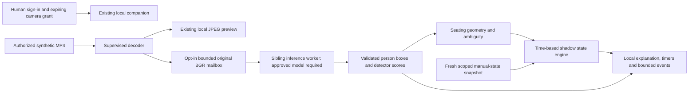

# Phase 5: local pretrained person detector and shadow occupancy

> **Phase 7 compatibility — 2026-11-12:** Approved [Phase 7](PHASE_07.md) extends the existing dashboard and signed transport with opt-in human-reviewed workflow, compatible v2 metadata and reports. It preserves the original DEMO/v1 contracts, manual precedence, session deadlines and synthetic-only AI limitations. Phase 7 verification passes 636 tests and ten browser groups; separately approved additive `0009` and matching local services are active. Original records, credentials and calibrations are preserved, and existing locations remain OFF. Earlier phase-specific test/status statements below are historical.

> **Phase 6 resumed verification - 2026-11-11:** The final 529-test suite retains all 445 original cases and the unchanged timing assertions. A first resumed run had 525 passes and one native model-loading failure; the focused and final runs passed without timeout/assertion changes. Prompt device-health publication was corrected after a browser failure and a deterministic regression. Native startup sensitivity remains a limitation; representative real-person/restaurant accuracy remains unverified. See [the fresh Phase 6 evidence](PHASE_06.md#resumed-final-verification---2026-11-11).

> **Phase 6 follow-up - 2026-11-08:** The delayed-first-frame MP4 pacing mismatch is fixed in `video_sources.py`, with the original assertions retained and added delay/reopen regressions. The final sequential Phase 6 regression passed 526 tests, including the original 445. [PHASE_06.md](PHASE_06.md) records this fix, later verification and all new/historical failures. The initial Phase 5 444-pass/one-failure run below remains historical evidence. Person/table-assignment/restaurant accuracy remains unverified; only synthetic footage is authorized.

**Date:** 2026-11-08, Asia/Dhaka; evidence timestamps use UTC.

> **Latest publication/planning update — 2026-11-08:** After separate founder commit and push approvals, the 53-file synthetic checkpoint was saved as `ae19ec81f342d17730ddd48845a5862a2d56a99a` on local/GitHub `main`; an independent remote lookup verified the matching hash, and Git was clean. Private files stayed excluded and no files were deleted. The 445-test pass and original intermittent MP4 timing failure below remain dated evidence, not new planning checks. Real-person/restaurant accuracy remains unverified. [The Phase 6 proposal](../PHASE_06_IMPLEMENTATION_PLAN.md) is documentation only and awaits implementation approval. Earlier “not committed/pushed” statements retain their original preparation context.

**Current status:** the real RF-DETR Nano CPU adapter, approved local checkpoint/export and synthetic-video integration are implemented. The founder separately approved the official checkpoint download and the exact 65-package isolated export environment. **Representative person-footage evaluation remains pending**, so Phase 5 is not certified for restaurant use. Only synthetic footage is approved; `SR.mp4` and other recordings remain unopened. The earlier YOLOX hold remains in force. See the [acquisition/export review and follow-up](../PHASE_05_RFDETR_REVIEW.md) for licensing, hashes, actual checks and the approval history.

The [approved proposal](../PHASE_05_IMPLEMENTATION_PLAN.md) remains the scope authority; the [original dependency review](../PHASE_05_DEPENDENCY_REVIEW.md) preserves the initial runtime approval and YOLOX hold. Real inference is now verified on generated inputs, with no positive person or restaurant accuracy claim. Do not start Phase 6 or deploy from this record. The founder requested the [Phase 5 checkpoint review](../PHASE_05_CHECKPOINT.md); committing and pushing each require separate explicit approval. Earlier dated implementation/review sections are preserved as history.

## Overview and objectives

Phase 4 supplies a camera picture and a saved outline around each table. Phase 5 adds the software around a person detector: deciding which table a person might belong to, waiting for stable evidence, and keeping uncertain observations separate from staff decisions.

For example, a passing person should not instantly start a dining session. Repeated supported observations can produce a local OCCUPIED estimate. A sustained possible departure can produce RESET_PENDING, meaning “may need cleaning.” Empty footage cannot confirm cleanliness or make the table AVAILABLE.

The local **shadow lab** is an experimental comparison view. It does not write to the operational dashboard, tasks, PostgreSQL events or DEMO controls. Existing staff actions and manager overrides remain authoritative.

## Implemented, verified, unverified and planned

| Component | Actual status |
| --- | --- |
| Replaceable detector interface | Implemented; normalized person boxes/scores and lifecycle methods |
| YOLOX-Tiny ONNX adapter | Implemented against the documented expected contract; fake-tensor preprocessing/decoding/NMS tests pass. Exact pretrained graph contract remains unverified |
| RF-DETR Nano CPU adapter | Actual approved pretrained checkpoint exported locally and run in ONNX Runtime; generated-array numerical parity, actual MP4/worker/browser integration verified; no person footage |
| ONNX Runtime CPU | Three approved packages installed; actual native import/provider check and `pip check` pass. Import does not prove YOLOX compatibility |
| Original-frame handoff | Actual geometric MP4 decode tested; opt-in bounded BGR mailbox stays inside local processes, separate from JPEG preview |
| Sibling inference supervision | Actual Windows process tests use a simulated detector; hung worker termination, file completion, fresh-result checks and cleanup pass |
| Seating/exclusion regions | Local interactive drawing/numeric controls, strict polygon validation, scoped immutable revisions and conflict/idempotency handling |
| Person/table association | Fake-box tests cover ambiguous borders, overlapping regions, multiple people, exclusions and anchor selection; no measured restaurant assignment accuracy |
| State engine | Deterministic simulated-clock tests cover arrival/departure, brief/long uncertainty, source generations, sparse/duplicate frames, overrides and resume |
| Protected local UI/APIs | Synthetic browser workflow verified with simulated authority; all normal startup paths require existing human/camera authorization and approved weights |
| Evaluation helper | Tested duration-weighted arithmetic on fabricated labels; no real model evaluation report |
| Real pretrained inference and CPU benchmark | Real inference verified; sustained synthetic benchmark recorded in the follow-up below; no fabricated accuracy |
| Positive person recall, false detections, real table assignment and transition quality | **Pending authorized representative person footage and independent labels** |
| Training, device identity/outbox/cloud ingestion | Not implemented; synchronization remains Phase 6; no training or alternate-model acquisition |

## AI model and dependency decisions

The initial candidate was **YOLOX-Tiny**, with a replaceable adapter so another approved detector can supply the same normalized boxes without rewriting geometry or the state engine. The founder subsequently selected and explicitly approved acquisition/tooling for **RF-DETR Nano**. It is now the locally provisioned real-model candidate. The earlier YOLOX details below remain historical evidence and do not authorize its download.

The official candidate asset is `yolox_tiny.onnx`, release `0.1.1rc0`, GitHub asset ID `42724912`, 20,219,662 bytes. No publisher digest was present in the metadata. No file was downloaded and therefore no local artifact hash or actual graph inspection is claimed. The repository is Apache-2.0, but separate pretrained-weight coverage remains unresolved; an upstream licensing question has no maintainer clarification found by this review. **Commercial use/redistribution is not cleared.** [Official ONNX assets](https://github.com/Megvii-BaseDetection/YOLOX/blob/main/demo/ONNXRuntime/README.md), [repository license](https://github.com/Megvii-BaseDetection/YOLOX/blob/main/LICENSE), [open weight-license question](https://github.com/Megvii-BaseDetection/YOLOX/issues/1865).

At the initial runtime step, the founder approved only these project `.venv` additions: `onnxruntime==1.31.1` (MIT), `protobuf==7.36.2` (BSD-3-Clause), and `flatbuffers==25.12.19` (Apache-2.0). Binary wheel hashes are pinned in `requirements-phase5-windows.txt`. All previous distribution versions are preserved. Exact-version OSV queries reported no listed advisories; bundled native code is not fully audited. No PyTorch, ONNX exporter, RF-DETR, Ultralytics, global software, setuptools, npm upgrade, driver or model package was installed at that step. The later separately approved RF-DETR export environment is documented below; it does not change the working `.venv`. The optional `ai` extra declares the three runtime packages; ordinary calibration imports do not load ONNX Runtime or a model.

The adapter expects original BGR uint8 frames, float32 NCHW input, 416-square upper-left letterboxing/padding 114 and the legacy release's expected raw output `[1, 3549, 85]`. It combines objectness with the person class score, reverses the resize and applies person NMS. These expectations are tested with constructed tensors, **not confirmed against the held artifact**. It loads only a privately provisioned artifact whose reviewed manifest, integrity hash and contract pass; there is no automatic download. ORT receives approved bytes, uses CPU/two intra-op threads and disables telemetry. [Publisher inference contract](https://github.com/Megvii-BaseDetection/YOLOX/blob/main/demo/ONNXRuntime/onnx_inference.py), [publisher preprocessing](https://github.com/Megvii-BaseDetection/YOLOX/blob/main/yolox/data/data_augment.py).

## Technologies in beginner-friendly English

- **Python, NumPy and OpenCV:** reuse the existing local video/array stack; raw pictures stay in local process memory.
- **ONNX Runtime:** executes a separately approved model on the CPU. It is an engine, not the person model itself.
- **FastAPI/Pydantic:** validate strict local requests and enforce permissions. Unexpected fields, invalid numbers, paths and conflicting revisions fail safely.
- **Multiprocessing and Windows Job Objects:** keep decoding and inference as sibling processes. A hung model can be terminated without stopping calibration or the cloud application. This is lifetime containment, not a native-code security sandbox.
- **Private JSON revisions:** preserve seating configuration history under ignored `.secrets/phase5/profiles/`; no database migration is required.
- **HTML/JavaScript canvas:** draw local regions/authorized boxes, show uncertainty and provide numeric alternatives. No new npm package or cloud video service is used.
- **HTTPX:** uses the existing per-human API session for passive metadata reads. Slow background AI metadata reads use its documented shared-thread capability without holding the preview permission request lock. [HTTPX Client thread support](https://www.python-httpx.org/api/#client).

## Processing workflow



1. The user signs in to the same loopback companion. Their role/location and current explicit camera grant are checked. Phase 5 currently rejects non-synthetic sources.
2. The existing decoder continues to produce preview JPEGs. Original BGR samples are copied only while analysis is enabled, using a one-item mailbox; old pending samples are dropped.
3. Explicit analysis startup requires a saved scoped profile and an approved model catalog entry. A missing/unapproved catalog returns 503 before loading a model or enabling raw handoff. The initial pre-acquisition catalog was empty; the later approved RF-DETR catalog is provisioned as described in the real-model workflow below. YOLOX acquisition remains held.
4. With the approved RF-DETR artifact selected, the separate worker performs inference. Startup has a 15-second bound; an outstanding inference has a five-second watchdog. Source health and analysis health remain separate.
5. Results must match the outstanding frame/generation and original dimensions, and satisfy freshness. Source/model failure clears stale boxes. Normal file completion releases the inference worker.
6. Scope/calibration and current manual states are refreshed through GET metadata requests. More than three seconds without a fresh manual snapshot makes observations unverified; four seconds ends analysis. Background reads do not renew human idle expiry or block the permission watchdog's serialization lock.
7. Matching boxes become table observations, then time-filtered shadow transitions. Only minimal bounded events stay in memory, marked `source=ai_local_shadow` and `authoritative=false`, with organization/location/camera/table identity, model/config fingerprints, zone revision, source generation/sequence and available media position. Images/boxes are not sent to the cloud.
8. Preview stop, logout, revoked/expired authority and source changes stop analysis and clear its output. Stopping analysis alone preserves preview. No durable state/outbox replay is claimed.

## Seating calibration and uncertainty

A tabletop outline may exclude a guest's feet or torso. The lab therefore stores a separate seating region linked to the exact table-zone ID/revision and original source dimensions. It never changes the cloud polygon when saving that local profile.

The user pauses an authorized picture, draws corners or enters coordinates, selects a torso/lower-center anchor and explicitly reviews visibility. A manager must create the initial profile and approve threshold changes; an installer can subsequently edit geometry. Local saves require an expected revision and request UUID. Retrying the same request is safe; conflicting edits return 409. Earlier revision files remain intact, including when a later save fails.

Shared regions, near borders, significant box overlap without a reliable anchor, low scores and excluded-but-overlapping people produce uncertainty. A person is never forcibly assigned to two tables. An unreviewed view remains uncertain. Multiple clear people can produce a visible-person estimate, not an exact party/customer count.

The UI edits one exclusion region directly and preserves any additional regions supplied through the strict local API. It displays the original view; the existing Phase 4 editor retains its separate rotation/mirror calibration tools. Different camera angles require separate reviewed profiles. Changed zone revisions stop analysis rather than silently reusing old geometry.

Detector score, geometric membership quality, covered evidence duration and LOW/MEDIUM/HIGH evidence bands are separate diagnostics. Geometric quality is a rule-based indicator, not a learned probability. `occupancy_probability` remains null. No “95% certain” or automatic cleanliness label is generated.

## States, timers and human precedence

Default experimental settings are entry score 0.60, retention 0.40, arrival ten seconds, departure 25 seconds, result maximum age two seconds and maximum observation gap two seconds. These are unvalidated starting values. The Phase 4 source watchdog remains five seconds.

The engine requires distinct samples and covered evidence time. An individual sample contributes at most one second by default, and coverage must reach 80%; long/sparse gaps do not manufacture a stable arrival or departure. Duplicate/older sequence numbers cannot advance a window. Live shadow durations use monotonic time; stored local event times are UTC processing/receipt times, never invented historical capture times. The UI converts event and original human-state timestamps to the selected location IANA time zone and labels a shadow state age separately from the original human timestamp.

| State | Rule |
| --- | --- |
| UNKNOWN | Insufficient trustworthy evidence; an initially empty picture does not mean ready |
| AVAILABLE | Comes from a current human state; retained unverified during failure, but a later stable arrival can become OCCUPIED |
| OCCUPIED | Requires stable eligible positive evidence; brief uncertainty is bounded, then UNKNOWN |
| RESET_PENDING | Possible departure after a known occupied session; never becomes AVAILABLE from vision |
| CLEANING | Staff-confirmed state is preserved; conflicting person evidence is a warning |
| OUT_OF_SERVICE | Manager block is preserved until the normal authorized workflow reopens it |

Within a running analysis, occupied-session context survives UNKNOWN to prevent duplicate departures. Occupancy returning after a reset proposal begins a new local session; it does not confirm cleaning. A newer human revision supersedes older observations, and frames captured before that command are ignored. Restart reloads configuration and current human context; it does not restore old inferred readiness or monotonic timers.

The existing dashboard remains its separate DEMO/staff workflow. No new cloud ingestion route, DEMO event call, database write, staff-action shortcut, machine credential or device pairing was introduced.

## Local APIs and security boundaries

All analysis APIs live on the existing loopback origin. Mutations inherit exact Host/Origin, JSON-size, strict-schema and CSRF checks. Reads remain passive. Data routes require the caller's active owned preview, eligible role/location, current camera permission and a synthetic source; another browser's valid login cannot read that reader's state.

| Local route | Purpose |
| --- | --- |
| `GET /local/v1/analysis/availability` | Signed-in feature/model availability, no pictures or other user's state |
| `GET/PUT /local/v1/analysis/config` | Scoped current local profile and expected-revision save |
| `POST /local/v1/analysis/start` | Explicit startup; fails closed without reviewed weights/configuration |
| `POST /local/v1/analysis/stop` | Stop the caller's analysis while preserving preview |
| `GET /local/v1/analysis/status` | Fresh non-authoritative estimates/boxes and instrumentation |
| `GET /local/v1/analysis/events` | Limited in-memory transition history, at most 100 per response |

Configuration history is limited to 500 revisions per camera, local start/stop audit files to 1,000 and in-memory transitions to 1,000. Reaching a quota requires review; existing files are not automatically removed. There is no image/video export endpoint, recording, external annotation service or cloud box upload. Existing Windows camera credential handling is unchanged.

## Created and modified files and their purposes

Edge paths below are under `services/edge-agent/`.

| File/area | Purpose |
| --- | --- |
| `src/restaurant_edge/detectors/base.py`, `__init__.py` | Replaceable normalized detector contract; no automatic model loading |
| `.../detectors/onnx_detector.py` | Closed approval catalog, hash validation, expected YOLOX preprocessing/decode/NMS and CPU adapter |
| `.../association.py` | Polygon validation, anchors, box overlap, exclusions and ambiguous association |
| `.../analysis_config.py` | Strict settings/regions, scoped immutable local revisions, request identity/conflicts |
| `.../state_engine.py` | Pure six-state shadow lifecycle, time coverage, manual precedence and bounded events |
| `.../analysis.py`, `analysis_metrics.py` | Sibling worker supervision, fresh frame/results, nonblocking metadata refresh, CPU/memory instrumentation |
| `.../analysis_routes.py` | Authorized local configuration, lifecycle/status/history and approval gates |
| Existing `.../capture.py` | Opt-in original-frame mailbox; preserve separate Phase 4 JPEG/reader behavior |
| Existing `.../cloud_client.py`, `companion.py`, `cli.py` | Passive background reads, expiry/stop binding and explicit `--ai-debug` options |
| `.../static/analysis.html`, `analysis.js`; existing `index.html`, `editor.js` | Separate responsive lab/drawing controls and calibration-to-lab link |
| `pyproject.toml`, `requirements-phase5-windows.txt` | Optional AI extra and approved exact Windows wheel hashes |
| Five new `tests/test_analysis_*.py` files | Domain/API, process, passive metadata and evaluation tests; original tests unchanged |
| `scripts/verify_phase5_browser.py` | Real Edge/MP4 UI check using explicitly simulated authority and no weights/database writes |
| `scripts/evaluate_phase5_intervals.py`, `.../evaluation.py` | Private interval comparison and strict provenance/timing/UNKNOWN handling |
| Phase 5 proposal/review/explanation and affected indexes/architecture/API/threat notes | Current evidence, decisions and limitations; historical phase records preserved |

Abbreviated `...` paths continue `src/restaurant_edge/`. Private reports, test clips/screenshots, configuration revisions and logs remain ignored under `.secrets/` or `.cache/`.

## Windows 11: initial lab snapshot before model acquisition

This subsection preserves the pre-acquisition walkthrough. Use **Windows 11: run the actual local detector** below for the current RF-DETR command and model-enabled behavior.

Run from `E:\Restaurent_startup`, using the existing `.venv` and retained containers. No model download is part of these commands.

```powershell
docker compose start
.\.venv\Scripts\python.exe -m restaurant_edge.cli serve --config .secrets/phase4/sources.json --ai-debug
```

Open `http://127.0.0.1:8765/analysis`. If the old companion already uses that port, stop that terminal with Ctrl+C before restarting; do not kill unrelated processes. Existing ordinary calibration remains at `/`.

1. In `http://localhost:3000/settings`, a manager grants the named user explicit preview access to a synthetic calibration-lab camera.
2. Sign in to the local lab with your existing account. Use private credentials locally; never paste them into documentation or Git.
3. Select the matching synthetic lab/camera/table and start synthetic preview. A missing grant, unconfigured alias or wrong location fails safely.
4. Pause the frame, review/draw the separate seating boundary and optionally an exclusion. Use numeric X/Y controls if easier than the pointer.
5. A manager saves the initial local seating profile. Reload/refresh, restart preview and reload the profile to verify persistence. This is separate from cloud polygon Revision 7.
6. At this original pre-acquisition step the detector button was disabled because weights were held, and direct startup returned 503. There was no working pretrained demonstration at that time. The later separately approved RF-DETR workflow below supersedes that limitation; do not create an invented approval manifest to bypass any remaining hold.

After licensing is resolved, the founder must approve the exact acquisition and artifact verification before a genuine model manifest is provisioned. The adapter's real graph/positive and negative inference tests, performance benchmark and evaluation then remain required; a successful import alone is insufficient.

## Windows 11: tests and interval evaluation

Use the existing isolated PostgreSQL test container, not the restaurant database, for the full suite. The API fixture refuses databases outside its explicitly named `phase2_security_test` family. The current machine's retained test container can be started without deleting/recreating it:

```powershell
docker start restaurant-phase2-test-1b92a3e5ca
.\.venv\Scripts\python.exe -m pytest services/api/tests services/edge-agent/tests -q -p no:cacheprovider
.\.venv\Scripts\python.exe -m ruff check --no-cache services/api services/edge-agent scripts/verify_phase5_browser.py scripts/evaluate_phase5_intervals.py
.\.venv\Scripts\python.exe -m pip check
node --check services/edge-agent/src/restaurant_edge/static/analysis.js
.\.venv\Scripts\python.exe scripts/verify_phase5_browser.py
```

The browser verifier generates its own geometric MP4 and private temporary manager account in a **simulated authority**. It does not log in to/mutate the business database, run a detector or open real footage. Its separate installed Edge profile, saved seating data and screenshot stay private.

The interval helper takes private JSON manifests with exactly `format_version: 1`, `clock: "media_seconds"`, matching `clip_sha256`/`scope`, `evidence_kind: "synthetic_fixture"` and `intervals`. Each interval has `table_id`, `start`, `end`, `state`. The labels must be independently supplied; the helper never labels cleanliness from video. Missing predictions count as UNKNOWN, and unknown coverage is reported alongside accuracy.

```powershell
.\.venv\Scripts\python.exe scripts/evaluate_phase5_intervals.py --labels .secrets/phase5/labels.json --predictions .secrets/phase5/predictions.json --output .secrets/phase5/new-interval-report.json
```

These label/prediction files are not supplied or claimed as an evaluated corpus. Existing outputs are preserved; choose a new output name. This helper does not compute detector AP, person-box recall, model speed or pilot quality.

## RF-DETR follow-up: implemented real-model workflow

The founder approved the official native checkpoint and the exact isolated export environment after reviewing licensing, checksums, dependencies and risks. RF-DETR Nano detection has an explicit publisher Apache-2.0 grant; required attribution/license texts are retained. The original runtime `.venv` is unchanged. The separate exporter is `.cache/phase5-rfdetr-export/.venv`, with 65 reviewed distributions plus Python's bundled pip. No global software, driver, npm upgrade, additional model, training or business database migration was added.

The native file has 366,287,238 bytes, publisher MD5 `fb6504cce7fbdc783f7a46991f07639f`, and acquired SHA256 `d8d6b9ee57d4d0ed2b1f305163624712a0532cb7bce0c747317984fc5457440d`. The accepted ONNX file has 107,826,617 bytes and SHA256 `ea1a44e23d3381b0a2a188e01cf84da67a89a936e118b37047bc7cb0d21320f1`. Weights, catalog, videos, caches and reports remain ignored/private. The failed first export attempt is preserved; the accepted workflow is `export-v2` with full provenance.

### How the real model works

1. The existing authorized Phase 4 reader produces an original BGR image. The same preview still works independently of inference.
2. `detectors/factory.py` chooses the explicit catalog model ID. There is no plugin import path, automatic model download or hosted inference call.
3. `detectors/rfdetr.py` converts BGR to RGB, resizes to 384 × 384 using float bilinear half-pixel sampling with no antialiasing, divides by 255, applies ImageNet normalization and produces float32 NCHW input.
4. The existing ONNX Runtime executes the approved model bytes on CPU, with two intra-op threads, one inter-op thread and telemetry disabled. **Graph optimizations are disabled** because the optimized graph failed a strict numerical comparison on one generated input; disabling them passed the original tolerance without relaxing it.
5. The model returns `dets [1,300,4]` and `labels [1,300,91]`. Box coordinates use original-image normalized units, but its reparameterized centers/sizes may extend outside the image. The adapter rejects non-finite/negative sizes or gross values, converts to corners and clips them to the image. It applies sigmoid, the publisher's global top-300 query/class selection and sparse COCO **person class 1**. It does not apply YOLOX NMS.
6. These person boxes pass through the same reviewed seating/exclusion polygons, ambiguity handling and temporal state engine. No detector score becomes an occupancy probability.
7. Only fresh results from the current source generation/configuration are displayed. Manual CLEANING/OUT_OF_SERVICE states and staff authority remain protected; estimates/events stay local and non-authoritative. Camera/model/grant/session failures clear results safely.

For example, selecting RF-DETR does not let an installer approve a new model threshold policy: the backend now requires a manager for a detector change even when the numerical thresholds are unchanged. Older YOLOX profiles retain their model identity and history; an authorized manager saves a new revision to switch models.

### New/modified files and why

| File | Purpose |
| --- | --- |
| `detectors/rfdetr.py` | Real CPU adapter, model-specific preprocessing/output validation/decoding and measured per-stage timings |
| `detectors/factory.py` | Explicit replaceable model dispatch; rejects unknown IDs |
| `detectors/onnx_detector.py` | Retains YOLOX; adds bounded RF catalog identity/hash handling, duplicate rejection and bounded file reads. RF ONNX limit is 160 MB; YOLOX remains 30 MB |
| `analysis.py`, `analysis_config.py`, `analysis_routes.py` | Select the approved adapter/model while preserving old profiles, supervision and permissions; managers approve model changes |
| `static/analysis.html`, `static/analysis.js` | Approved-model selector, saved-profile/start gate and accurate synthetic/real-evaluation labels |
| `requirements-phase5-rfdetr-export-windows.txt` | Exact 65-wheel Windows/Python 3.14 exporter lock; not a runtime dependency list |
| `third_party/RFDETR.md`, `third_party/RFDETR_LICENSE.txt`, `pyproject.toml` | Preserve attribution/license and include them as distribution data; no package reinstall in the main environment |
| `scripts/export_phase5_rfdetr.py` | Hash-check native weights, block Python network attempts, export locally and validate numerical parity/provenance; refuses existing output directories |
| `scripts/benchmark_phase5_rfdetr.py` | Generate its own MP4 and measure actual pretrained CPU throughput, sustained sampling, memory and shadow-state behavior; never accepts an existing recording |
| `scripts/verify_phase5_rfdetr_browser.py` | Actual Edge/MP4/ONNX integration with explicitly simulated human authority and no business mutations |
| `tests/test_rfdetr_adapter.py` | 28 constructed-input/security/authorization tests; clearly simulated |
| `tests/test_rfdetr_real.py` | Four opt-in genuine pretrained-model checks using generated arrays/MP4 and real reader/inference processes |
| `.gitignore`, review/handoff/architecture/API/index documentation | Protect `.pth`/`.safetensors`/ONNX sidecars and keep model, permission, run and verification records consistent |

Paths without a prefix in this table are relative to `services/edge-agent/` or its `src/restaurant_edge/` package as appropriate. No application API/web/database functionality outside this local detector integration was changed. Existing database credentials and Revision 7 are preserved.

### Windows 11: run the actual local detector

Use the **working runtime**, not the large export environment, for the companion. If an older companion is already running on this port, stop it with Ctrl+C in its terminal before starting the updated one. Do not terminate another process or recreate containers just to free a port.

```powershell
cd E:\Restaurent_startup
.\.venv\Scripts\python.exe -m restaurant_edge.cli serve --config .secrets/phase4/sources.json --ai-debug --models .secrets/phase5/models/catalog.json
```

Open `http://127.0.0.1:8765/analysis`. Sign in using your existing account without pasting passwords into chat. You still need an eligible location role and current explicit camera preview grant. Choose the synthetic Phase 4 lab camera, start its synthetic preview, select RF-DETR Nano, review the seating region/visibility and save a **new local** profile revision as a manager. Saving does not change the cloud calibration or Revision 7. Click **Start approved detector**. The page shows real processing milliseconds and local shadow states. It should not invent people in the geometric video or claim occupancy accuracy. Model startup is explicit; passive viewing never renews sign-in expiry.

The private catalog is already provisioned for the accepted local artifact. It contains no camera credentials and is intentionally not committed. A new checkout needs a separately authorized model/toolchain provisioning process; do not bypass the catalog by labeling another file as verified. Missing/unapproved models still produce a safe 503.

For a new export, use the already approved isolated environment and choose a new output directory:

```powershell
.\.cache\phase5-rfdetr-export\.venv\Scripts\python.exe scripts/export_phase5_rfdetr.py --checkpoint .secrets/phase5/models/rfdetr-nano/native/rf-detr-nano.pth --output-dir .secrets/phase5/models/rfdetr-nano/export-new
```

This does not download or train a model. Preserve its export-provenance file, retain notices and review the new artifact hash before updating any private catalog. The exact graph remains CPU/static batch one/384/FP32/opset 17. Future exporter/runtime changes require their own parity tests; an existing hash does not validate a different export.

### Windows 11: verify real-model and simulated checks

The retained isolated PostgreSQL test container must be running for the full suite. Never substitute the restaurant database. Set the opt-in model path so genuine model tests run instead of explicitly skipping unavailable weights:

```powershell
$env:RFDETR_TEST_CATALOG = (Resolve-Path .secrets/phase5/models/catalog.json).Path
.\.venv\Scripts\python.exe -m pytest services/api/tests services/edge-agent/tests -q -p no:cacheprovider
.\.venv\Scripts\python.exe scripts/verify_phase5_rfdetr_browser.py --catalog .secrets/phase5/models/catalog.json
.\.venv\Scripts\python.exe scripts/benchmark_phase5_rfdetr.py --catalog .secrets/phase5/models/catalog.json --output-dir .secrets/phase5/new-benchmark-run --seconds 600 --sampling-fps 2
```

Choose new private output paths. The benchmark always generates its own geometric MP4, warms up the real model, times 50 unpaced frames and then measures paced samples. Timed-loop throughput and the 2 FPS sample target are different measurements. Reports contain no claimed restaurant accuracy. The browser verifier creates a separate private profile and simulated manager identity; it does not reuse your password or modify business records. The hosted dashboard/SSE remains covered by the earlier regression suite, not by this simulated authority.

### Current real-model verification

- **Full regression:** **445 passed**, one preexisting Starlette/HTTPX warning, **105.65 seconds**, with all previous 413 retained and four actual model checks enabled. There are 32 new checks: 28 constructed-input/authorization cases and four genuine-model cases. After a fixture-import lint correction, the affected 28 cases passed again in 1.59 seconds; no old test file was changed.
- **Real-model browser:** six groups passed: saved-profile/model gate, actual MP4 and real worker/live metrics, manual cleaning preservation, refresh/restart persistence, 390px layout and revocation terminating actual workers. Human authority was **simulated**, footage geometric, no browser exceptions or business mutations. This is not live-person validation.
- **Earlier browser verifier:** all seven groups passed again with actual generated MP4, fake/no model and simulated authority; this separately retains the closed-model gate, offline clearing and geometry workflow.
- **Compatibility:** the 65-package export environment passes native imports and `pip check`. Native checkpoint integrity, self-contained ONNX graph/opset/interface checks and Python-level offline export pass. Three generated-image shapes (360×640, 97×53, 384×384) have preprocessing maximum difference **0**, box maximum absolute difference at most **0.00007505**, and raw logit difference at most **0.00010682** against PyTorch under the validated conservative setting. These are numerical implementation comparisons, not accuracy percentages.
- Frontend lint/type/production build, both local JavaScript syntax checks, Compose validation and main-runtime `pip check` passed. Ruff findings were confined to new test-import formatting and corrected; final verification is recorded with the completion checks.
- The sustained CPU run below completed successfully. No person-footage evaluation, model training, hosted CI or physical-camera inference is claimed.

### Actual CPU benchmark: real model, synthetic video only

Measured on the existing i5-8265U/approximately 15.9 GiB Windows development host, with the retained Docker services and ordinary development tools present. The runtime was ORT 1.31.1 CPU, FP32, batch one, two intra-op/one inter-op threads and **graph optimization disabled**. Source arrays were 640×360, resized to 384×384. The benchmark generated its own geometric MP4 and warmed up ten frames.

| Measurement | Actual result |
| --- | --- |
| Model load | 0.734 seconds |
| Unpaced timed loop | 50 frames in 15.850 seconds: **3.155 completed FPS**, including MP4 read |
| Sustained paced run | **600.075 seconds**, 1,184 completed frames: **1.973 FPS** against a 2 FPS target |
| Missed sampling slots | **17**; skipped instead of growing a backlog |
| Sustained preprocessing p50 / p95 | 50.88 / 63.20 ms |
| Sustained inference p50 / p95 | **279.18 / 365.92 ms** |
| Sustained postprocessing p50 / p95 | 2.65 / 4.66 ms |
| Sustained complete detection p50 / p95 | **331.87 / 421.09 ms**; maximum 846.22 ms |
| Decoded-array-to-result age p95 / maximum | 421.31 / 846.36 ms |
| Process CPU during sustained run | 837.86 CPU seconds: about **1.40 logical-core equivalents** on average |
| End-of-run process working set / peak working set | **380.57 / 396.28 MiB** |
| Synthetic frames with person candidates at score ≥0.05 | **0 of 1,184**; not a representative false-positive rate or accuracy score |
| Protected manual state / network | CLEANING preserved; zero Python-level attempted network connections; zero cloud state writes |

Here p50 means the middle frame time; p95 means 95% of measured frames finished within that time. A 2 FPS sample target is not 30 FPS CCTV inference. The short unpaced speed does not prove that three cameras can run at that speed together. Even this 2 FPS target missed 17 slots; describe the observed 1.973 FPS rather than claiming perfect 2 FPS support.

This is a **paced sequential-frame harness**, not the full real-time Capture/browser pipeline: it reads generated MP4 frames at the requested sampling cadence and separately measures decode-to-result age. That age begins after decoding and excludes camera transport, receipt/IPC and browser rendering delay. The separate actual-reader/worker/browser checks verify integration, freshness and cleanup, but do not supply sustained end-to-end latency percentiles. Working set is this process's resident memory, not total-system RAM, committed memory, exporter RAM or a certified maximum. CPU temperature/power/throttling, multi-camera capacity, long-duration hardware certification, person-rich footage and a clean-machine/package build remain unverified. There is no positive person/restaurant accuracy claim.

### Final preservation and repository checks

Read-only hashes match all **427 public business records**, **10 user rows** and saved polygons including **Revision 7**. All preexisting test files covering the earlier 413 tests, existing migrations, API/web source, master specification, working `.venv` distribution versions, `.env`, Git configuration and HEAD are unchanged from the pre-integration baseline. No existing file was deleted. The isolated exporter contains exactly the 65 approved versions plus bundled pip 25.2; its license-file configuration parses and points to the retained texts, but a fresh wheel/clean-machine build was not run.

The bounded final review scanned **157 Git-eligible files** against **50 private candidate values** and credential patterns, with **zero findings**. All **22 ignore probes**, **133 local document links/anchors** and `git diff --check` pass. Models/native weights, ONNX sidecars, video, `.env`, `.secrets/`, export environments, dependencies and reports are excluded. These checks do not guarantee discovery of every possible secret. Ruff passes after the new fixture-import formatting correction. The real-model browser verifier was rerun after its reporting change and again passed six groups; unique report names preserve earlier evidence.

Nothing is staged, committed or pushed. The branch is `main`, and HEAD remains Phase 4 checkpoint `143831395429785a2a5647b7317aafc0fe4fdea7`. Existing uncommitted Phase 5 work is preserved alongside this follow-up. No database mutation/migration, container recreation, credential rotation, real-person recording or Phase 6 was introduced by this task. Full private acquisition/export/benchmark/security evidence remains under `.secrets/phase5-rfdetr-review/`.

### Evaluation limits that remain

Positive person recall/precision/AP, seated/occluded people, staff crossings, restaurant false detections/negatives, wrong-table association, arrival/departure quality and real occupancy accuracy require expressly authorized representative clips and independent labels. Generated geometric footage contains no people. Neither a successful export nor a published COCO score answers those questions. Keep all such evaluation pending and do not open `SR.mp4` or relabel real recordings as synthetic to bypass the policy.

Native dependencies are not an OS sandbox. The initial exact-version OSV review had no listed findings, but did not fully audit codecs/native libraries. Existing npm findings, weak administrator credential rotation, physical camera certification and deployment hardening remain recorded pre-pilot gates. No system package, other weights, public deployment, Phase 6, commit or push is authorized.

## Earlier RF-DETR review snapshot (before acquisition approval)

The founder confirmed that there is **no authorized local video containing real people**. Real-person detection and restaurant occupancy evaluation stay pending. Do not open `references/SR.mp4` or any other recording without explicit permission. Once model/tooling acquisition is approved, genuine pretrained inference and CPU benchmarking can use generated geometric frames, clearly labeled as synthetic inputs with a real model. Such runs cannot verify positive person recall, real table assignment or occupancy accuracy.

[The RF-DETR review](../PHASE_05_RFDETR_REVIEW.md) identifies the official native Nano checkpoint, published MD5/size, pinned source revision, official alternative Safetensors SHA256, Apache-2.0 model coverage, notices, CPU/export risks and targeted integration steps. A binary-only dry run resolved 65 exact packages for a separate ignored project exporter environment; all exact-version OSV queries returned no listed advisories. The proposed export lock includes setuptools **only in that isolated environment**, requiring new approval; the existing runtime remains unchanged. No weight download, additional install, model export or inference occurred during this review. The current ORT CPU-provider import passed again; the historical tests below were not rerun for a metadata/documentation-only change.

The existing catalog/config/editor accept only YOLOX and cap artifacts at 30 MB. RF-DETR needs an explicit model adapter, bounded model-specific artifact policy and safe model selection after approval. Published package compatibility and Apache licensing are not proof of actual graph compatibility, CPU performance or restaurant accuracy. Phase 5 remains incomplete; no Phase 6, commit or push is authorized.

## Actual verification results

**Historical initial implementation (before the separately approved RF-DETR acquisition):** these 333/413-test results and blocked-model statements describe that earlier snapshot. The real-model workflow and 445-test follow-up above supersede them where applicable; they are retained rather than reclassified as pretrained tests.

- **Fresh pre-change baseline:** all **333** previous tests passed, one existing Starlette/HTTPX warning, **85.09 seconds**.
- **Expanded full suite:** the first run passed 412 tests in 92.05 seconds. After the sign-in fallback regression was added, the final full run passed **413 tests**, one existing warning, **92.51 seconds**; all 333 original tests were retained, and their source files are unchanged. There are **80 new tests**. After adding scoped event provenance, the affected 44 domain tests plus one actual-frame/simulated-detector transition test passed again (**45 tests, 4.29 seconds**). The CPU provider import is real; detector boxes/tensors/clock scenarios are simulated.
- **Browser:** seven groups passed using installed Edge and actual generated MP4: login/model gate, preview/seating save, refresh persistence, backend startup denial, 390-pixel layout/numeric controls, offline clearing and simulated revocation stopping the actual reader. No browser exceptions. This is not live-database authentication or pretrained detection evidence.
- New process cases exercised actual reader/inference sibling processes with a fake detector, fresh internal BGR handling, local-only simulated transitions, hung inference termination, normal EOF, manual cleaning preservation and cleanup. The earlier actual Windows reader-parent-death test remains in the regression; a real pretrained worker/long hardware soak is unverified.
- **Final checks:** Ruff, `pip check`, both local JavaScript syntax checks, Compose validation, frontend lint, TypeScript and production build passed. Lint findings encountered during development were fixed and the affected check rerun. A final browser rerun after readiness/POST hardening passed all seven groups. Optional ORT import/CPU-provider/telemetry-disable checks passed on the actual host; environments without the optional runtime explicitly skip that import check, not claim model verification. Hosted CI was not run.
- **Preservation:** read-only hashes match all **427 public business records**, all **10 user rows** and all saved polygons, including Revision 7. Original migrations/test files, `.env`, Git configuration and HEAD remain unchanged. The only installed distribution differences are the three approved additions; no removals/upgrades occurred. No database migration or business-data write was performed.
- **Private-file/document review:** all **146 Git-eligible files** were scanned against 50 privately collected candidate values and credential patterns: no findings. All **16 ignore probes**, **115 local document links/anchors** and `git diff --check` passed. These are bounded checks, not an absolute guarantee against every possible secret. Nothing is staged, committed or pushed; local HEAD remains Phase 4 checkpoint `1438313`. Supporting reports stay ignored under `.secrets/phase5-*.json`.
- No pretrained inference, real person evaluation, YOLOX latency/FPS/memory benchmark, physical CCTV test, training, hosted CI or deployment was performed.

## Problems encountered and solutions

**Historical infrastructure snapshot:** the original YOLOX acquisition problem below was later resolved for RF-DETR specifically through the separately approved artifact/toolchain. Current RF-specific fixes are described in the real-model workflow above and the acquisition follow-up.

1. **Docker was stopped.** Started the existing Docker Desktop and retained four containers; no images were rebuilt, no volumes were deleted and no project rebuild was performed.
2. **Weight licensing could not be established separately.** Documented official evidence and the unresolved upstream question. The founder held acquisition; the catalog stays empty and startup fails closed.
3. **A JPEG preview is insufficient as an internal detector input contract.** Added a separate opt-in original-BGR mailbox while preserving JPEG preview behavior.
4. **A decoder daemon cannot spawn an inference child.** The local parent owns sibling workers with bounded cleanup instead.
5. **Slow metadata could delay authorization checks.** Background refresh is nonblocking and passive GETs do not hold the permission client's serialization lock; specific concurrency tests cover this.
6. **Empty output, sparse samples and tabletop-only geometry can create false confidence.** Added visibility review, overlap/border ambiguity, bounded evidence coverage and safe UNKNOWN handling.
7. **Retries/concurrent edits could replace a newer profile.** Added immutable snapshots, actor/request fingerprints, expected revisions and exact retry/conflict handling; delayed browser responses are scoped to the current view.
8. **No authorized positive person corpus exists for this task.** Followed the synthetic-only decision and kept all real-world/model-quality metrics explicitly pending.
9. **A browser setup rerun timed out before the login handler was ready.** The verifier now waits for explicit JavaScript initialization. Both local sign-in forms also default to POST and keep submit disabled until handlers are installed, avoiding a native GET fallback that could place form fields in a URL. This hardening preserves the normal Phase 4 sign-in flow. New security and affected browser checks cover it. The verifier uses newly generated synthetic credentials, not founder credentials.

## Remaining limitations and completion gates

**Historical pre-acquisition gate list:** licensed RF-DETR acquisition, graph validation and actual inference are now implemented as documented above. Representative person-footage evaluation and deployment/hardware limits remain current. The original list is retained as history.

- Obtain documented pretrained weight rights and explicit download approval. Verify publisher provenance/local hash, exact graph/opset/output/preprocessing contract and real CPU inference on approved positive/negative inputs.
- Real-person footage needs a new explicit authorization and a reviewed change to the current synthetic-only policy; never relabel a real recording as synthetic to bypass the gate.
- Acquire separately authorized representative person recordings before claiming person recall, false-positive/negative rates, table-assignment quality, occlusion robustness, transition delays or restaurant accuracy. Current geometric MP4 and fabricated labels cannot provide those measurements.
- Benchmark actual inference p50/p95 latency, sustained sample rate, CPU/memory/result age and application responsiveness on this i5/approximately 16 GB host. Instrumentation exists; no YOLOX measurements exist.
- A generic detector cannot reliably identify staff versus customers, see hidden seats, certify a camera angle, identify a repeatedly stale scene or determine cleanliness. Blind/ambiguous views must abstain. Thresholds remain experimental.
- The local state engine/events are in-memory shadow data. There is no durable recovery/outbox, device identity, autonomous human-independent camera authorization, cloud state write or operational staff/AI reconciliation. Do not bypass this through DEMO routes.
- Debug footage export, an independent annotation UI, multi-camera fusion, tracking/re-identification, model training and RF-DETR comparison are not implemented.
- Existing npm high/moderate findings and weak legacy administrator password remain documented deployment blockers; no new npm audit/remediation or credential rotation is claimed. Native model/codec code is not a security sandbox. Production identity/MFA/recovery, TLS, retention/legal review and physical-camera support remain later gates.

## Phase summary

The initial snapshot implemented the shadow workflow and safety tests while pretrained acquisition was held. That earlier hold is resolved specifically for the founder-approved RF-DETR Nano artifact and isolated toolchain; YOLOX remains held.

The current system runs actual pretrained RF-DETR Nano on local generated video through the protected reader, person adapter, seating association and shadow engine. The 445-test suite preserves the previous 413 tests. The live-model lab is demonstrated with actual MP4/ONNX/Edge, clearly separated from simulated human authority and fake-detector cases. **Real-person and restaurant occupancy validation remain pending**, so no accuracy or deployment readiness is claimed. Stop here for founder review; no Phase 6, commit or push is authorized.

## Founder manual verification and checkpoint review — 2026-11-08

The founder reports completing the local synthetic-video walkthrough with these observations. This is **founder-reported manual evidence**, separate from automated tests and from representative restaurant evaluation.

| Manual check | Founder-reported result |
| --- | --- |
| Actual model on this PC | RF-DETR Nano ran successfully on CPU |
| Local video | Synthetic preview played successfully |
| Seating profile | Local **Revision 1** was saved |
| Analysis status | The lab displayed **RUNNING** |
| Latest processing reading | Approximately **396 ms** for one displayed processing result; not an average, FPS measurement or accuracy score |
| No person evidence | A Lab Table remained **UNKNOWN**, rather than claiming confirmed occupancy or cleanliness |
| Earlier calibration | Phase 4 calibration **Revision 7** remained preserved |

UNKNOWN means the system lacks supported evidence for a stronger state. This synthetic observation does not establish that a real restaurant is empty, measure positive person recall or validate occupancy accuracy.

The checkpoint review independently captured the current **429 public business records**, **10 user rows**, saved polygons and private seating files before rerunning checks. Compared with the earlier 427-row implementation snapshot, the current database has one additional preview grant and one audit entry. Those records already existed when checkpoint preparation began; this review preserves the post-manual-test state. One local Revision 1 profile record is present. Profile contents, grant records, videos, model files and credentials stay outside Git; committing the application does not back up these private records.

The [Phase 5 checkpoint manifest](../PHASE_05_CHECKPOINT.md) records the fresh automated results, exact reviewed/staged file set, security exclusions and separate commit/push approvals. Earlier 445-test, browser, CPU benchmark and preservation records above retain their original dates and measurements. **Real-person detection accuracy and restaurant occupancy accuracy remain unverified. Phase 5 is not fully validated.** No Phase 6 or deployment work is authorized.

### Fresh automated checkpoint results

The first full rerun had **444 passes and one failure**, with one existing Starlette/HTTPX warning. The unchanged Phase 4 MP4 timing test measured about **148.41 ms** between two 5 FPS frames against a **150 ms** minimum assertion. This failed run remains in the evidence; it was not relabeled as passing.

The affected 5/20 FPS cases then passed independently (**2 passed in 1.20 seconds**). The complete suite, rerun without overlapping the frontend build, passed **all 445 tests in 94.62 seconds**, with **zero failures, zero skips and one warning**. The four actual RF-DETR model cases were enabled using the existing private catalog. Ten further independent runs of the two pacing cases all passed (**20 additional passes**). No assertion, timeout, test selection in the full suite or application code was changed.

The investigation identified an intermittent mismatch between start-anchored playback and the test's first-frame-relative timing assertion. For a beginner: if the first picture arrives late, the player can catch up to its original schedule, making the next gap shorter. A separate diagnostic with a generated two-frame clip measured a normal **198.811 ms** gap, then reproduced a **123.130 ms** gap by deliberately delaying the first read by 70 ms. Both frames remained present and ordered. The pacing implementation and test match the Phase 4 checkpoint. This explains a reproducible failure mechanism, but the exact operating-system scheduling event in the original failure was not recorded. **The timing test is still load-sensitive and may fail again; no pacing fix or guaranteed timing is claimed.** A future focused change should decide the intended catch-up behavior before changing implementation or assertions.

Fresh frontend lint, TypeScript, production build, Ruff, `pip check`, local editor/analysis JavaScript syntax and quiet Compose checks passed. The warning remains documented; nothing was installed to remove it. Earlier browser groups and CPU benchmarks were not rerun here. Read-only preservation checks confirm the **429 public records**, **10 users**, all captured calibration/polygon data and four private seating-related files are unchanged from the post-manual-test baseline. No files were deleted, and application/scripts, dependency versions, credentials and Git configuration were not changed during this review.

To reproduce the full suite in Windows 11 PowerShell from the project root, use the already approved local model catalog; do not download another artifact:

```powershell
$env:RFDETR_TEST_CATALOG = (Resolve-Path .secrets/phase5/models/catalog.json).Path
.\.venv\Scripts\python.exe -m pytest services/api/tests services/edge-agent/tests -q -p no:cacheprovider --tb=short
.\.venv\Scripts\python.exe -m pytest services/edge-agent/tests/test_video.py -q -k different_frame_rates_and_monotonic_pacing -p no:cacheprovider --tb=short
```

The full suite uses the existing isolated test database. Do not point its connection configuration at business data. The [checkpoint review](../PHASE_05_CHECKPOINT.md) lists exclusions and the exact files proposed for the local commit. Commit approval is still required; publishing requires separate approval.

The prepared checkpoint contains **53 staged files**: 18 modified and 35 new, with no file deletion. The exact staged-blob review found no matches against 54 privately collected credential candidates or credential/path patterns; 23 ignore probes and 141 local documentation links/anchors passed. Private `.env`/`.secrets` content, model weights, recordings, saved profiles and database data remain excluded and local. This is a reviewed checkpoint proposal, not an existing commit or GitHub publication.
