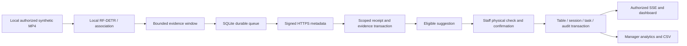

# Phase 7: human-reviewed table workflow, reports and CSV

**Phase 7 checkpoint verification — 2026-11-12:** Fresh complete regression passes **650 tests**, zero skips, plus **eleven browser groups** and frontend/Python checks. The founder verified A02 totals and opened its CSV in Excel. All 615 current baseline records, credentials/calibrations and the database volume are preserved. [The exact 55-file checkpoint review](../PHASE_07_CHECKPOINT.md) records security findings and separate commit/push approval gates. Earlier 636/210-test results below remain historical.

**Later A02 reporting correction — 2026-11-12:** The original DEMO scenario summary gap is fixed and active locally. Current follow-up checks pass 210 relevant tests, eleven isolated browser groups and the exact deployed A02 JSON/CSV/browser report. [Root cause and actual results](#a02-demo-analytics-correction--2026-11-12). The 636-test full verification below describes the earlier phase completion; the full native suite was not rerun for this correction.

**Resumed verification:** 2026-11-12, Asia/Dhaka. Evidence timestamps are UTC.
**Status:** Implemented and verified locally: **636 tests passed**, zero skips,
plus **ten browser groups** using the prepared Linux web image. After separate
founder approval, exact additive `0009`, restricted runtime grants and matching
local API/web/TLS code are active. All 580 original records and protected
credentials/calibrations are preserved; existing locations remain OFF.
Public/pilot deployment and real-world AI accuracy remain unapproved/unverified.
**Authority:** [Master specification](../MASTER_SPEC.md), [approved 11-milestone
plan and 18 acceptance checks](../PHASE_07_IMPLEMENTATION_PLAN.md), and [permanent
engineering rules](../../AGENTS.md).

## Overview and objectives

Phase 6 reliably delivered local AI observations. Phase 7 connects eligible
observations to **suggestions that a person must review**. It also explains how
long tables were occupied, waiting for cleaning and being cleaned, using saved
history. It does not turn an untested detector into an autonomous restaurant
operator. Real-person and restaurant occupancy accuracy remain unverified.

For example, AI may suggest that guests left Table 4. The table stays OCCUPIED
until an authorized staff member physically checks and confirms departure. That
confirmation creates one cleaning task. Staff acknowledge it, start cleaning and
explicitly confirm readiness. An empty frame cannot mark a table AVAILABLE.

All existing locations remain OFF by default. Initial assisted activation is
restricted to DEMO mode, an explicitly synthetic location and manager approval
of particular camera/table bindings. Human preview permission remains separate.

## Implemented features and why they exist

| Component | What it does |
| --- | --- |
| Version-2 evidence contract | Adds truthful bounded scores, duration, sample coverage, frame age and source/policy revisions; keeps old queued v1 messages unchanged |
| Evidence window | Collects analyzed samples locally and resets on uncertainty, gaps, source changes or a new manual revision |
| Location workflow policy | A manager selects approved bindings and reviewed settings; absent policy means OFF |
| Arrival/departure suggestions | Fresh eligible transitions create review cards without changing operational tables or creating tasks |
| Staff confirmation and dismissal | Physical-check confirmation records a human decision; dismissal leaves no operational task |
| Canonical table-use session | A server-controlled ID links a confirmed arrival to its departure and cleaning; no customer identity is stored |
| Task attempts | One task row per session is preserved even when a manager cancels a mistaken departure and a later genuine departure reopens it |
| Protected manual actions | Staff cleaning and manager blocks take precedence; only managers correct mistakes, block, reopen or reconcile a restarted source |
| Audit and publication | Table, task, decision, evidence link and ordered live-update record commit together |
| Source-aware readiness | Fresh qualified vacancy evidence plus an authorized physical check is required; failure never means empty or clean |
| Analytics | Daily/hourly state durations, valid visit durations, cleaning wait, cleaning duration and time-to-ready; missing history stays unknown |
| CSV export | Manager-only bounded download using the same calculations, with safe labels and session checks during delivery |

The checkbox is an authenticated person's statement. Software cannot prove that
the person actually inspected or cleaned the table. A model score is not proven
occupancy accuracy.

## Architecture and execution flow



1. The Phase 4 reader supplies a timestamped local frame. No frame is uploaded.
2. The approved RF-DETR Nano ONNX artifact runs in the existing supervised CPU
   worker. Phase 5 seating polygons associate visible detections to tables.
3. Version-2 windows preserve actual observation quality and minimum scores.
   POSITIVE requires HIGH quality and sufficient scores. VACANT may retain
   MEDIUM quality because no detected person is not a confidence measurement.
   LOW/UNCERTAIN never qualifies. Vacancy still needs reviewed visibility, a
   complete time window, adequate coverage, bounded gaps and a fresh result.
4. Defaults remain 10 seconds arrival, 25 seconds departure, three samples,
   80% coverage, two-second gap/result limits. These are development settings,
   not evaluated restaurant thresholds. Snapshots normally publish every ten
   seconds and on meaningful changes; a heartbeat alone is not table evidence.
5. The cloned engine, metadata and checkpoint commit to SQLite before becoming
   visible or being transmitted. Old v1 bytes, hashes and event IDs stay intact.
6. The Phase 6 transport verifies HTTPS, signatures, replay protection, device,
   location, assignment and binding. A terminal receipt derives its evidence and
   suggestion within the same database transaction.
7. The backend checks current policy/profile/model/calibration/manual revisions,
   source generation, health, freshness and quality. Late or uncertain evidence
   remains history; it cannot recreate an old live alert.
8. Staff confirm or dismiss a revisioned suggestion. A stale browser gets 409 and
   must refresh. Retrying the same request key returns the original result.
9. The existing authorized SSE publishes changes to permitted browsers only.
   Polling, reports, downloads and SSE never refresh idle session expiry.
10. Reports read a coherent snapshot with an explicit UTC cutoff and location
    time zone. Each later download has its own cutoff.

### Staff workflow and manager corrections

| Action | Result |
| --- | --- |
| Eligible arrival observation | Suggestion only |
| Staff confirms arrival | OCCUPIED and one canonical session |
| Eligible departure observation | Suggestion only |
| Staff confirms departure | RESET_PENDING and one RESET task |
| Acknowledge | Task ACKNOWLEDGED; table remains RESET_PENDING |
| Start cleaning | Task IN_PROGRESS; table CLEANING |
| Fresh vacancy + physical ready confirmation | Task COMPLETED; table AVAILABLE |
| Manager blocks | OUT_OF_SERVICE; protected from AI |
| Manager reopens | UNKNOWN, requiring a separate readiness check |
| Correct mistaken departure before cleaning | Return to OCCUPIED; retain cancelled attempt; later departure reuses the same task with another attempt |
| Correct mistaken arrival | Invalidate that session and return UNKNOWN, never ready |
| Reconcile a restarted source | Manager physically confirms the same open visit; preserve its original arrival/timer and audit a new source alias |

Source failure preserves the saved human decision and timer. A saved AVAILABLE
table becomes **unverified availability** if fresh evidence is missing; the
verified-ready total excludes it. A new human action changes the manual revision,
so another matching evidence update is needed before live verification resumes.
No offline readiness exception is implemented.

## Database and authorization

Additive revision `0009`, following applied `0008`, defines nine scoped tables:
`workflow_policies`, `workflow_policy_history`, `workflow_sessions`,
`workflow_evidence`, `workflow_suggestions`, `workflow_task_attempts`,
`workflow_decisions`, `workflow_journal` and `workflow_quality_boundaries`.
It also adds scoped uniqueness to existing receipts, tasks and events so new
foreign keys cannot link different restaurants or locations.

Existing rows are not backfilled, deleted or rewritten. Frozen revisions
0001–0008 remain unchanged. Legacy history lacks reliable session/coverage data,
so reports label it rather than inventing past visits.

FastAPI checks both role and location grant. PostgreSQL RLS checks scope again.
The application login is not an administrator and cannot directly write the new
tables. Narrow controlled functions use a fixed search path; internal legacy
helpers cannot bypass the reviewed workflow. Device, table and location locks
serialize conflicting human/device/policy actions. Unique constraints protect
one task/session, one active task/table and one decision/request key.

The founder separately approved the existing-database migration and local
activation. Exact `0009` and restricted grants are now applied, with zero model
differences and all 580 original records preserved. See [migration
review](../PHASE_07_MIGRATION_REVIEW.md) for exact artifacts, backup/rehearsal and
applied results. Test databases are separate, named `phase2_security_test_*`.
Their records are synthetic, and their recovery containers/volumes are retained.

## APIs

All human routes require a current session and explicit location access. Changes
also require CSRF/origin validation. Manager means owner, organization admin or
manager with that location grant; staff can perform the normal physical workflow.

| Route | Permission / purpose |
| --- | --- |
| GET `/v1/locations/{id}/workflow` | Staff; coherent table context and pending review cards |
| GET `/v1/locations/{id}/workflow-suggestions` | Staff; bounded keyset pagination and status filter |
| GET/PUT `/v1/locations/{id}/workflow-policy` | Manager; current policy or revisioned approved change |
| POST `/v1/locations/{id}/workflow-suggestions/{suggestion}/decisions` | Staff; confirm/dismiss with current versions and request key |
| POST `/v1/tables/{id}/workflow-actions` | Staff readiness; manager-only correction/source reconciliation |
| GET `/v1/locations/{id}/analytics` | Manager; bounded daily/hourly JSON report |
| GET `/v1/locations/{id}/analytics.csv` | Manager; safe authorized CSV |
| Existing device heartbeat/events | Negotiates v1/v2 and supplies scoped workflow context; existing signed HTTPS and lease rules stay in force |
| Existing dashboard/tasks/activity/stream | Backward-compatible controls plus reviewed changes and invalidations |

The browser proxy refuses device endpoints. No image, recording, RTSP URL,
signature, private key, user password or arbitrary diagnostic text belongs in
the evidence/report contracts.

## Report meanings and safeguards

Stored instants are UTC; date inputs use the location's stored IANA zone. Start
date is included, end date is excluded. New York days may last 23 or 25 hours;
repeated hours include their offset. Unsupported/ambiguous local midnight is
rejected explicitly instead of silently substituting UTC.

State-time totals are clipped to table creation, the selected range and cutoff.
Completed visit/reset averages use full valid durations **ending in** that range.
Open, cancelled and incomplete attempts are reported separately. Corrected false
departures contribute occupied time rather than a completed cleaning delay.
Unknown history and empty denominators remain unknown/null, not zero occupancy.

CONFIRMED_WORKFLOW, DEMO, LEGACY and ESTIMATED_EVIDENCE are distinct bases.
Evidence coverage expires after 15 seconds and ends on source/policy/health
boundaries or changed human context. Heartbeats cannot fill those gaps. Blocked
time is excluded from usable table time. These reports measure recorded workflow
and evidence availability, not true customer occupancy or staff performance.

Limits: 31 local days, 100 tables, 20,000 output rows, 100,000 input records per
history category, eight-second SQL timeout and 16 MiB CSV. Oversized reports fail
clearly rather than truncate. The local single API process permits one concurrent
report calculation/export per user and four in total, releasing the slot even
after a failed calculation or disconnected client.
Multiple API workers would need a shared limiter before deployment.

CSV uses standard quoting, control-character cleanup and a visible `Text: `
prefix for formula-like labels, including full-width variants. Original database
labels stay unchanged. It has one metadata/summary row then table/bucket rows,
so report totals are not repeated as if additive. Downloads are private/no-store,
reauthorize every chunk and carry API Content-Length plus `X-Report-Bytes`.
Next.js may replace Content-Length with chunked delivery. The browser therefore
checks decoded file bytes against `X-Report-Bytes` before saving; truncated or
unframed responses show an error and save no file. Identity and gzip delivery
are verified. Custom clients must enforce the same completeness check.
Bytes already delivered cannot be recalled after revocation. Excel/LibreOffice
save/reopen round trips are not verified.

## Technologies reused

| Technology | Plain-English purpose |
| --- | --- |
| Python / FastAPI / Pydantic | Backend routes and strict allowed data shapes |
| PostgreSQL 16 / SQLAlchemy / Alembic | Durable records, authorization rules, controlled transactions and forward migrations |
| SQLite / HTTPX / approved Ed25519 signature packages | Save events locally first and deliver verified metadata with retries |
| OpenCV / ONNX Runtime / RF-DETR Nano | Existing local decoding and pretrained CPU inference; no training or new download |
| `datetime`, `zoneinfo`, existing tzdata, `csv` | Correct elapsed-time calculations, local calendar boundaries and export encoding |
| Next.js / React / TypeScript / SSE | Interactive floor, human review, responsive reports and live updates |
| pytest / Ruff / installed Microsoft Edge | Automated regression, code checks and actual browser verification |

No new dependencies are required or installed for Phase 7. No broker, cloud video
service, chart library, model download or training pipeline was introduced.

## Created and modified files and their purposes

| Files | Purpose |
| --- | --- |
| `packages/contracts/evidence_protocol.py`; matching API/edge `evidence_protocol.py` | Identical strict v2 contract; frozen v1 stays unchanged |
| Edge `evidence_window.py`, `durable_engine.py` | Truthful summaries, bounded cadence, durable commit barrier and same-source episode context |
| Edge `analysis.py`, `device_runner.py`, `outbox.py` | Actual frame age, negotiated configuration and v2 queue validation |
| API `workflow_models.py`, `workflow_review.py` | New storage models, policy/review/correction/readiness routes |
| API `analytics_domain.py`, `analytics.py` | Independently tested calculations and bounded authorized JSON/CSV |
| API `edge_routes.py`, `edge_models.py`, `models.py`, `management.py`, `main.py` | Compatible device integration, scoped constraints/runtime grants and router/response wiring |
| `services/api/migrations/env.py`, version `0009_reviewed_workflow.py`, SQL `0009_workflow_schema.sql`, `0009_workflow_security.sql` | Additive schema, RLS, locked controlled functions, receipt/task/audit derivation |
| `scripts/freeze_phase7_schema.py`, `scripts/rehearse_phase7_migration.py` | Reviewed schema generation and isolated restored-backup preservation checks |
| Web dashboard `page.tsx`, `workflow-review.tsx`, `workflow-types.ts` | Review cards, physical checks, manager policy/corrections, safe task/ready context |
| Web `analytics/page.tsx`, `globals.css`, API proxy `route.ts` | Scoped reports, mobile styling and authorized streaming CSV |
| API `test_phase7_evidence.py`, `test_phase7_workflow.py`, `test_phase7_analytics_domain.py`, `test_phase7_analytics_api.py`, `test_phase7_native.py` | Contract, transaction/permission/concurrency, arithmetic, export and actual-model synthetic checks |
| Edge `test_phase7_evidence_delivery.py` | Sample coverage, unchanged manual polls, duplicate frames, old bytes and queue failure checks |
| Existing `test_database_isolation.py`, `test_route_inventory.py`, `test_edge_database_restart.py` | Update expected head/routes and add reviewed restart branch; retain original assertions and original restart case |
| `scripts/verify_phase7_browser.py` | New isolated DB and installed Edge walkthrough through the production web build and actual API |
| README, handoff, architecture, API, roadmap, plan and phase index/explanations | Current behavior, approval gates and dated verification; older evidence remains historical |

Private backups, logs, generated videos, model assets, credentials, SQLite queues,
browser profiles and screenshots remain under ignored `.secrets/` or `.cache/`.

## Windows 11 run and test instructions

Use PowerShell from `E:\Restaurent_startup`. Keep the existing `.env`, credentials
and volumes. Starting existing services does not apply a migration:

```powershell
docker compose start db api web
```

The separately approved local Phase 7 app and database revision `0009` are now
active. Open `http://localhost:3000/dashboard` or
`http://localhost:3000/analytics` and sign in with an authorized private account.
Existing locations remain OFF; viewing reports does not enable AI suggestions.
Do not rerun migration, rotate credentials or publicly deploy as a startup step.

For isolated verification, start the already-approved test server if stopped,
then use the existing project environment. Never aim test commands at the
business database. Native tests need the already-approved private catalog:

```powershell
$env:RFDETR_TEST_CATALOG = (Resolve-Path .secrets/phase5/models/catalog.json).Path
.\.venv\Scripts\python.exe -m pytest services/api/tests services/edge-agent/tests -q
.\.venv\Scripts\ruff.exe check services/api services/edge-agent
Push-Location apps/web
npm.cmd run lint
npx.cmd --no-install tsc --noEmit
npm.cmd run build
Pop-Location
.\.venv\Scripts\python.exe scripts/verify_phase7_browser.py
```

To repeat the same isolated browser checks with the already-prepared local Linux
web image instead of the host web process:

```powershell
$env:PHASE7_WEB_IMAGE = 'restaurant-phase7-web-reviewed'
./.venv/Scripts/python.exe scripts/verify_phase7_browser.py
Remove-Item Env:\PHASE7_WEB_IMAGE
```

This requires that prepared image to exist; it does not build/download an image
or install dependencies. It starts/stops only a new labeled test web container,
publishes only loopback port 3001 and mounts no business data.

The browser script requires unused loopback ports 8001/3001 and the installed
Microsoft Edge. It creates a new marked test database, starts a temporary API
and production web process, generates private test accounts and runs the review,
correction, task, reconnect and CSV workflow. Only its temporary processes stop
afterwards; database/artifacts remain. Evidence is constructed and signed for
these tests, not a claim that AI saw people. No installation is performed.

### Manual review checklist

After approved activation, open `/dashboard` with a permitted private demo account.
Select an explicitly synthetic location with a paired device, reviewed local
model/profile/calibration and an approved binding. Open Manager review settings,
select the intended tables and approve the thresholds before enabling suggestions.

1. With the actual geometric MP4, inspect source health and evidence. With no
   stable person evidence, no arrival/task should appear; UNKNOWN is appropriate.
2. For the complete positive workflow, use the isolated signed-metadata browser
   demonstration. Do not route AI through the older DEMO simulation controls.
3. A possible arrival leaves the floor unchanged until its checkbox and confirm.
4. Confirm departure only after a physical check. Acknowledge the single task,
   start cleaning, then confirm ready only with fresh matching vacancy context.
5. Test dismissal, manager correction before cleaning, block/reopen and source
   restart review. No action should erase earlier decisions or create a new visit
   just because the camera restarted.
6. Open `/analytics`, choose the same location and date range, inspect DEMO,
   quality/unknown warnings and cutoff, and download CSV. Try a staff account:
   manager reports must remain inaccessible.
7. Disconnect the browser. Actions must disable and saved decisions remain visible
   as stale information. Reconnect to obtain a fresh authorized snapshot.

## Actual verification and failures

Final isolated verification and separately approved local activation are complete:

- **636 tests passed**, **zero skips**, one existing Starlette/httpx deprecation
  warning, **235.33 seconds**. All original 529 cases are retained. The final run
  enables the already-approved private native catalog and includes actual-model
  tests, both DB restart branches and the new protected-context regression.
  The final actual-model result retained eight evidence records, qualified
  vacancy, zero pending events and UNKNOWN with no operational change; its latest
  individual processing measurement was **347.4 ms**. This is synthetic evidence,
  not person/restaurant accuracy or a sustained-load guarantee.
- **Ten real Edge groups passed** with the host production build, then all ten
  passed again with the prepared Linux web image. The latter uses actual browser,
  Next.js proxy and API against a new isolated PostgreSQL database.
- Prepared Linux API image imports all 44 OpenAPI paths, matches all installed
  package versions and exact migration hashes, and supports the required zones.
  Prepared Linux web image serves sign-in/dashboard/analytics and passes the
  complete browser workflow, including truncated/unframed CSV rejection. Both
  images copy verified code/build assets onto existing runtimes; **no packages
  were installed**. Only API/web were replaced after separate founder approval;
  their existing environment values and original database container/volume remain
  unchanged. The matching local TLS listener uses its existing private certificate. Current Next 15.5.29 / React 19.3.1 versions match.

Earlier completed steps, retained as separate evidence:

- Original baseline before implementation: **529 passed**, one existing warning,
  171.02 seconds. This is separate from the later full rerun.
- Focused workflow/report/evidence checks: **52 passed**, one existing warning,
  24.98 seconds, including injected receipt/decision transaction failures.
- Actual isolated PostgreSQL restart: both original fixture and reviewed-workflow
  cases passed. Replayed receipts leave one task/session and preserve decisions.
- Actual RF-DETR/V2/stationary synthetic MP4/verified TLS integration: **1 passed**,
  68.21 seconds. Eight evidence records, qualified vacancy, no suggestion/task,
  canonical table unchanged; latest measured processing about **342.9 ms**.
- Frontend lint, TypeScript and production build passed. The earlier flex alignment
  CSS warning was fixed; the existing `next lint` deprecation remains.
- Restored private backup upgraded twice to `0009`, preserving **580 records**,
  all existing policies OFF and **zero model/schema differences**. This is isolated
  rehearsal evidence; the separately approved application is recorded below.
- Before activation, business read-only preservation at `0008`: all **580 captured records**, ten
  existing users/password hashes, four private seating files, local credentials
  and original DB container/mounts preserved. Calibration Revision 7 and seating
  Revision 1 remain part of the protected baseline.
- Initial eligible-file scan: 222 files, no forbidden paths or known-secret/pattern
  hits, all original files present, nothing staged and HEAD unchanged. Repeat
  after final documentation; this is not a guarantee against unknown secrets.

Post-activation verification also confirms both A/B own dashboard, OFF policy,
workflow/suggestions, reports, full CSV and SSE heartbeat through the actual Linux
web proxy; foreign scope is 404 and anonymous access is 401. Identity and gzip
CSV responses contain the expected complete rows/decoded byte counts. The
existing local TLS CA verifies readiness and current routes. These live checks
used five new short-lived verification sessions, all revoked, avoiding password
login/rate-bucket changes to original records. Genuine password login and the
positive human workflow were tested in the isolated browser database.

Final repository review: **224 Git-eligible files** scanned, **265 local Markdown
links** resolved, no forbidden private paths or known-secret/pattern matches,
all starting files retained and no tracked deletions. The 52 changed/new public
files remain unstaged on `main`; HEAD remains the published Phase 6 checkpoint.
Ruff, `pip check` and the CRLF-aware tracked whitespace check pass. Ordinary Git
line-ending notices remain. No commit, remote change or push was performed.

Problems retained as evidence:

- Live activation checks found Next.js removes standard Content-Length while
  streaming CSV. The API now publishes an independent expected decoded-byte
  count, the proxy forwards it, and the UI refuses incomplete/unframed files.
  All 12 affected API tests, lint/types/build and ten Linux-image browser groups
  passed before the final complete regression rerun. API Content-Length checks
  and all authorization/revocation rules remain intact.

- Earlier focused tests found CSV cache headers being overwritten and an untyped
  nullable table-filter SQL parameter. Explicit private/no-store and UUID casts
  fixed those failures. The preservation test's expected head became `0009`;
  its record-preservation assertions remain intact. An accidental indentation
  error during that edit was corrected before verification.
- Actual-model integration exposed unchanged manual polls publishing false
  UNKNOWN snapshots and genuine MEDIUM-quality vacancy being reduced to LOW.
  Unchanged polls now publish no new evidence; actual vacancy quality is retained,
  with the full fresh/coverage/visibility/human gates still enforced.
- The moving synthetic clip also produces occasional low-score (about 0.05)
  person-shaped outputs from changing text/graphics. Abstention correctly clears
  its window. Initial tests demanding uninterrupted qualified vacancy failed;
  those logs are retained privately. A separate stationary geometric fixture
  verifies sustained vacancy. Scores, quality thresholds and safety timeouts
  were not relaxed to hide those uncertain outputs.
- The first full implementation rerun recorded **633 passes and one native
  freshness failure** while a frontend build overlapped. Diagnostics show
  NO_FRESH_ANALYSIS clearing incomplete windows; the latest inference was about
  435 ms, but individual frame freshness was not sustained. A sequential rerun
  passed **634 tests** in 234.37 seconds. This does not prove loaded-system
  capacity; builds/browser/native verification must run sequentially here.
- A post-activation full rerun recorded **635 passes and one native freshness
  failure**, 238.64 seconds, even without an overlapping frontend build. The
  actual detector was RUNNING (latest inference about 544.9 ms); diagnostics
  recorded NO_FRESH_ANALYSIS clearing a 38-sample incomplete window and only
  40 samples rebuilding before the run ended. No qualified vacancy was sent;
  operational tables stayed protected. This is retained evidence of intermittent
  end-to-end freshness on this CPU, not proven detector capacity. The test,
  60-second run, evidence windows and safety timeouts were not relaxed or skipped.
  The exact test then passed separately in 69.09 seconds, including real-model
  qualified vacancy, empty queue and unchanged operational table. A later full
  rerun is recorded above; that pass does not remove this intermittency finding.
- Screenshot inspection found report filters fitting the viewport but extending
  outside their card. A grid with constrained control widths fixed it; a stronger
  real-browser bounding-box check and production build passed.
- A regression exposed a rejected owned message leaving protected CLEANING
  stuck behind its rejection-context flag even after a valid new generation.
  The final `0009` change permits only qualified fresh V2 context from a new
  generation to clear that separate flag. It preserves CLEANING, manual revisions
  and the human ready gate. Same-generation/uncertain evidence cannot clear it.
  The new regression and all **74 affected checks** passed, followed by another
  580-record/zero-difference restored-backup rehearsal.

The ten-group browser run measured constructed signed metadata, one table, three
browser users and the local Windows computer—not customer load. Its three
receipt-to-visible samples were **1.878, 0.687 and 2.086 seconds** (median 1.878;
nearest-rank p95/max 2.086, too few samples for a capacity claim). One physical
confirmation-click-to-task sample was **1.433 seconds**; human thinking time is
excluded. No representative AI accuracy is established by these timings.

Fresh security checks queried 63 public Python package/version combinations
across the working environment and existing API image. OSV reported pip findings
(six distinct GHSA IDs plus aliases) and one pytest issue. npm audit still reports
**eight affected packages: one high, seven moderate**. `pip check` passes; that
checks compatibility, not absence of vulnerabilities. Native codecs, model
binaries and the isolated exporter are not a complete security audit. No fixes
or upgrades were installed.

A separate offline benchmark reran the existing Phase 5 benchmark tool on a new
generated geometric MP4: 60 frames in **30.001 seconds**, **2.000 FPS**, no missed
sampling slots, total processing median **328.7 ms**, p95 **391.2 ms**, max
**453.3 ms**. Own-process working set was **384.2 MiB**, peak **395.3 MiB**; CPU
use was about 1.36 logical-core equivalents. Hardware: Intel Core i5-8265U,
four cores/eight logical processors; ORT CPU, two inference threads/one inter-op
thread. No network connection was attempted, and protected CLEANING survived.
This short detector/association benchmark is not a full concurrent browser/cloud
load, multicamera capacity test or restaurant shift. The actual Phase 7 native
runner separately retained eight queue records in a 40,960-byte SQLite file;
that is a small final-size observation, not a queue-growth capacity result.

A Linux-web browser run repeated all ten groups against the prepared web image.
Its receipt-to-visible samples were **1.684, 0.664 and 2.112 seconds**; one
confirmation-to-task sample was **1.422 seconds**. The final post-CSV-fix run
again passed all ten groups, rejected both truncated and missing-length files,
and measured **1.696, 0.903 and 1.862 seconds**, with one confirmation-to-task
sample of **1.016 seconds**. The host
results above are retained as a separate earlier run. Both demonstrations use
constructed signed metadata and actual human browser actions, never AI posting
through DEMO controls.

## Remaining limitations and security risks

### Acceptance-check evidence map

The approved plan remains the exact requirement text. This map distinguishes
isolated implementation evidence, approved local activation and remaining real-world deployment gates.

| Check | Evidence / current boundary |
| --- | --- |
| P7-01 | Fresh 529-case baseline; final 636-case pass, absent-policy OFF and preserved v1 bytes/rows |
| P7-02 | Signed scope/context/score/gap/coverage/stale/future tests; qualified transition creates one suggestion, not an operational update |
| P7-03 | API full workflow plus actual multi-browser confirmation/task/clean/ready and report/CSV walkthrough |
| P7-04 | All six device states, snapshots, human echoes, manager reopen and blocked readiness checks cannot automatically mark ready |
| P7-05 | Concurrent same-key decisions, signed replay, SQLite commit-failure tests, lost-response browser retry and actual isolated DB/API restart |
| P7-06 | Expected-version 409, protected CLEANING/OUT_OF_SERVICE, policy/key revocation and manager permissions; existing transport/manual-priority regressions retained |
| P7-07 | Sticky dismissal without task; false-departure correction retains cancelled attempt and reuses the same task/session; corrected metrics are independently tested |
| P7-08 | Both-tenant and same-tenant ungranted-location API/direct SQL tests, existing stream tests, report/table-filter denial and actual browser cross-tenant checks |
| P7-09 | Passive identity/suggestion/report/export checks, absolute expiry, mid-download revocation and retained preview/SSE/device permission tests |
| P7-10 | Reordered/15-minute-delayed signed observations plus retained offline lease/queue/restart tests; no timer rewind or historical live task |
| P7-11 | Mirrored contract parity, frozen v1 hashes, v2 negotiation, private/extra/nonfinite data rejection and actual-model synthetic HTTPS path |
| P7-12 | Hand-calculated state/session/attempt/correction/coverage/null fixtures and actual PostgreSQL JSON/CSV fixture comparison |
| P7-13 | New York 23/25-hour days and repeated offsets, Dhaka, Kolkata, Kathmandu, Lord Howe partial-hour transition and invalid/missing midnight |
| P7-14 | Separate bases, evidence expiry, quality boundaries, human-context cuts and UNKNOWN denominators; heartbeat cannot fill coverage |
| P7-15 | Formula/control/full-width/quote cases, scoped JSON/CSV, API framing, expected-byte browser check, private headers, revocation and disconnected-export cleanup; shared limits and actual truncated/unframed download rejection pass |
| P7-16 | Ten actual Edge groups: desktop/mobile, keyboard focus, lost response, SSE/offline reconnect, location switch and downloaded CSV; visual inspection found/fixed mobile card overflow |
| P7-17 | Fresh restored-backup rehearsal preserves 580 rows with zero model differences; protected business rows/files/container/volume checked read-only. Exact `0009`/grants and matching local services applied after separate approval; post-activation A/B/SSE/CSV/TLS and original-record/file/volume preservation pass |
| P7-18 | Strict metadata/body/privacy tests, known-value/path repository scan, local model/footage only and no new dependencies/downloads; no real-world accuracy or production claim |

Existing Phase 6's actual 900-second outage remains dated evidence. The Phase 7
full rerun uses its default short real-TLS outage and new 15-minute-delayed
metadata fixtures; those are not a new 15-minute wall-clock outage. Injected SQL
transaction failures and actual process/container restart are also different
from testing arbitrary power loss on physical storage.

### Current deployment and evaluation gates

- No authorized representative person footage: positive person recall, wrong-table
  association, restaurant occupancy accuracy and false-reset-per-shift targets
  remain unverified. Synthetic transport/workflow arithmetic is not that evidence.
- No real webcam/RTSP hardware, multi-camera capacity, unattended Windows account
  operation or long restaurant shift has been certified.
- A signed device can still be compromised and lie about metadata. Human review,
  explicit synthetic activation and deployment gates remain necessary.
- Native startup/load sensitivity and an earlier unexplained worker exit remain
  known Phase 5/6 limits; safety timeouts and supervision remain unchanged.
- No record retention/queue compaction deletion is introduced. Snapshot/history
  growth needs measured capacity and a separate retention review before pilots.
- Known npm/pip/pytest advisories, preserved weak legacy administrator password,
  production TLS/MFA/recovery/hardening and external review remain deployment
  blockers. Phase 7 installs/upgrades nothing and rotates no credentials.
- Physical-check truth, real spreadsheet round trips, malicious authorized human
  behavior, hardware storage failures and public production load are not proven.
- No public deployment, commit, push or Phase 8 is included.

## Phase summary

The implementation adds a reviewable path from signed AI evidence to human-owned
restaurant workflow, plus honest reports and safe exports. Isolated verification
passes 636 tests and ten browser groups. Separately approved `0009` and matching
local services are active, with all 580 original records and protected
credentials/calibrations preserved and existing locations OFF. No Phase 8,
public deployment, commit or push is included.

## A02 DEMO Analytics correction — 2026-11-12

### What the founder observed and the actual cause

The founder completed Guests arrive, Guests leave, acknowledge, start cleaning
and mark ready for A02 in Synthetic Restaurant A / DEMO A Dining Room. The
dashboard correctly saved AVAILABLE and a COMPLETED cleaning task. The report
still showed zero visits/resets and no average cleaning duration.

Read-only database checks and an authenticated request to the deployed API
reproduced the problem with the exact filters: November 12 included, November 13
excluded, Daily, A02, Location default, America/New_York. Those filters are
correct. Local midnight boundaries are 2026-11-12 05:00 UTC and November 13
05:00 UTC; all five test actions occurred inside that New York day. Location
default resolves to DEMO because the location is explicitly synthetic.

This was a genuine reporting integration bug. The original scenario buttons save
`table_events`, `staff_tasks` and a table's occupancy-session identifier. They do
not create the device-backed `workflow_sessions` and `workflow_task_attempts`
used by the new assisted AI review path. A02 had zero rows in those two new
tables. Its DEMO journal/state durations were visible, but summary arithmetic
only read the new tables, so the completed task was omitted. The root cause was
explained to the founder before application changes.

### Saved A02 evidence and corrected report

| Saved event | UTC | America/New_York |
| --- | --- | --- |
| Original synthetic arrival | November 7, 15:11:45.508987 | November 7, 10:11:45.508987 EST |
| Repeated Guests arrive (already OCCUPIED) | November 12, 08:00:46.209881 | November 12, 03:00:46.209881 EST |
| Departure / task created | November 12, 08:02:15.535310 | November 12, 03:02:15.535310 EST |
| Task acknowledged | November 12, 08:04:22.531756 | November 12, 03:04:22.531756 EST |
| Cleaning started | November 12, 08:04:31.998707 | November 12, 03:04:31.998707 EST |
| Ready / task completed | November 12, 08:06:22.849426 | November 12, 03:06:22.849426 EST |

| Metric under the founder's exact filters | Corrected saved-record result |
| --- | --- |
| Completed occupied sessions | 1 |
| Completed resets | 1 |
| Wait until cleaning started | 136.463397 seconds (UI: 2.3 min) |
| Cleaning duration | 110.850719 seconds (UI: 1.8 min) |
| Departure to ready | 247.314116 seconds (UI: 4.1 min) |
| Full recorded synthetic visit | 406230.026323 seconds (UI: 6770.5 min) |
| Visits beginning before the selected dates | 1 |

The long occupancy duration is intentional history preservation. A02 was already
OCCUPIED from the earlier synthetic setup. Pressing Guests arrive again did not
start another visit or reset its timer. The report counts the completed visit by
its departure date and measures its full recorded duration. This is not evidence
of real guests staying for five days. Daily state-time rows remain clipped to
the chosen date and record basis; an explicitly recorded old DEMO arrival can
support a full simulated visit without reclassifying all LEGACY state history.
For a new short test, begin with an AVAILABLE synthetic table.

### Implementation and execution flow

1. The report reads a single scoped database snapshot, as before.
2. `analytics.py` also reads bounded noncanonical scenario tasks for explicitly
   synthetic locations. Matching saved DEMO departure events, manual cleaning/
   ready events and task timestamps corroborate the flow. Generic AVAILABLE
   history by itself does not prove a completed reset.
3. New `analytics_scenarios.py` projects those records into temporary calculation
   inputs. It deduplicates session IDs and gives canonical reviewed sessions
   precedence. It writes no sessions, attempts, journal rows or device receipts.
4. `analytics_domain.py` includes those inputs only for DEMO. Missing arrivals
   never produce invented occupancy durations; cancelled or unproven resets
   cannot become completed cleaning. Other bases and ordinary production
   locations remain separate. Calculation version is now 2.
5. JSON, charts and CSV use the same calculations. The report page additionally
   shows how many visits began before the selected range and explains full
   average durations versus clipped daily/hourly state times.

Existing schema/migrations, device contracts, operational state transitions,
session-expiry rules and staff/manager controls are unchanged. Reports do not
create AI suggestions or operational effects. Pre-upgrade completed history
without sufficient corroboration remains LEGACY/unknown; there is no backfill.

Changed files for this correction:

| File | Purpose |
| --- | --- |
| `services/api/src/restaurant_api/analytics.py` | Bounded scoped scenario task/event snapshot |
| `services/api/src/restaurant_api/analytics_scenarios.py` | New read-only DEMO projection and duplicate/canonical protection |
| `services/api/src/restaurant_api/analytics_domain.py` | Include eligible scenario totals; calculation version 2 and explanatory limits |
| `apps/web/app/analytics/page.tsx` | Cross-boundary visit count and duration explanation |
| `services/api/tests/test_phase7_scenario_analytics.py` | Fourteen new regressions using real saved actions and independent fixtures |
| `scripts/verify_phase7_browser.py` | Add the exact old DEMO A02 workflow and matching report/CSV walkthrough |
| README, handoff, architecture, API, roadmap and phase index/03/07 explanations | Correct current behavior and preserve earlier results as history |

No dependencies were installed. Prepared API/web images were refreshed by
copying code/build assets onto existing runtimes with network-disabled builds;
package inventories are unchanged. Only API/web containers were replaced. The
database stayed at `0009`; no migration or business-data update was needed.
Docker Desktop was initially stopped and the existing installation/containers
were started before inspection. The original database container/volume remain.

### Actual follow-up verification

- **210 relevant tests passed**, zero skips, one existing warning, **78.84 s**:
  analytics domain/API/new scenario tests, original dashboard, database isolation
  and reviewed Phase 7 workflow. They cover saved action timestamps, repeated
  arrivals, retry deduplication, canonical precedence, cancellations, missing
  proof/arrival, original older arrival, basis separation, New York completion
  date, report/CSV agreement and role/tenant denial. No existing tests weakened.
- **Eleven installed Edge browser groups passed**, using the prepared Linux web
  image, real API and a new isolated synthetic database. The added group clicks
  the original DEMO A02 controls through arrival, departure, acknowledgement,
  cleaning and readiness, then verifies one visit/reset, numeric cleaning time
  and the same CSV totals. All earlier groups remain included.
- Exact saved A02 filters were checked before and after local activation through
  the actual deployed web proxy. Version 1 returned zero; version 2 returns the
  one/one summary above. Identity/gzip CSV byte counts and totals agree; foreign
  restaurant and anonymous requests are denied. Existing workflow mode stays OFF.
- A fresh passive browser on the deployed application visibly shows A02 with the
  exact requested dates, Daily and Location default: one visit/reset, 1.8 min
  cleaning, 4.1 min time to ready and the older-visit explanation. Screenshot
  inspected locally; no staff actions or video were processed in that check.
- Frontend lint, sequential TypeScript check and production build passed. Python
  lint passed. Linux API imports, 44 routes, existing package inventory and exact
  frozen migration hashes were verified.
- All **609 captured pre-investigation records** (including the migration-version
  row) remain unchanged, as do seven protected credential/configuration/seating
  files and the original database container/mounts. The only added business-DB
  verification records are five short-lived sessions, all revoked. Calibration,
  task, event, user and older session records remain preserved; zero model/schema
  differences and head `0009`.

The initial new focused run had 55 passes and one test-input failure: its manager
block reason was outside the API's fixed reason list. The fixture was corrected
to the supported maintenance reason; cancellation assertions remain intact.
A first standalone type check overlapped Next build regeneration and reported
missing generated types. The build passed and the same type check passed when
rerun sequentially. Neither issue was fixed by skipping or relaxing a test.

The earlier full **636-test** run is retained as original Phase 7 evidence. The
full native-model suite was not rerun for this analytics-only change. No new
real-person accuracy, physical-camera or loaded-system capacity claim is made.

### Windows 11 reproduction and expected behavior

Open `http://localhost:3000/analytics`, use the founder's original location/table
and November 12 to November 13 exclusive filters, then select Refresh report.
If the browser retained old frontend assets, reload the page first. The report
should show one completed visit/reset and numeric cleaning duration unless a new
workflow has since been completed. An authorized manager account is required.
The old long visit is deliberately retained; do not reset data to hide it.

From the project root, using the existing isolated test database and `.venv`:

```powershell
.\.venv\Scripts\python.exe -m pytest services/api/tests/test_phase7_analytics_api.py services/api/tests/test_phase7_analytics_domain.py services/api/tests/test_phase7_scenario_analytics.py services/api/tests/test_dashboard.py services/api/tests/test_database_isolation.py services/api/tests/test_phase7_workflow.py -q
.\.venv\Scripts\ruff.exe check services/api
$env:PHASE7_WEB_IMAGE = 'restaurant-phase7-web-reviewed'
.\.venv\Scripts\python.exe scripts/verify_phase7_browser.py
Remove-Item Env:\PHASE7_WEB_IMAGE
Push-Location apps/web
npm.cmd run lint
npx.cmd --no-install tsc --noEmit
npm.cmd run build
Pop-Location
```

The integration tests refuse non-test database names. Run frontend commands
sequentially so the build cannot regenerate type files during a standalone check.
Do not install packages or point tests at the business database.

No files/data were deleted, no credentials rotated, no commit/push performed and
no Phase 8 work started. Existing accuracy/security deployment gates still apply.

## Final checkpoint verification and founder manual test — 2026-11-12

The founder confirms the full A02 DEMO workflow, one occupied session/reset,
1.8 minutes cleaning, 4.1 minutes departure to ready and a CSV downloaded/opened
in Excel. This verifies ordinary Excel opening; it does not verify every unsafe
formula-label/save/reopen case or real-person AI accuracy. The A02 long synthetic
arrival history remains preserved.

A fresh **complete API/edge regression passed all 650 tests**, zero skips,
one existing warning, **259.19 seconds**, including the 14 A02 regressions and
all earlier cases/native-model opt-ins. **Eleven browser groups passed** using
the prepared Linux web image and isolated synthetic database. Frontend lint,
sequential types/build, Ruff and dependency compatibility checks pass.

Checkpoint preservation covers **615 current records**, including the version
row, all original files, seven protected credential/configuration/seating files,
DB password verifiers and the original database container/mounts. `0009` and
zero schema differences remain. All 25 running API source files match the
candidate source. Earlier manual authentication advanced two login buckets and
revoked one older session; those expected changes predate the new baseline.
No checkpoint business row was changed or removed.

Fresh dependency queries cover 105 package/version pairs in three Python
environments. Known pip/pytest findings and npm's one-high/seven-moderate findings
remain, with no installs/upgrades. Private files are excluded; custom known-value,
token/path, index and reachable-history checks are repeated for the exact staged
set. See [the full checkpoint manifest](../PHASE_07_CHECKPOINT.md) for reviewed
paths, limitations and separate local-commit/push approval gates. Earlier failed,
intermittent, focused and full results remain dated history rather than being
silently replaced by this pass. No Phase 8 or public deployment was started.
